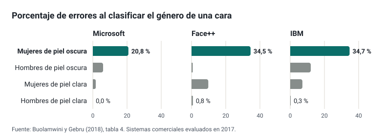
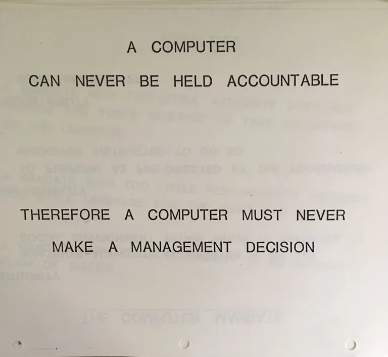

## What is law and what is prudence

Many lists of “what you cannot do with AI” mix three things of very different kinds. In this module each criterion carries its origin:

Legal obligation
: A rule requires it, and the article is cited. It is not a matter of opinion: you either comply or you do not.

Institutional recommendation
: An official guide advises it (in this edition, guidance from EU bodies such as the European Commission), and the document is cited. It is not binding in itself, but it reflects the view of those who supervise, and it is worth knowing.

Good practice
: This course proposes it, with its reasoning. It is open to debate, and debating it is welcome.

Telling them apart avoids two common mistakes: treating as prohibited what is only prudent, or as optional what is mandatory. It also shows where a prohibition has no legal or technical basis and amounts to trying to hold back the tide. What each rule says is set out on the [legal framework](normativa.md) page.

## Three filters before using a tool

There are three questions to ask, in this order:[^xunta-filtros]

1. **Relevance.** Does it add something to learning or to my work that I cannot achieve equally well another way? If the answer is no, there is no need to go on to the others.
2. **Ethics.** Does it respect the people affected: their autonomy, their privacy, fair treatment? The European Commission’s guidelines for educators, revised in 2026, turn this into questions on human oversight, transparency, inclusion, fairness, wellbeing, privacy, technical robustness and accountability.[^directrices]
3. **Law.** Does the law allow it? Data protection, the AI Act and education rules.

The order matters. A perfectly legal tool may make no sense for a task, and one that makes a lot of sense may be illegal with student data.

## Learning with AI: an open question

How much AI should be used for learning, and how much for assessment, has no general answer yet. What there is, is a handful of well-designed studies that show what to look at.

The most cited is a trial with nearly a thousand maths students at a secondary school in Turkey, in the 2023–2024 school year. Access to an assistant based on GPT-4 was assigned at random, which makes it possible to attribute the differences between groups to the tool. Those who practised with the unrestricted assistant did 48% better on the practice exercises, but in the later exam, without it, they scored 17% lower than those who never had it. With an assistant set up to give hints instead of solutions, that negative effect largely disappeared.[^bastani] A study with 52 programmers found something similar: those who used an assistant to learn a new library scored worse on a later quiz than those who did not (it is covered in [Vibe coding](../vibe-coding/index.md#en-los-ciclos-de-informática)).

The lesson they leave is a distinction: **performing better with the tool is not learning more**. What has been learnt is what remains when the tool is taken away. But these studies are not enough to set a general rule:

- **Each is a single context.** Random assignment is the best way to know whether the tool caused the difference, but only under the study’s conditions: one subject, one school, one country, one version of the model and a moment when these tools were new. Generalising needs replications in other subjects, ages and schools.
- **They measure the short term.** Both check what remains shortly after practising, not what happens over a school year.
- **Not all their conclusions are equally solid.** In the Turkish study, the type of assistant (with solutions or with hints) was also assigned at random. In the programmers’ study, by contrast, each person chose how to use the AI: those who asked it for explanations scored better than those who only asked it for code, but the groups had between 2 and 7 people, and whoever asks for explanations may also be whoever most wants to learn. The authors themselves warn that this comparison does not establish a causal relationship.[^anthropic-aprendizaje]

There is also a prior question that no study answers for you: **what students need to be able to do without the tool**. It depends on the subject and the learning outcome. In a computing VET programme, working with an assistant may be part of professional competence; in maths, the aim may be the very opposite, reasoning without help. The same goes for assessment: you decide the mark ([Student data](../datos-alumnado/index.md#feedback-on-an-essay-or-a-piece-of-work)), but how much AI can help you prepare corrections and comments without losing what you learn by marking is another open question.[^xunta-residuo] These are questions that each subject will settle through teaching practice and more research.

**Good practice.** Treat each decision as a hypothesis: if you allow AI in a task, check afterwards what students can do without it. Design tasks so that the thinking is visible (the process, the oral explanation, the corrected version, the reasoned decision). And if students are going to use an assistant, make it one set up to guide rather than to solve, such as [tutor modes and educational bots](../bots-educativos/index.md).

## Bias

### Where bias comes in

A model learns the regularities in its training data, including the unfair ones: if a group is under-represented or appears associated with certain stereotypes, the system reproduces it. The mechanism is explained in [How a language model works](../intro-ia/funcionamiento.md#sesgos-un-reflejo-de-los-datos). But “AI is biased” describes the problem badly: bias enters at a specific stage of building or using a system, and at each stage there is a human decision. Suresh and Guttag distinguish seven sources of harm across the life cycle of a machine learning system;[^suresh] five of them are easy to recognise from a school:

| Stage | What happens | The human decision |
| --- | --- | --- |
| Historical | The world the data come from was already unequal, and the model learns it even if the data are perfectly measured | Using the past to decide about the future |
| Representation | A group appears little in the data the system is developed with, and the system works worse for it | Which sample is collected |
| Measurement | What is predicted is a stand-in (proxy) for what matters: the average mark for academic success, healthcare spending for the need for care | What is chosen to be measured |
| Evaluation | The data the system is tested with do not represent those who will use it | Who it is tested with |
| Deployment | The system is used for something other than what it was meant to solve | What it is used for |

The healthcare spending case is the clearest. A widely used commercial algorithm, with which health systems decided which patients with complex needs received extra care, predicted healthcare spending, not illness. Because unequal access to care means less money is spent on treating Black patients, at the same score they were considerably sicker than white patients. Correcting it would have raised the share of Black patients receiving that help from 17.7% to 46.5%.[^obermeyer] The model predicted well what it was asked to: what was wrong was the question.

What matters for a teacher is that bias does not show in a single answer: it appears **when the error is measured by group**.

### Two measured cases

The *Gender Shades* study evaluated, in 2017, three commercial systems that classified gender from a photo of a face. The error varied enormously by group:[^gender-shades]

| System | Darker-skinned women | Darker-skinned men | Lighter-skinned women | Lighter-skinned men |
| --- | --- | --- | --- | --- |
| Microsoft | 20.8% | 6.0% | 1.7% | 0.0% |
| Face++ | 34.5% | 0.7% | 9.8% | 0.8% |
| IBM | 34.7% | 12.0% | 7.1% | 0.3% |

The second case is closer to the classroom. Five speech recognition systems (from Amazon, Apple, Google, IBM and Microsoft) transcribed interviews with speakers in the United States: on average they got wrong 35% of the words of Black speakers and 19% of those of white speakers, even when they said exactly the same sentences.[^koenecke] If you use automatic transcription with students whose accents, varieties or languages are under-represented in the training data, check the result before accepting it.

Both cases belong to the evaluation stage: the systems were on the market with very different error rates by group, and the difference only appeared when someone measured it by group.

### A programmed rule is not a learned bias

Not everything reported as AI discrimination is. In 2023, the online tutoring company iTutorGroup agreed to pay $365,000 to settle a lawsuit brought by the US Equal Employment Opportunity Commission (EEOC). According to the lawsuit, it had programmed its tutor selection software to automatically reject female applicants aged 55 or older and male applicants aged 60 or older, and so it turned away more than 200 qualified people.[^eeoc] The EEOC brought the case as part of its initiative on AI and algorithmic fairness, and it is often cited as a case of AI discrimination. But there was no model learning anything: it was a rule written by people. The EEOC chair summed it up: “Even when technology automates the discrimination, the employer is still responsible”.

Before blaming “AI” for something, it is worth asking what was decided and who decided it.

### Who answers for it

That bias enters through a human decision does not mean that the same person always answers for it:

- **Legal obligation.** The AI Act divides obligations between whoever develops or commissions the system and whoever deploys it ([who is who](normativa.md#who-is-who)). Everyone has the right not to be subject to a decision based solely on automated processing that significantly affects them ([Article 22 GDPR](normativa.md#automated-decisions-and-impact-assessments)).
- **Institutional recommendation.** The European Commission’s guidelines for educators ask each teacher whether they know what to review in an AI tool’s outputs and how to check them before using them in their teaching, and ask each school who is responsible for reviewing and validating those outputs.[^directrices] For what you do with a tool, the answer is you: what you use, you review and answer for. But that is not the whole division: whoever builds the system answers for the system, and whoever deploys it answers for putting it in place.
- **Good practice.** Keep a record of which tool you used, for what, and how you checked the result. That is what lets you answer for it.

The underlying idea is not new. A page attributed to an internal IBM training from 1979 put it like this: “A computer can never be held accountable. Therefore a computer must never make a management decision”.[^ibm-1979] Decades later, the GDPR and the AI Act reflect that same idea, each in its own way: the right not to be subject to a decision based solely on automated processing and, for high-risk systems, [human oversight](normativa.md#high-risk-in-education) by people with the necessary competence, training and authority. Neither prohibits using the tool; both keep a person in charge of the decision.

{.narrow}

### The biases of the person using the tool

It is often forgotten that humans have biases too, and two weigh heavily here.[^xunta-nesgos] The first is **confirmation bias**: we look for and accept more readily what matches what we already thought, a phenomenon psychology has documented in very different contexts.[^nickerson] A well-written answer that matches what we expected is exactly the one we check least.

The second is **automation bias**: the tendency to trust too much what a machine proposes. A systematic review of 74 studies, mostly from medicine and aviation, describes it with two faces: following wrong advice, and failing to act when the system gives no warning. In four clinical studies that could be pooled, when the decision support system was wrong, the risk of making an incorrect decision rose by 26%. Among the things that reduced it were training and making clear that the person is accountable for the decision, exactly what the previous section asks for.[^goddard]

With language models there is an aggravating factor: a false answer can sound as fluent and confident as a correct one ([How a language model works](../intro-ia/funcionamiento.md#alucinaciones-plausible-no-es-verdadero)). In a preregistered experiment with 404 people who answered medical questions with the help of a fictitious AI-powered search engine, when the answers included a first-person expression of uncertainty (“I’m not sure, but…”), participants trusted them less and got more answers right: overreliance on the wrong answers went down, though it did not disappear.[^kim] It is a single study, in a specific domain, but it suggests that the tone of an answer affects how much we check it. This is where **overconfidence** comes from, one of the [risks of AI in education](#opportunities-and-risks).

**Good practice.** Check more carefully the answers that confirm what you already thought, do not take a confident tone as a sign of accuracy, and try tools out with cases of different students before using them with a group.

## Privacy: the practical rule

Your school may process student data for its educational task, on a legal basis laid down by EU or national law and with appropriate security.[^rgpd] What that basis does not cover is copying the data into a tool that your school or education authority has not contracted: the provider does not act on the school’s behalf, it may keep them or use them for training, and no contract prevents it.

- **Legal obligation.** Do not enter students’ personal data (names, marks, reports, photos, family circumstances) into tools that your school or education authority has not contracted or authorised. The detail is on the [legal framework](normativa.md#data-protection) page.
- **Good practice.** Work with invented cases, or ask the AI for the template or the procedure instead of the result. With real work stripped of anything that reveals whose it is, the risk drops a lot, but for you it is still personal data, so sending it to a chatbot with a personal account needs the authorisation of your school or education authority; and removing the name is not enough if a combination of details (“the only girl in second year with a hearing impairment”) identifies the person. What is clear and what is not, case by case, is in [Student data](../datos-alumnado/index.md).
- **Good practice.** Always prefer the accounts your school provides, as shown in [Educational bots](../bots-educativos/index.md#lo-primero-con-qué-cuenta-entra-el-alumnado).

A useful classroom demonstration: a small model run on your own computer, with free programs such as Ollama or LM Studio, works **without an internet connection**. Disconnect the network and it keeps answering: visible proof that the model does not need to send anything out. These models are less capable than those behind commercial chatbots, but they show that the privacy question depends on **where the model runs**.

## Authorship and assessment

**Detectors of AI-generated text are not reliable.** OpenAI withdrew its own in July 2023 “due to its low rate of accuracy”: it identified only 26% of AI-written texts and labelled 9% of human-written ones as AI-written.[^openai-clasificador] A study of seven detectors found that they classified as AI-generated more than half of the essays written by students of English as a foreign language, with an average false positive rate of 61%: they penalise precisely those who write with simpler vocabulary.[^liang]

- **Good practice.** Never sanction on the basis of a detector’s result. At most, it can be a reason to start a conversation.
- **Good practice.** Rethink assessment:[^xunta-conclusiones] assess the process, ask for oral explanations, work on the key parts in class, ask for the intermediate versions.
- **Institutional recommendation.** Ask students to declare how they have used AI and teach them to cite it. It is one of the questions the European guidelines put to teachers.[^directrices]
- **Good practice.** State in your materials which parts were generated with AI. Note that the AI Act only requires labelling deep fakes and texts published to inform the public on matters of public interest ([legal framework](normativa.md#transparency)), not ordinary class materials.

Hidden-text traps in assignments, and why they do not work for assessment, are covered in [Advanced techniques](../prompts/avanzado.md#trampas-de-texto-oculto-en-los-enunciados).

## Environmental cost

The most precise public figures are few, and they come from the providers themselves. Google measured in 2025 that a median text prompt to Gemini used 0.24 Wh and 0.26 ml of water, slightly less than watching nine seconds of television; it is its own measurement, and only for text.[^google-energia] The problem is the aggregate: according to the International Energy Agency, data centres used around 1.5% of the world’s electricity in 2024 (415 TWh), and it expects that figure to double to around 945 TWh in 2030, with AI as the main driver.[^iea]

**Good practice.** Proportionality: use AI when it adds something, not by default, and prefer text generation to image or video generation when text is enough.

## Opportunities and risks

AI in education brings opportunities and risks, and systematic, impartial studies of its effects are still lacking.[^xunta-conclusiones] This table lists each risk, what to do and where the course covers it:

| Risk | What to do | Where it is covered |
| --- | --- | --- |
| Privacy and data protection | Student data only in tools contracted by your school or education authority | [Privacy](#privacy-the-practical-rule) and [Legal framework](normativa.md#data-protection) |
| Surveillance | No systems that infer emotions at school: it is prohibited | [Legal framework](normativa.md#prohibited-practices) |
| Bias | Measure by group; check transcriptions and classifications | [Bias](#bias) |
| Filter effect | Compare with sources; ask for the sources | [Chatbots](../chatbots/index.md#buscar-en-la-web-e-investigar-a-fondo) |
| Social disconnection | Do not let AI replace group work or tutoring | [Learning with AI](#learning-with-ai-an-open-question) |
| Effects on abilities | Tasks in which the thinking is visible | [Learning with AI](#learning-with-ai-an-open-question) |
| Inaccuracies and overconfidence | Check against the source; distrust what confirms what you expected | [How a language model works](../intro-ia/funcionamiento.md#alucinaciones-plausible-no-es-verdadero) |
| Copyright and plagiarism | Assess the process; declare AI use | [Authorship and assessment](#authorship-and-assessment) |
| Commercialisation of education | Prefer contracted tools and open resources | [Legal framework](normativa.md#who-may-process-student-data) |
| Digital divide | Do not require paid tools or personal accounts | [Educational bots](../bots-educativos/index.md) |
| Energy use | Proportionality | [Environmental cost](#environmental-cost) |
| Manipulation and conflicts of interest | AI literacy for students | [With your students](#with-your-students) |

## Practice

Take the AI rules or guidelines of your school, your department or your course plan, and label each point with its origin: legal obligation, institutional recommendation or good practice. For each legal obligation, look up its article on the [legal framework](normativa.md) page; if you cannot find it, it is probably not one. And for each prohibition with no legal basis, ask yourself what risk it is trying to avoid and whether there is a better way to avoid it.

## With your students

The best protection for students is understanding how these tools work: why they make mistakes, where their biases come from, what happens to what they type into them. Many of this course’s modules serve that purpose directly: the [prompt injection demonstration](../navegadores-agenticos/index.md#una-demostración-segura), the bias cases on this page or comparing answers in [Chatbots](../chatbots/index.md).

[^xunta-filtros]: Adapted from *Intelixencia artificial (Ética e normativa en materia de Educación)*, a training deck of the Galician education authority (Xunta de Galicia) by Tina Campo Fernández and Fátima Mª García Doval, December 2025, p. 12.
[^directrices]: European Commission, [*Guidelines on the ethical use of artificial intelligence and data in teaching and learning for educators*](https://data.europa.eu/doi/10.2766/7967834), revised edition, 2026, section “Guiding questions for educators and school leaders”.
[^xunta-residuo]: Adapted from *Intelixencia artificial (Ética e normativa en materia de Educación)*, a training deck of the Galician education authority (Xunta de Galicia) by Tina Campo Fernández and Fátima Mª García Doval, December 2025, pp. 16–19.
[^bastani]: Bastani et al., [*Generative AI without guardrails can harm learning: Evidence from high school mathematics*](https://doi.org/10.1073/pnas.2422633122), PNAS, 2025.
[^anthropic-aprendizaje]: Anthropic, [*How AI assistance impacts the formation of coding skills*](https://www.anthropic.com/research/AI-assistance-coding-skills), 29 January 2026.
[^gender-shades]: Buolamwini and Gebru, [*Gender Shades: Intersectional Accuracy Disparities in Commercial Gender Classification*](https://proceedings.mlr.press/v81/buolamwini18a.html), 2018, table 4. Chart made for this course from their data.
[^suresh]: Suresh and Guttag, [*A Framework for Understanding Sources of Harm throughout the Machine Learning Life Cycle*](https://doi.org/10.1145/3465416.3483305), EAAMO ’21, 2021, section 3.
[^obermeyer]: Obermeyer, Powers, Vogeli and Mullainathan, [*Dissecting racial bias in an algorithm used to manage the health of populations*](https://doi.org/10.1126/science.aax2342), *Science*, 2019.
[^koenecke]: Koenecke et al., [*Racial disparities in automated speech recognition*](https://doi.org/10.1073/pnas.1915768117), PNAS, 2020.
[^eeoc]: EEOC, [*iTutorGroup to Pay $365,000 to Settle EEOC Discriminatory Hiring Suit*](https://www.eeoc.gov/newsroom/itutorgroup-pay-365000-settle-eeoc-discriminatory-hiring-suit), 11 September 2023; the chair’s quotation is from the [press release on the lawsuit](https://www.eeoc.gov/newsroom/eeoc-sues-itutorgroup-age-discrimination), 5 May 2022.
[^xunta-nesgos]: Adapted from *Intelixencia artificial (Ética e normativa en materia de Educación)*, a training deck of the Galician education authority (Xunta de Galicia) by Tina Campo Fernández and Fátima Mª García Doval, December 2025, pp. 3–7 and 15.
[^nickerson]: Nickerson, [*Confirmation bias: A ubiquitous phenomenon in many guises*](https://doi.org/10.1037/1089-2680.2.2.175), *Review of General Psychology*, 1998.
[^goddard]: Goddard, Roudsari and Wyatt, [*Automation bias: a systematic review of frequency, effect mediators, and mitigators*](https://doi.org/10.1136/amiajnl-2011-000089), *JAMIA*, 2012.
[^kim]: Kim, Liao, Vorvoreanu, Ballard and Vaughan, [*“I’m Not Sure, But…”: Examining the Impact of Large Language Models’ Uncertainty Expression on User Reliance and Trust*](https://doi.org/10.1145/3630106.3658941), FAccT ’24, 2024.
[^ibm-1979]: The image has circulated since February 2017 and the original has not been found: IBM’s archive looked for it without success. Simon Willison, [*A computer can never be held accountable*](https://simonwillison.net/2025/Feb/3/a-computer-can-never-be-held-accountable/), accessed 9 November 2026.
[^rgpd]: Regulation (EU) 2016/679, General Data Protection Regulation ([EUR-Lex](https://eur-lex.europa.eu/eli/reg/2016/679/oj)), Articles 5(1)(f) (integrity and confidentiality) and 6(1)(e) and 6(3) (processing for a task carried out in the public interest, on a basis laid down by Union or Member State law).
[^openai-clasificador]: OpenAI, [*New AI classifier for indicating AI-written text*](https://openai.com/index/new-ai-classifier-for-indicating-ai-written-text/), note added on 20 July 2023.
[^liang]: Liang et al., [*GPT detectors are biased against non-native English writers*](https://arxiv.org/abs/2304.02819), Patterns, 2023.
[^xunta-conclusiones]: Adapted from *Intelixencia artificial (Ética e normativa en materia de Educación)*, a training deck of the Galician education authority (Xunta de Galicia) by Tina Campo Fernández and Fátima Mª García Doval, December 2025, pp. 70–71.
[^google-energia]: Elsworth et al. (Google), [*Measuring the environmental impact of delivering AI at Google Scale*](https://arxiv.org/abs/2508.15734), August 2025.
[^iea]: International Energy Agency, [*Energy and AI*](https://www.iea.org/reports/energy-and-ai/executive-summary), 2025.
