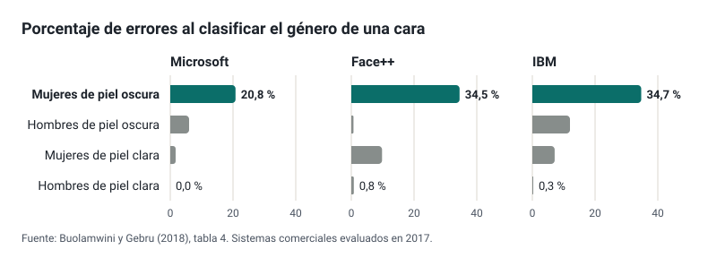
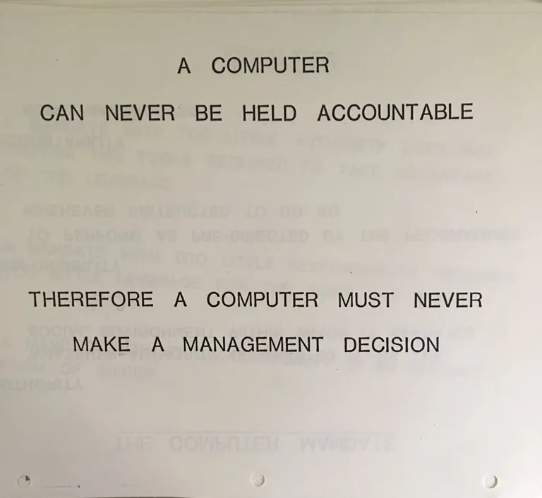

<!-- .slide: id="ley-o-prudencia" class="statement" -->
## Not everything you “can’t do” with AI is illegal

Separating what the law requires from what is prudence.

---

<!-- .slide: id="tres-origenes" class="cards" -->
## Each criterion, with its origin

### Legal obligation
A rule requires it: the article is cited.

### Institutional recommendation
An official guide advises it; it is not binding in itself.

### Good practice
The course proposes it, with reasons: it can be debated.

Notas:
Telling them apart avoids treating as prohibited what is only prudent, or as optional what is mandatory, and shows where a prohibition amounts to trying to hold back the tide.

---

<!-- .slide: id="tres-filtros" class="fragments" -->
## Three filters, in this order

1. **Relevance**: does it add something I cannot achieve equally well another way?
2. **Ethics**: does it respect the people affected?
3. **Law**: does the law allow it?

Notas:
The order matters: something perfectly legal may make no sense for a task, and something that makes a lot of sense may be illegal with student data.

---

<!-- .slide: id="ensayo" class="big-number" -->
## Performing better with AI is not learning more

**−17%** in the exam without help, after practising with an unrestricted assistant.

Bastani et al., PNAS 2025: a secondary school in Turkey, nearly a thousand students.

Notas:
With the assistant they did 48% better in practice; with one set up to give hints instead of solutions, the negative effect largely disappeared: hence tutor modes and educational bots. Access was assigned at random, so the tool caused the difference, but there: one subject, one school, one country, and in the short term. Generalising needs replications.

---

<!-- .slide: id="pregunta-abierta" class="statement" -->
## What students must be able to do without AI is for each subject to decide

And how much to use it for assessment: questions still open.

Notas:
In a computing VET programme, working with an assistant may be part of professional competence; in maths, the aim may be reasoning without help. The mark is always the teacher’s decision. Good practice: treat each decision as a hypothesis and check afterwards what students can do without the tool.

---

<!-- .slide: id="etapas" class="table" -->
## Bias enters at a stage, and at each one someone decides

| Stage | The human decision |
| --- | --- |
| Historical | Using the past to decide about the future |
| Representation | Which sample is collected |
| Measurement | What is chosen to be measured |
| Evaluation | Who it is tested with |
| Deployment | What it is used for |

Notas:
Five of Suresh and Guttag’s seven sources of harm (2021). “AI is biased” describes the problem badly: bias enters at a specific stage, and at each stage there is a human decision. What matters for a teacher is that it does not show in a single answer: it appears when the error is measured by group.

---

<!-- .slide: id="gasto-sanitario" class="big-number" -->
## Measuring spending instead of need

**46.5%** of Black patients with extra care, instead of 17.7%, had the algorithm not predicted spending.

Obermeyer et al., Science 2019.

Notas:
The algorithm predicted healthcare spending, not illness. Because unequal access to care means less is spent on treating Black patients, at the same score they were considerably sicker. The model predicted well what it was asked to: what was wrong was the question.

---

<!-- .slide: id="gender-shades" class="image-full" -->

Notas:
Bias does not show in a single answer: it appears when the error is measured by group. Three commercial systems that classified gender from a face, evaluated in 2017.

---

<!-- .slide: id="voz" class="big-number" -->
## In speech transcription too

**35%** of words mistranscribed for Black speakers, against 19% for white speakers.

Koenecke et al., PNAS 2020: five commercial systems.

Notas:
Even when they said exactly the same sentences. With students whose accents, varieties or languages are under-represented, check the transcription before accepting it. This case and the previous one belong to the evaluation stage: the systems were on the market with very different error rates by group, and it only showed when someone measured it.

---

<!-- .slide: id="regla-programada" class="statement" -->
## A programmed rule is not a learned bias

iTutorGroup rejected female applicants aged 55 or over because someone programmed it that way (EEOC, 2023).

Notas:
And male applicants aged 60 or over: more than 200 qualified people turned away. It agreed to pay $365,000. It is often cited as a case of AI discrimination, but there was no model learning anything. The EEOC chair: “Even when technology automates the discrimination, the employer is still responsible”. Before blaming “AI” for something, ask what was decided and who decided it.

---

<!-- .slide: id="quien-responde" class="cards" -->
## Who answers for it

### Legal obligation
For the system, whoever develops or commissions it; for its use, whoever deploys it.

### Institutional recommendation
Know what to check in AI outputs before using them.

### Good practice
Keep a record of what you used, for what, and how you checked it.

Notas:
For what each teacher does with a tool, it is simple: what you use, you review and answer for. The recommendation comes from the guiding questions in the European Commission’s guidelines for educators, which also ask each school who reviews and validates AI outputs. But that is not the whole division: the AI Act divides obligations between whoever develops or commissions the system and whoever deploys it, and the GDPR gives everyone the right not to be subject to a decision based solely on automated processing.

---

<!-- .slide: id="ibm-1979" class="image-full" -->

Attributed to an internal IBM training, 1979.

Notas:
The idea is not new: decades later, the GDPR and the AI Act reflect it, each in its own way. Neither prohibits using the tool; both keep a person in charge of the decision. Attributed, not confirmed: the image has circulated since 2017, the original has not been found and IBM’s archive did not find it. And the person who decides also has biases (next slide).

---

<!-- .slide: id="sesgo-propio" class="statement" -->
## Biases are ours too: we trust what we expected and what the machine proposes

Notas:
Confirmation bias and automation bias. In four pooled clinical studies, when the decision support system was wrong, the risk of deciding wrongly rose by 26% (Goddard et al., 2012); training and making clear who is accountable reduced it. With language models, a first-person expression of doubt (“I’m not sure, but…”) reduced overreliance in an experiment with 404 people (Kim et al., 2024), although it is a single study. A confident tone is not a sign of accuracy.

---

<!-- .slide: id="privacidad" class="comparison" -->
## Student data, only where your school or authority answers for them

### No
Names, marks, reports or photos in a chatbot with a personal account.

### Yes
Tools contracted by your school or education authority, invented cases, or the template and the procedure instead of the result.

Notas:
The school processes student data on a legal basis laid down by EU or national law, with appropriate security. A third party that processes those data must be a processor under contract (Article 28 GDPR). Removing the name is not enough if a combination of details identifies the person. And whoever sends a piece of work with the name replaced by a code is still processing the student’s data, because they keep the table: it reduces the risk, but which tool may be used is for the controller to decide, the school or the authority that runs it. That is why a well-cleaned piece of work is in neither the “No” nor the “Yes”: it needs the controller’s authorisation. What is clear and what is not, with work, marks and reports, is in the Student data module.

**Demo (5 min): a model that works without the internet**. Ollama or LM Studio with a small model already downloaded on the laptop.

1. Ask the local model a question and look at the answer.
2. Disconnect the network (Wi-Fi and cable).
3. Ask again: it keeps answering.
4. Ask a commercial chatbot the same question and compare the quality.

**Expected result:** it answers offline, with lower quality than a commercial chatbot.
**If it fails:** if no model is downloaded, explain the principle as the page does and show it in another session.
**Key message:** the problem is not “AI”, but where the data go.

---

<!-- .slide: id="detectores" class="big-number" -->
## AI detectors are not reliable

**61%** of essays by students of English as a foreign language flagged as AI.

Liang et al., 2023: seven detectors.

Notas:
OpenAI withdrew its own detector in July 2023 because of its low accuracy: it detected 26% of AI-written texts and flagged 9% of human-written ones.

---

<!-- .slide: id="evaluar" -->
## Assessing when AI exists

- Never sanction on the basis of a detector’s result.
- Assess the process and the intermediate versions.
- Oral explanations and work in class on the key parts.
- Ask students to declare how they have used AI.

---

<!-- .slide: id="normativa" class="section" -->
## What the law says

---

<!-- .slide: id="calendario" class="table dense" -->
## The AI Act applies in stages

| From | What changes at a school |
| --- | --- |
| 2 February 2025 | Inferring students’ emotions is prohibited |
| 2 August 2026 | Telling people they are talking to an AI; labelling deep fakes |
| 2 December 2026 | Fake nude apps are prohibited |
| 2 December 2027 | Obligations for high-risk education systems |
| 2 August 2030 | Final deadline for high-risk systems that public authorities were already using |

Notas:
Regulation (EU) 2026/1744, the Omnibus, postponed the high-risk obligations (previously 2 August 2026) and added the new prohibitions. Many guides, including the European guidelines for educators, still give the old dates.

---

<!-- .slide: id="emociones" class="statement" -->
## Prohibited since 2025: inferring students’ emotions

An app that the school requires students to use and that detects interest or anxiety already breaks the ban.

Notas:
Article 5(1)(f) of the AI Act, with the examples in the Commission’s guidelines: the same language app is not prohibited if it is used outside school; tracking gaze in an online exam is not either, as long as it does not detect nervousness.

---

<!-- .slide: id="alto-riesgo" class="cards" -->
## High risk in education, from December 2027

### Admission
Deciding access or assigning students.

### Assessment
Evaluating learning outcomes.

### Level
Deciding the appropriate level of education.

### Exams
Monitoring prohibited behaviour.

Notas:
Annex III, point 3. What does not materially influence the decision is not high-risk (Article 6(3)), unless it performs profiling. The obligations fall mainly on the school or authority that deploys the system: human oversight, informing students and, for public bodies, a fundamental rights impact assessment.

---

<!-- .slide: id="decision-humana" class="statement" -->
## No mark can come from a tool alone

Article 22 GDPR: the right not to be subject to a decision based solely on automated processing.

---

<!-- .slide: id="practica-etiquetar" class="practice" -->
## Law, recommendation or prudence

1. Take the AI rules of your school or your course plan.
2. Label each point with its origin.
3. For each legal obligation, look up the article on the legal framework page.
4. For each prohibition with no basis, think about what risk it tries to avoid.

**15 minutes.** Output: rules with their origin in plain sight.

Notas:
In department groups. The interesting part comes out when sharing: which “prohibitions” had no basis and which legal obligations nobody knew about.
