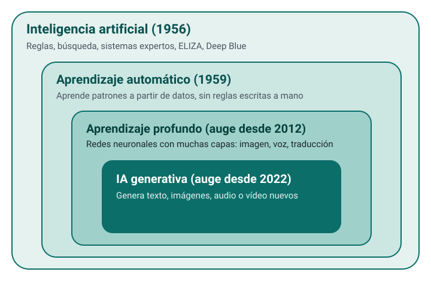
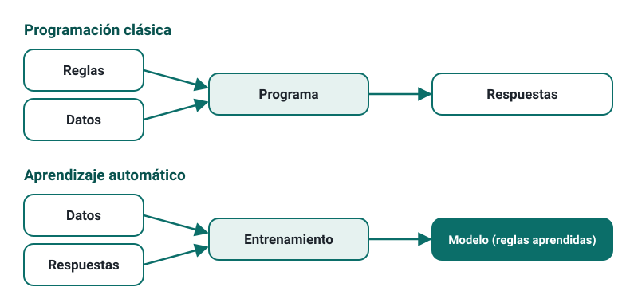

## Four concepts, one inside another

What everyday language now calls “AI” is only the most recent part of a field with seventy years of history. It helps to distinguish four concepts, each contained in the previous one.

### Artificial intelligence

The term was born in 1956, at a workshop at Dartmouth (United States), and refers to the development of systems that perform tasks we associate with human intelligence. For decades, most of those systems worked with **hand-written rules**:

- ELIZA (1966) simulated a conversation with a therapist by looking for keywords and replying with predefined phrases.
- Deep Blue (1997) defeated Kasparov at chess by combining programmed strategies with an enormous capacity for calculation.

### Machine learning

Machine learning (a term coined in 1959) changes the approach: instead of writing the rules, the program is given **data with their answers** and training extracts the rules. The result is a **model**: a set of parameters that, applied to new data, produces answers.

It is the technique behind spam filters, video recommendations and weather forecasting, long before chatbots.

### Neural networks and deep learning

Artificial neural networks are a type of model inspired, in a very simplified way, by biological neurons: the artificial neuron was described in 1943, the perceptron in 1957, and the technique that makes it possible to train networks with several layers (backpropagation) became widespread in 1986.

**Deep learning** uses networks with many layers. It took off in 2012, when a network of this kind, AlexNet, cut the error in the main image recognition competition from 26% to 15%.

### Generative AI

Generative AI uses deep learning to **generate new content**: text, images, audio, video or code. It is what has been popularised as “AI” since late 2022, with ChatGPT.

## Moravec’s paradox

In the 1980s, Hans Moravec and other researchers pointed out something that is still surprising: it is relatively easy for a computer to do what we humans find hard (calculation, formal logic, chess) and very hard for it to do what any child does effortlessly (recognising objects, moving around a room, understanding an ambiguous sentence).

Deep learning has solved a good part of perception and language, but the paradox helps to understand why today’s AI can write a flawless report and fail a common-sense question, or why robotics is advancing much more slowly than chatbots.

## Why now

The boom of recent years is not due to a new idea, but to four factors coming together:

- **Computing power**: graphics processors (GPUs) and specialised chips that make it possible to train huge networks.
- **Data**: the web, digitised books and public code offer unprecedented amounts of text and images.
- **Architectures**: the transformer (2017) makes it possible to train much larger language models efficiently.
- **Investment**: since 2022 the industry has been devoting to AI resources that no research field had before.

## A timeline

- **2012**: AlexNet starts the deep learning boom in computer vision.
- **2014**: generative adversarial networks (GANs) open the way to generating synthetic images, still small and blurry.
- **2016**: DeepMind’s AlphaGo defeats the world go champion Lee Sedol.
- **2017**: the transformer architecture, the basis of today’s language models, is published.
- **2020**: GPT-3 shows that a very large language model can do tasks it was not specifically trained for.
- **2022**: diffusion models generate realistic images from text; in November, ChatGPT popularises conversational assistants.
- **2023**: multimodal models arrive, working with text and images at the same time.
- **2024**: models that “reason” before answering appear (OpenAI o1).
- **2025**: DeepSeek-R1 is released with its weights, a performance comparable to o1’s and a much lower cost of use; generated video gains sound (Veo 3); agentic browsers arrive (Comet), as do models that decide by themselves how much to reason (GPT-5).

For the current state of the tools, see [Chatbots](../chatbots/index.md).

## Model, chatbot and agent

These are three different things, and confusing them leads to misunderstandings:

Language model
: The trained system that, given a text, generates a continuation. GPT-5, Gemini and Claude Sonnet are names of models or of model families.

Chatbot or assistant
: The product we converse with (ChatGPT, Gemini, Claude, Perplexity…). It uses one or more models and adds an interface, memory, web search, file attachments and other tools to them.

Agent
: A system that, given a goal, **acts**: it plans steps, uses tools (a browser, a program, email) and decides what to do next according to what it observes, until it meets the goal or stops.

The practical difference: you ask a chatbot and it answers; you give an agent a task and it carries it out, with the risks that this implies. This is covered in detail in [Agentic browsers](../navegadores-agenticos/index.md).

How a language model works inside, and why that explains its successes and its errors, is in [How a language model works](funcionamiento.md).
