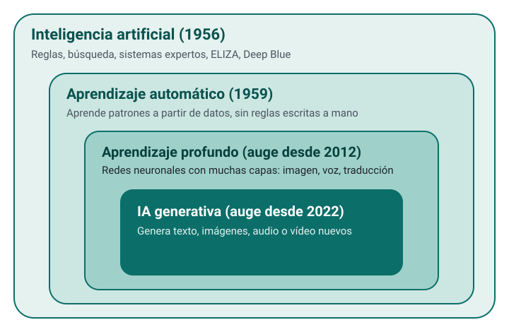
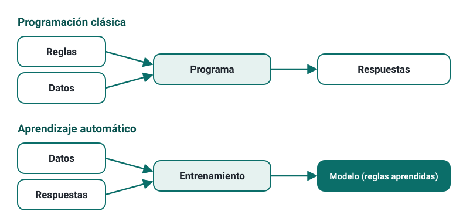

---
derived_from:
  es/intro-ia/slides.md: "dd6073a665cd145f84b3c4138150434211622b44"
---

<!-- .slide: id="setenta-anos" class="statement" -->
## “AI” is the most recent part of a seventy-year-old field

Artificial intelligence, machine learning, deep learning and generative AI are not synonyms.

---

<!-- .slide: id="conjuntos" class="image-full" -->

Notas:
ELIZA (1966) and Deep Blue (1997) were AI without learning: hand-written rules and a lot of calculation. Deep learning took off in 2012 and generative AI became popular in late 2022.

---

<!-- .slide: id="reglas-o-datos" class="image-full" -->

Notas:
The change of approach: instead of writing the rules, the program is given data with their answers and training extracts the rules. The result is a model. Everyday examples that predate chatbots: spam filters, recommendations, weather forecasting.

---

<!-- .slide: id="moravec" class="statement" -->
## What is hard for us is easy for a computer, and vice versa

Moravec’s paradox: AI writes a flawless report and fails a common-sense question.

---

<!-- .slide: id="por-que-ahora" class="cards fragments" -->
## Why now

### Computing power
GPUs and specialised chips to train huge networks.

### Data
The web, digitised books and public code.

### Architectures
The transformer (2017) scales up language models.

### Investment
Since 2022, unprecedented resources.

---

<!-- .slide: id="linea-temporal" class="timeline" -->
## A timeline

- **2012** AlexNet starts the deep learning boom.
- **2017** The transformer architecture is published.
- **2020** GPT-3 does tasks it was not trained for.
- **2022** ChatGPT popularises conversational assistants.
- **2024** Models that reason before answering.
- **2025** Cheap open weights, video with sound, agentic browsers.

---

<!-- .slide: id="modelo-chatbot-agente" class="cards" -->
## Three different things

### Model
The trained system that generates text. GPT-5, Gemini, Claude Sonnet.

### Chatbot
The product we converse with: model plus interface, memory, search, files.

### Agent
Given a goal, it **acts**: it plans, uses tools and decides the next step.

Notas:
You ask a chatbot and it answers; you give an agent a task and it carries it out, with the risks that this implies.

---

<!-- .slide: id="como-funciona" class="section" -->
## How a language model works

---

<!-- .slide: id="siguiente-palabra" class="statement" -->
## It predicts the next word, again and again

Like a phone keyboard, but trained on an enormous amount of text and taking everything before into account.

Notas:
**Demo (3 min): the same question, two answers**. Any chatbot, in two temporary chats.

1. Make the same open request in both chats (for example, “Propose a 20-minute activity to introduce photosynthesis in the second year of lower secondary”).
2. Put the two answers side by side.
3. Regenerate one of them and show that it changes again.

**Expected result:** different proposals, equally confident.
**If it fails:** explain with the page that each word is chosen from a probability distribution.
**Key message:** when the result matters, regenerate or compare.

---

<!-- .slide: id="plausible" class="statement" -->
## It generates the most plausible; it does not check what it says

Almost always that coincides with what is correct. When it does not, the error sounds just as confident.

---

<!-- .slide: id="tokens-contexto" class="two-col" -->
## Tokens and context window

### Tokens
Pieces of text the model works with. In Spanish, for example, a word often takes up more than one.

### Context window
What the model takes into account at once: instructions, conversation, attachments and answer. Whatever falls outside does not exist for it.

---

<!-- .slide: id="base-asistente" class="two-col" -->
## From base model to assistant

### Pre-training
It learns to predict the next token over huge amounts of text. It can continue texts, not follow instructions.

### Post-training
With example conversations and human ratings it learns to behave like an assistant: follow instructions, format answers, refuse.

Notas:
The helpful tone and the tendency to agree with you are not a personality: they are behaviours learned in this phase.

---

<!-- .slide: id="alucinaciones" -->
## Hallucinations

- A fluent, confident answer that is **false**: invented figures, quotations, references.
- Not a one-off fault: training rewards guessing an answer more than saying “I don’t know”.
- Today’s models fail less, especially with web search, but the risk does not go away.
- **Every figure, quotation, reference or regulation is checked at the source.**

Notas:
**Demo (5 min): do these references exist?** Any chatbot, in a temporary chat and without web search if it can be turned off.

1. Ask for three academic references on a very specific topic in your subject.
2. Look up each title in an academic search engine.
3. Repeat the request with web search turned on and open the sources it cites.

**Expected result:** a plausible reference that does not exist or has its details changed; with search, real sources that still have to be read.
**If it fails:** if they all exist, check that the details (authors, year, journal) match.
**Key message:** plausible is not true; whatever goes into a document is checked at the source.

---

<!-- .slide: id="sabe-busca" class="two-col" -->
## What it knows and what it searches for

### Cutoff date
What happened after training is not in the model.

### Web search
Chatbots search and cite pages. That improves how up to date they are, but they may choose the wrong sources or summarise them badly.

Notas:
A nuance: the model can reproduce fragments of its training data word for word, especially texts that appear many times. That is part of the reason for the copyright disputes and for the recommendation not to enter personal data.

---

<!-- .slide: id="razonan" -->
## Reasoning models

- They generate intermediate reasoning before answering.
- They improve a great deal in mathematics, programming and logic, at the cost of time.
- It is still generated text: not infallible deduction.
- The reasoning they show does not always reflect what determined the answer.

---

<!-- .slide: id="sesgos" class="statement" -->
## Biases are a reflection of the data

Not a “decision” of the model, and correcting them introduces other imbalances.

Notas:
“Bias” has two senses that are best kept apart: the statistical one, a systematic error, and the fairness one, an error or a treatment that differs by group. A model can reproduce its data faithfully and still give unfair results if that data reflects an unequal world. The useful question is not “Is AI sexist?” but at which stage the bias entered and who made that decision: the stages are covered in the ethics block.
