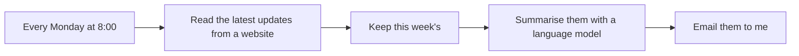

> [!NOTE]
> **Advanced module**
> You do not need to install anything or know how to program, but you do need to create an account on an automation service, connect other accounts to it (your email, a spreadsheet) and not be afraid of configuring things.

## What an automation is

An automation, or **workflow**, is a fixed sequence of steps that runs on its own when something happens: at a set time, when an email arrives, when a form is submitted. It is like a recipe that the computer follows without you, step by step, every time the conditions are met.



It helps to place it next to what the course has already covered:

Chatbot
: Answers when you ask. If you do not open the chat, it does nothing.

Automation
: Always runs the same steps, without you being there. It is predictable: you have set the path.

[Agent](../intro-ia/index.md#modelo-chatbot-y-agente)
: Decides the steps itself to meet a goal. It is more flexible and less predictable.

An automation can include a language model in one of its steps (to summarise, classify or draft) and even an agent, but you decide the skeleton.

## The tools

There are several tools for building these workflows visually, without programming: each step is a box connected to the next one. They are used in the browser, with an account, and all of them have connectors for hundreds of services (Gmail, Google Sheets, Telegram, forms, RSS). What changes is the price, where the data is kept and what the free plan allows, such as adding a step with a language model.

| Tool | Without paying | Where the data is kept |
| --- | --- | --- |
| Zapier | Free plan with 100 tasks a month, but only two-step workflows (a trigger and an action) and no AI steps | In the United States, with no option to host it in the EU |
| Make | Free plan with 1,000 credits a month; scheduled workflows run at most every 15 minutes | In the EU or in the United States, as chosen at sign-up; it cannot be changed afterwards |
| n8n Cloud | 14-day trial with no card; after that, from €20 a month billed annually | In the EU, on Azure servers in Germany and Sweden |
| Power Automate | Included in Microsoft 365 education licences (A1, A3 and A5), with the standard connectors only | In the Microsoft 365 of the education account |

The example workflow in this module has four steps and uses a language model, so it does not fit in Zapier’s free plan.[^herramientas]

For simple tasks you do not even need a workflow: some assistants can already schedule recurring tasks, such as Claude in Chrome.

## n8n

The examples in this module use [n8n](https://n8n.io), for two reasons: its gallery of example workflows can be viewed node by node without creating an account, and, unlike Zapier and Make, it can also be installed on your own server. It has nodes for hundreds of services and AI nodes for using language models and agents. The cloud version, n8n Cloud, also includes an assistant that builds workflows from a description, and AI models that can be used without your own key.

Installing it is free, but its licence is not free software in the strict sense. It is what the company calls “fair-code”: it can be used, modified and installed free of charge for internal, personal or non-commercial use, but not offered as a service to third parties or resold.[^licencia] With your own installation, the workflow data stays on that server and n8n does not receive it.[^privacidad] It is a job for whoever administers the school’s systems, with the [official installation guide](https://docs.n8n.io/hosting/).

## How a workflow is built

All these tools are built on the same pieces, even if they give them other names (Zapier calls the steps actions; Make calls them modules). These are the names n8n uses:

Trigger
: The node that starts the workflow: a fixed time (Schedule Trigger), a form, a chat message, a new item in an RSS feed, an incoming email.

Nodes
: Each step: read, filter, transform, call a model, send. Each node receives data from the previous one, does its job and passes the result on to the next.

Items
: Data travels as a list of items (for example, one RSS entry per item), and each node runs once per item.

Expressions
: To use data from an earlier step in a node, you drag the field from the node’s input panel.[^arrastrar] n8n writes it as an expression in double curly braces: `{{ $json.title }}` is the title of the item being processed.

Credentials
: The accounts and keys the nodes use (your Gmail, your API key). They are stored separately, encrypted; when you export a workflow, their name and ID go with it, but not the key.

Workflows are saved as JSON files: they can be downloaded, shared and imported, and also **copied and pasted** straight onto the canvas.[^importar] That means you can ask a chatbot for a ready-made workflow (“give me the JSON for an n8n workflow that…”), paste it and review it node by node. In n8n Cloud, the built-in assistant does the same from within the editor.

## An example: what’s new in the BOE, in your inbox

Spain’s official gazette, the BOE, publishes an RSS feed with its provisions on *Educación y enseñanza* (education and teaching). This workflow summarises them for you every Monday:

1. **Schedule Trigger**: every Monday at 8:00.
2. **RSS Read**, with the address `https://www.boe.es/rss/canal_leg.php?l=l&c=114`.
3. **Filter**: only the items published in the last seven days.
4. **A language model node** with these instructions:

   ```text
   Summarise this BOE provision in one sentence for secondary and VET teachers.
   Say who it affects and whether it changes anything in their work. If it does not affect them, say so.
   Do not add anything that is not in the text.

   Title: {{ $json.title }}
   Link: {{ $json.link }}
   ```

5. **Send Email** or **Gmail**: a single email to you with all the summaries and their links.

It handles no personal data, each summary comes with its link so you can check it, and if it fails, nothing serious happens. That is why it makes a good first workflow. The same pattern works with any similar feed.

The [n8n gallery](https://n8n.io/workflows/) has similar ready-made workflows, which can be viewed node by node without creating an account. [This weekly digest of several RSS feeds](https://n8n.io/workflows/16037-send-a-weekly-aicurated-rss-digest-email-with-openai-and-gmail/), for example, starts on Mondays at 8:00, reads the feeds, keeps the most relevant articles, asks an OpenAI model for the summary and sends it with Gmail. It is more elaborate than the BOE one, with two nodes that contain code, but the route is the same.

## Agents inside a workflow

The **AI Agent** node turns a step into an agent: it receives a goal, a language model and some tools (other nodes: searching a spreadsheet, querying a website, sending a message) and decides which ones to use and in what order. It is powerful, but it brings back the risks covered in [Agentic browsers](../navegadores-agenticos/index.md#el-riesgo-principal-la-inyección-de-prompts): an agent that reads anyone’s emails and can send emails is the complete “lethal trifecta”.

n8n lets you require **human approval** before the agent uses a particular tool: the workflow stops and someone approves or rejects the action with its data in view.[^aprobacion] It is worth turning it on for any tool that sends, publishes, modifies or deletes.

## What to automate in a school, and what not to

Good candidates
: Tasks with no personal data, or only yours: news digests, deadline reminders, alerts when a website changes, converting materials between formats, backups of your documents.

Only in authorised tools
: Anything that touches student or family data. An automation service with your account is, like a chatbot with a personal account, an external platform: personal data only go to tools that your school or education authority (whichever decides on the tools) has contracted or authorised ([Student data](../datos-alumnado/index.md#the-prior-question-does-the-ai-need-the-data)). In addition, whatever is sent to the language model reaches its provider, and n8n Cloud **stores the data of each execution**, including what passed through each node, for as long as your plan sets.[^privacidad]

No
: Decisions about students (marks, sanctions, admissions) without human review.

A practical detail: n8n has no Moodle node. It can connect to Moodle’s web API through the HTTP Request node, but that requires a permission that only the Moodle site’s administrators can grant.

[^herramientas]: Prices and terms of [Zapier](https://zapier.com/pricing) ([AI steps](https://help.zapier.com/hc/en-us/articles/8496342944013), [data hosting](https://zapier.com/legal/data-privacy)), [Make](https://www.make.com/en/pricing) ([minimum interval](https://academy-content.make.com/courses/make-basics-modules/05-scheduling-your-scenario/), [data centres](https://help.make.com/organizations)), [n8n](https://n8n.io/pricing/) ([free trial](https://docs.n8n.io/deploy/use-n8n-cloud/start-your-free-trial)) and [Power Automate](https://learn.microsoft.com/en-us/power-platform/admin/power-automate-licensing/faqs), accessed 5 November 2026. The n8n Cloud servers, in its list of [sub-processors](https://n8n.io/legal/sub-processors/), accessed 22 October 2026.
[^arrastrar]: n8n, [*Use the UI mapper*](https://docs.n8n.io/build/work-with-data/reference-data/use-the-ui-mapper.md).
[^licencia]: n8n, [*Community license*](https://docs.n8n.io/n8n-community-license/community-license.md) and [*License FAQ*](https://docs.n8n.io/n8n-community-license/community-license/license-faq.md), accessed 22 October 2026.
[^importar]: n8n, [*Export and import*](https://docs.n8n.io/build/manage-workflows/export-and-import.md).
[^aprobacion]: n8n, [*Human-in-the-loop for tools*](https://docs.n8n.io/build/integrate-ai/ai-examples/human-in-the-loop-for-tools.md).
[^privacidad]: n8n, [*Privacy*](https://docs.n8n.io/privacy-and-security/privacy.md), accessed 5 November 2026.
