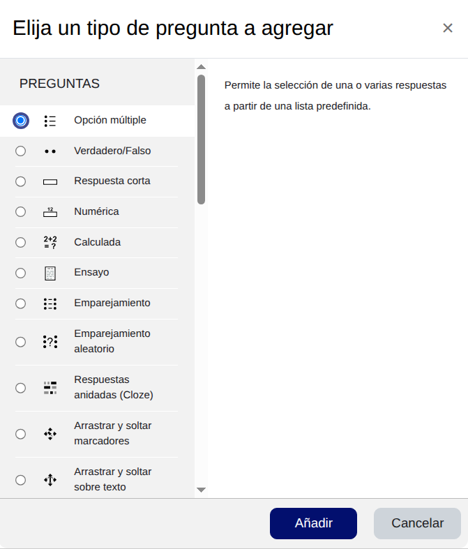
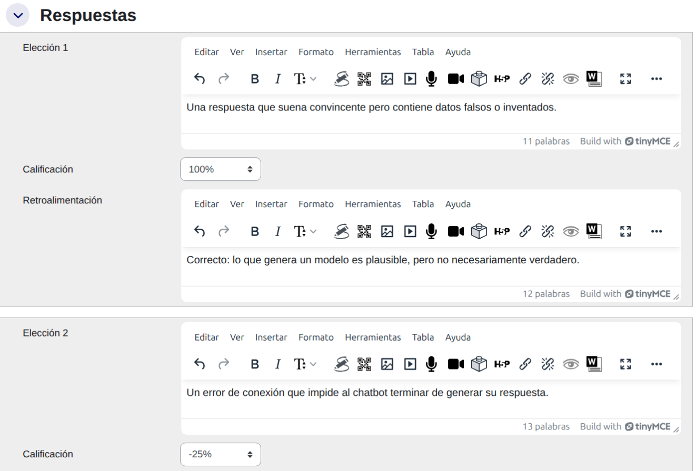
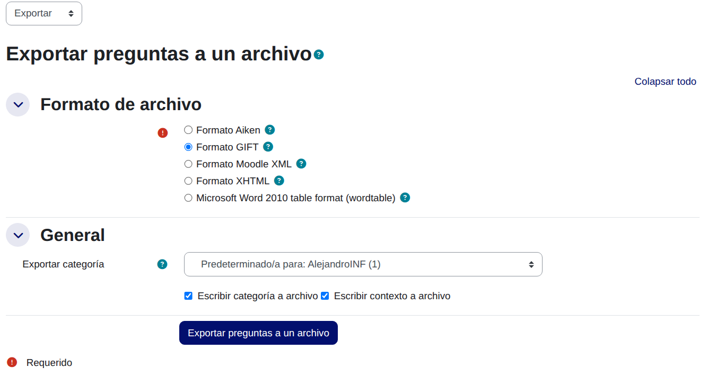
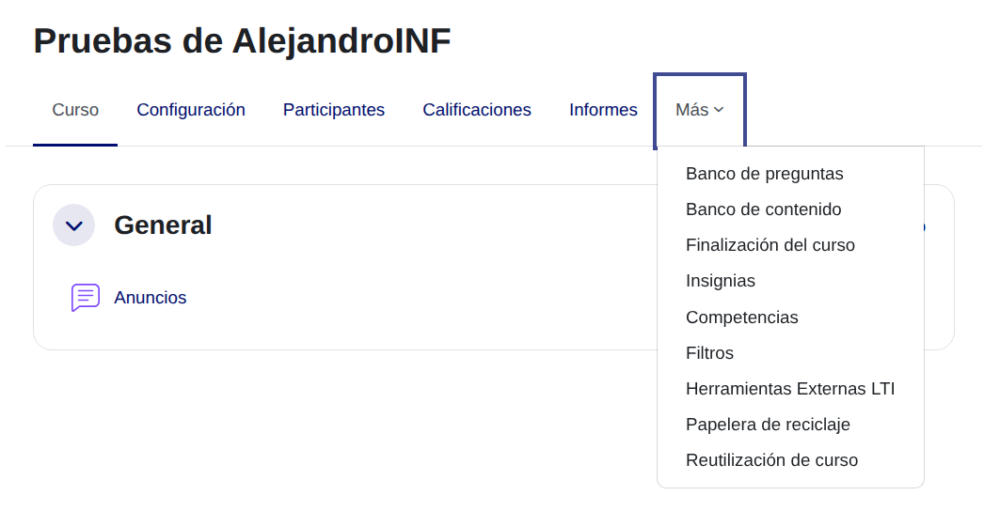
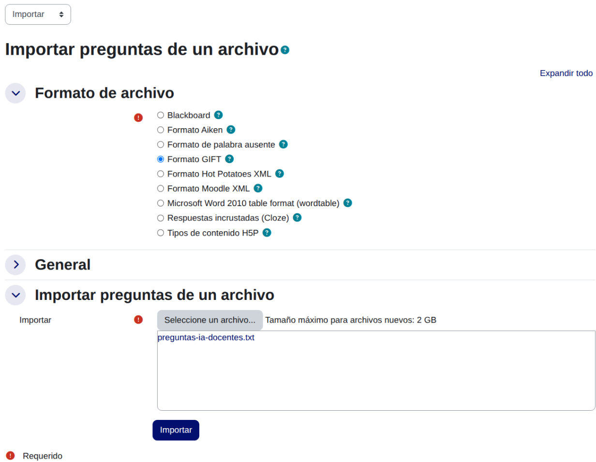
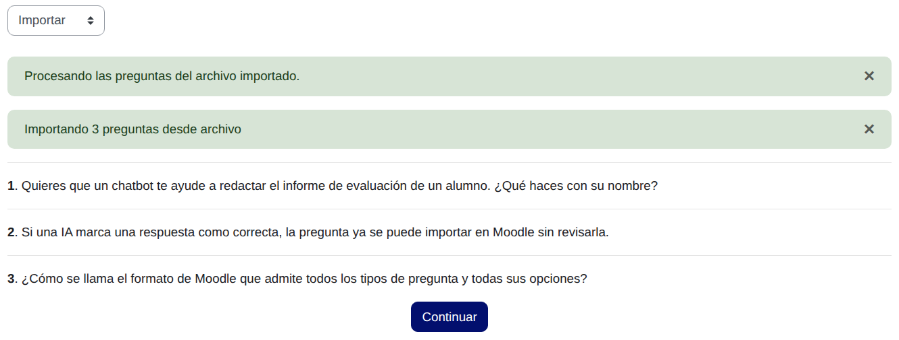
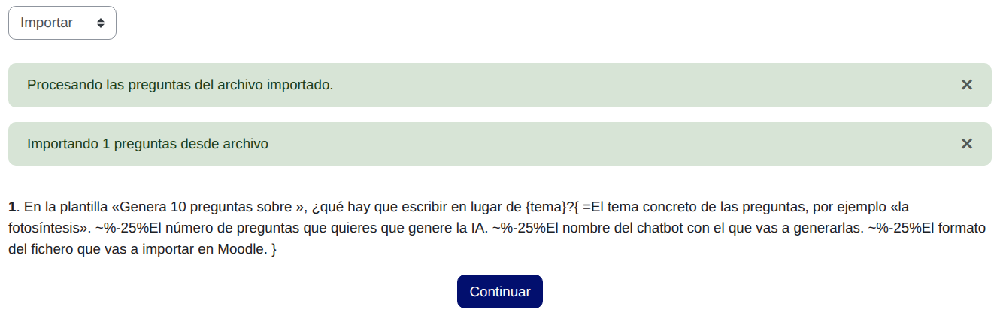
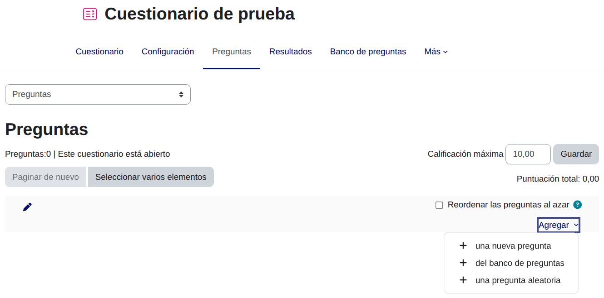
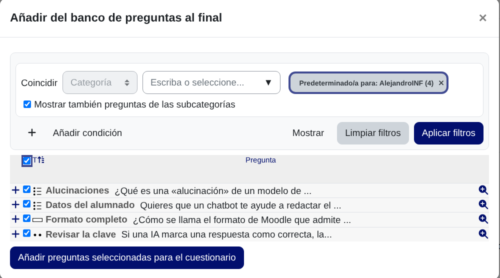
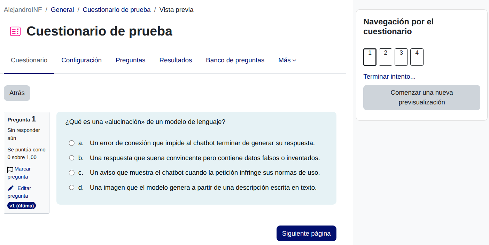

## Formats Moodle imports

Moodle imports questions from a text file in several formats. Three of them are useful for working with AI:

| Format | What it is for | Advantages | Limitations |
| --- | --- | --- | --- |
| Aiken | Simple multiple choice | Very easy to read and to generate | Only multiple choice with one correct answer; no penalties or feedback |
| GIFT | Most question types | Compact; supports penalties, feedback and several question types | Its special characters have to be escaped |
| Moodle XML | Every question type and all its options | It is Moodle’s full export format | Long and hard to read at a glance |

Official Moodle documentation: [Aiken](https://docs.moodle.org/en/Aiken_format), [GIFT](https://docs.moodle.org/en/GIFT_format) and [Moodle XML](https://docs.moodle.org/en/Moodle_XML_format).

The examples on this page are the questions that appear in the screenshots, translated into English.

### Aiken

```aiken
What is a “hallucination” in a language model?
A. A connection error that stops the chatbot from finishing its answer.
B. An answer that sounds convincing but contains false or made-up information.
C. A warning the chatbot shows when the request breaks its usage rules.
D. An image the model generates from a description written in text.
ANSWER: B
```

### GIFT

A multiple-choice question with a title, one correct answer (`=`), three wrong ones (`~`) that each deduct 25% and feedback (`#`) on every option. The colons in the feedback are escaped (`\:`), for the reason explained in the warning below:

```gift
::Student data::You want a chatbot to help you write a student's assessment report. What do you do with the student's name?{
    =I remove it, like any other data that could identify the student.#Correct\: the report does not need any personal data about students.
    ~%-25%I leave it, because the chatbot needs to know who the report is about.#The chatbot can write the report without knowing who the student is.
    ~%-25%I leave it if I have turned off the provider's training on my data.#The provider not training on your data does not stop you from sending the data to a third party.
    ~%-25%I leave it if I delete the conversation when the report is finished.#Deleting it afterwards does not undo the fact that the data has already been sent.
}
```

A true/false question with feedback. Mind the order: the **first** message is the one shown to students who get it wrong, and the second to those who get it right.

```gift
::Check the key::If an AI marks an answer as correct, the question can be imported into Moodle without checking it.{FALSE#AI also gets it wrong when marking the correct answer\: always check it.#Correct\: checking cannot be delegated.}
```

> [!WARNING]
> **The most common mistake when importing GIFT**
> The characters `~ = # { } :` have a meaning in GIFT. If they appear in the text of a question or an answer (a formula, a time, a link), they have to be written with a backslash in front: `\=`, `\:`, `\{`… Ask the AI explicitly to escape them. An unescaped character does not always cause an error: sometimes Moodle silently imports a malformed question, as in the [import example](#importar-en-moodle).

### Moodle XML

The file has to be a complete XML document: with the header, and all the questions inside a single `<quiz>` element. A short-answer question that accepts two valid answers:

```xml
<?xml version="1.0" encoding="UTF-8"?>
<quiz>
  <question type="shortanswer">
    <name><text>Full format</text></name>
    <questiontext format="html">
      <text><![CDATA[<p>What is the name of the Moodle format that supports every question type and all its options?</p>]]></text>
    </questiontext>
    <defaultgrade>1</defaultgrade>
    <answer fraction="100" format="moodle_auto_format">
      <text>Moodle XML</text>
      <feedback format="html"><text><![CDATA[<p>Correct.</p>]]></text></feedback>
    </answer>
    <answer fraction="100" format="moodle_auto_format">
      <text>XML</text>
      <feedback format="html"><text><![CDATA[<p>Correct.</p>]]></text></feedback>
    </answer>
  </question>
</quiz>
```

## Generating the questions with AI

### The most reliable method: start from a Moodle export

Instead of describing the format to the AI, **give it a real example**. It is the technique of giving an example of the output (one-shot) applied to Moodle:

1. Create by hand in Moodle a question of the type you want (for example, multiple choice with penalties and feedback). In the screenshots it is the one from the [Aiken example](#aiken), now with penalties and feedback. In the question bank (how to get there is in [Importing into Moodle](#importar-en-moodle)), click **Create a new question…** and choose the type:

   {.border .narrow}

   In the form, each answer has its grade (100% for the correct one and a negative percentage for the wrong ones, if you want them to deduct marks) and its feedback:

   {.border}

2. Export it from the question bank in the format you are going to use (GIFT or Moodle XML): in the page’s drop-down menu, **Export**. Moodle exports every question in the category you choose, but you only need to copy one.

   {.border}

3. Open the downloaded file, copy the question and paste it into the chat as an example: “Generate 10 questions on [topic] in exactly this format”.
4. Add the generated questions to the same file and import it.

This way the AI copies exactly what your Moodle expects, including the details nobody would remember to describe (the HTML markup, the penalties, the characters already escaped).

> [!TIP]
> **One format per conversation**
> If you give it examples in different formats at once (one question in GIFT and another in XML), models tend to mix them up. Use a single format in each request, and if you need to convert, ask for the conversion as a separate task.

### A base prompt

```text
Generate 10 multiple-choice questions in GIFT format on: [TOPIC].

Requirements:
- 4 options per question and only one correct answer.
- A range of difficulty (easy, medium, hard).
- Plausible distractors, of similar length to the correct answer.
- Escape with \ the characters ~ = # { } : that appear in the text.
- Return only the content of the file, with no comments.
```

### A custom assistant for quizzes

This prompt is used as the fixed instructions of an assistant that generates questions to demanding standards of rigour:

:::: chat model="ChatGPT (custom GPT)"
::: user
Create test questions in GIFT format that can be imported into Moodle, following these rules.

- They will always be multiple-choice questions with 4 answers and only one correct one.
- Wrong answers will deduct half a question unless stated otherwise.
- All answers must be of similar length.
- Rigour must come first. The correct answer must be the only one that is correct. The others must be clearly wrong.
- Avoid answers that are wrong because they are not “the best definition” of those given, “the main disadvantage” or other forms of ranking. Wrong answers must be clearly wrong to avoid ambiguity, and the questions must be clear.
- None of the answers should be trivial to rule out. Avoid the usual bias where the correct answer is always one of 3 similar ones and there is another, more absurd one.
- The expected level of difficulty is for university master’s degree students unless stated otherwise.
- Do not put a number before the questions; they will be shuffled.
- You will usually be given material to generate the questions from; avoid direct references such as “according to the notes”. The questions must contain on their own all the information needed to answer them.
- Be careful to avoid biases such as the correct answer being the most detailed or the longest.

An example of the desired format:

```gift
::What is stratified sampling?::[html]What is stratified sampling?{
    ~%-50%Splitting the dataset into groups and making sure that all the samples of a group are in the same set (test, validation or training).
    =Splitting the dataset into groups and taking a percentage of each stratum while keeping the original class proportions.
    ~%-50%Splitting the dataset into groups and increasing the presence of minority classes by duplicating samples or generating new ones.
    ~%-50%Splitting the dataset into groups and increasing the complexity of the model to make it more robust.
}
```
:::
::: assistant collapsed
```gift
::What is a generative model in artificial intelligence?::[html]What is a generative model in artificial intelligence?{
    ~%-50%An algorithm that classifies existing data into predefined categories based on features learned during training.
    ~%-50%A system that optimises sequential decisions by interacting with an environment to maximise a cumulative reward.
    =A type of model that learns the distribution of the training data and can generate new samples similar to it.
    ~%-50%An approach that reduces the dimensionality of complex data by transforming it into simpler representations while preserving essential information.
}

::What is cross-validation?::[html]What is cross-validation?{
    ~%-50%A technique for reducing the complexity of the model by removing redundant features from the dataset.
    ~%-50%A method for evaluating the performance of several models at the same time on a single training set.
    ~%-50%A procedure that combines the predictions of several models to improve the overall accuracy of the system.
    =A technique that splits the data into multiple subsets to train and validate the model, using each subset as test data once.
}
```
:::
::::

There is a [public GPT](https://chatgpt.com/g/g-67b721d49a0481918a78bc5104bd22ea-generador-de-preguntas-de-test) (in Spanish) with these instructions that you can use directly.

> [!WARNING]
> **What to write in an assistant’s instructions**
> Do not write “Create a test question generator…”: that describes the assistant, not what it has to do. Write directly the instructions you want applied in every conversation: “When the user gives you a topic or some material, generate test questions in GIFT format with these rules…”.

## Reviewing before importing

Generating is the easy part. Reviewing is essential and cannot be delegated:

- [ ] **The key is correct.** Check that the answer marked as correct really is, and that none of the wrong ones could also be correct.
- [ ] **No unintended clues.** The correct answer is not systematically the longest, the most detailed or the most nuanced.
- [ ] **No confusing negatives.** Questions with “NOT” or “EXCEPT” tend to measure attention more than knowledge.
- [ ] **Self-contained.** They can be answered without looking at the notes (“according to unit 3…”).
- [ ] **The file imports.** Try it first in a test question bank and look at the preview.

## Importing into Moodle

1. Save the questions in a text file (`.txt` for GIFT or Aiken, `.xml` for Moodle XML) with UTF-8 encoding.
2. Open the question bank:
   - In **Moodle 4.x**: in the course, **More → Question bank**, and in the page’s drop-down menu, **Import**. The screenshots on this page are from this version, on a school’s Moodle site (October 2026), with the interface in Spanish.

     {.border}

   - In **Moodle 5.0 or later**: the question banks are in the course, under **More → Question banks**. Open the bank where you want to save them and choose **Import**.
3. Choose the format, upload the file and click **Import**. In the screenshots, the file has three questions in GIFT: the two from the [GIFT example](#gift) and the short-answer one from the [Moodle XML example](#moodle-xml).

   {.border}

   Moodle shows the imported questions, or the error on the line that fails:

   {.border}

   Read that list even if there is no error. If GIFT marks (`~`, `=`, `%`) appear in a question text, a special character was not escaped and Moodle has silently imported a malformed question. In this example, the braces of the placeholder `{tema}` (Spanish for “topic”) made Moodle take “tema” as the only correct answer of a short-answer question, and stick the four options onto the question text:

   {.border}

4. In the quiz, **Questions → Add → from question bank**:

   {.border}

   Select the new ones and click **Add selected questions to the quiz**:

   {.border}

5. Use the quiz **preview** before opening it to students: it shows each question as they will see it.

   {.border}

## Going further

For large banks generated from a course’s materials, the [tests-generator](https://github.com/avidaldo/tests-generator) project automates the whole process: it summarises the materials, generates the questions in batches, lets you review them in an editor and exports to Moodle XML.
