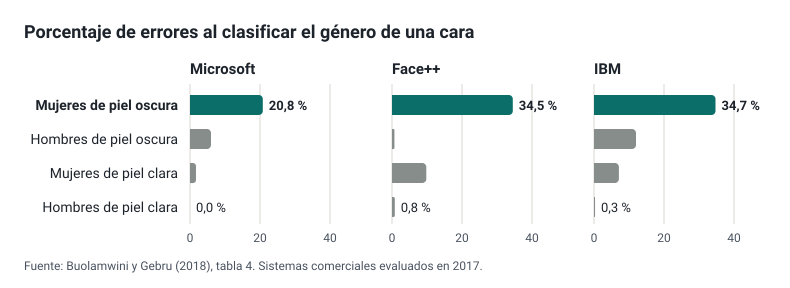
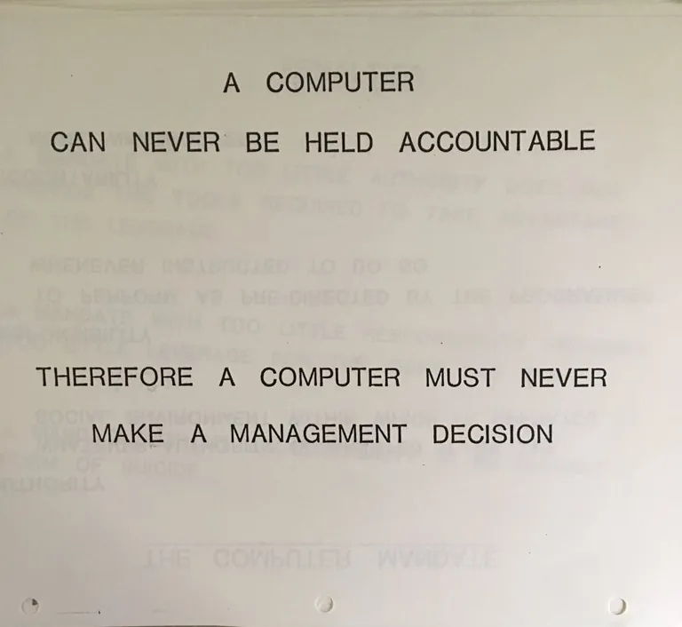

## Qué es ley y qué es prudencia

Muchas listas de «lo que no se puede hacer con IA» mezclan tres cosas de naturaleza muy distinta. En este módulo cada criterio lleva su origen:

Obligación legal
: Lo exige una norma, y se cita el artículo. No es opinable: se cumple o se incumple.

Recomendación institucional
: Lo aconseja una guía oficial (de la Comisión Europea, del Ministerio o de la Xunta), y se cita el documento. No obliga por sí misma, pero refleja el criterio de quien supervisa y conviene conocerlo.

Buena práctica
: Lo propone este curso, con su razonamiento. Es discutible, y está bien discutirlo.

Distinguirlas evita dos errores frecuentes: tratar como prohibido lo que solo es prudente, o como opcional lo que es obligatorio. También permite ver dónde una prohibición no tiene base legal ni técnica y se queda en poner puertas al campo. Lo que dice cada norma se desarrolla en [Normativa](normativa.md).

## Tres filtros antes de usar una herramienta

Hay tres preguntas que hacerse, en este orden:[^xunta-filtros]

1. **Pertinencia.** ¿Aporta algo al aprendizaje o a mi trabajo que no consiga igual de bien de otra forma? Si la respuesta es no, no hace falta pasar a los demás.
2. **Ética.** ¿Respeta a las personas afectadas: su autonomía, su privacidad, un trato justo? Las directrices de la Comisión Europea para docentes, revisadas en 2026, lo concretan en preguntas sobre supervisión humana, transparencia, inclusión, equidad, bienestar, privacidad, solidez técnica y rendición de cuentas.[^directrices]
3. **Normativa.** ¿Lo permite la ley? Protección de datos, Reglamento de IA y normas educativas.

El orden importa. Una herramienta perfectamente legal puede no tener sentido en una tarea, y una que tiene mucho sentido puede ser ilegal con datos del alumnado.

## Aprender con IA: una pregunta abierta

Cuánto conviene usar la IA para aprender, y cuánto para evaluar, no tiene todavía una respuesta general. Lo que sí hay son unos pocos estudios bien diseñados que enseñan qué mirar.

El más citado es un ensayo con casi mil estudiantes de matemáticas de un instituto de Turquía, en el curso 2023-2024. El acceso a un asistente basado en GPT-4 se repartió al azar, y eso permite atribuir a la herramienta las diferencias entre grupos. Quienes practicaron con el asistente sin restricciones mejoraron un 48 % en los ejercicios de práctica, pero en el examen posterior, ya sin él, sacaron un 17 % menos que quienes nunca lo tuvieron. Con un asistente configurado para dar pistas en lugar de soluciones, ese efecto negativo desapareció en gran parte.[^bastani] Un estudio con 52 programadores encontró algo parecido: quienes usaron un asistente para aprender una biblioteca nueva sacaron peor nota en un cuestionario posterior que quienes no lo usaron (se ve en [*Vibe coding*](../vibe-coding/index.md#en-los-ciclos-de-informática)).

La lección que dejan es una distinción: **rendir más con la herramienta no es aprender más**. Lo aprendido es lo que queda cuando se retira. Pero estos estudios no bastan para establecer una regla general:

- **Cada uno es un solo contexto.** Repartir al azar es la mejor forma de saber si la herramienta causó la diferencia, pero solo en las condiciones del estudio: una materia, un centro, un país, una versión del modelo y un momento en que estas herramientas eran nuevas. Para generalizar hacen falta réplicas en otras materias, edades y centros.
- **Miden el corto plazo.** Los dos comprueban lo que queda poco después de practicar, no lo que pasa a lo largo de un curso.
- **No todas sus conclusiones tienen la misma solidez.** En el de Turquía, el tipo de asistente (con soluciones o con pistas) también se repartió al azar. En el de programadores, en cambio, cada cual eligió cómo usar la IA: los que le pedían explicaciones puntuaron mejor que los que solo le pedían código, pero eran grupos de entre 2 y 7 personas, y quien pide explicaciones quizá es también quien más quiere aprender. Los propios autores advierten que esa comparación no establece una relación causal.[^anthropic-aprendizaje]

Hay además una pregunta previa que ningún estudio responde por ti: **qué tiene que saber hacer el alumnado sin la herramienta**. Depende de la especialidad y del resultado de aprendizaje. En un ciclo de informática, trabajar con un asistente puede formar parte de la competencia profesional; en matemáticas, el objetivo puede ser justo el contrario, razonar sin ayuda. Con la evaluación pasa lo mismo: la nota la decides tú ([Datos del alumnado](../datos-alumnado/index.md#retroalimentación-sobre-una-redacción-o-un-trabajo)), pero cuánto puede ayudarte la IA a preparar correcciones y comentarios sin que pierdas lo que aprendes corrigiendo es otra pregunta abierta.[^xunta-residuo] Son dudas que cada especialidad irá resolviendo con la práctica docente y con más investigación.

**Buena práctica.** Trata cada decisión como una hipótesis: si permites la IA en una tarea, comprueba después qué sabe hacer el alumnado sin ella. Diseña las tareas para que el pensamiento quede a la vista (el proceso, la explicación oral, la versión corregida, la decisión razonada). Y si el alumnado va a usar un asistente, que sea uno configurado para guiar y no para resolver, como los [modos tutor y los bots educativos](../bots-educativos/index.md).

## Sesgos

### De dónde entra el sesgo

Un modelo aprende las regularidades de sus datos de entrenamiento, también las injustas: si un grupo está poco representado o aparece asociado a ciertos estereotipos, el sistema lo reproduce. El mecanismo se explica en [Cómo funciona un modelo de lenguaje](../intro-ia/funcionamiento.md#sesgos-un-reflejo-de-los-datos). Pero «la IA tiene sesgos» describe mal el problema: el sesgo entra en una etapa concreta de la construcción o del uso de un sistema, y en cada etapa hay una decisión humana. Suresh y Guttag distinguen siete fuentes de daño a lo largo de la vida de un sistema de aprendizaje automático;[^suresh] cinco de ellas se reconocen bien desde un centro educativo:

| Etapa | Qué pasa | La decisión humana |
| --- | --- | --- |
| Histórica | El mundo del que salen los datos ya era desigual, y el modelo lo aprende aunque los datos estén perfectamente medidos | Usar el pasado para decidir sobre el futuro |
| Representación | Un grupo aparece poco en los datos con que se desarrolla el sistema, y el sistema funciona peor con él | Qué muestra se recoge |
| Medición | Lo que se predice es un sustituto (*proxy*) de lo que importa: la nota media por el éxito académico, el gasto sanitario por la necesidad de atención | Qué se decide medir |
| Evaluación | Los datos con que se comprueba el sistema no representan a quien lo va a usar | Con quién se comprueba |
| Despliegue | El sistema se usa para algo distinto de lo que debía resolver | Para qué se usa |

El caso del gasto sanitario es el más claro. Un algoritmo comercial muy extendido, con el que los sistemas sanitarios decidían qué pacientes con necesidades complejas recibían atención adicional, predecía el gasto sanitario y no la enfermedad. Como, por un acceso desigual a la atención, se gasta menos dinero en atender a los pacientes negros, a igual puntuación estaban bastante más enfermos que los blancos. Corregirlo habría subido del 17,7 % al 46,5 % la proporción de pacientes negros que recibían esa ayuda.[^obermeyer] El modelo predecía bien lo que se le pidió: lo que estaba mal era la pregunta.

Lo importante para un docente es que el sesgo no se ve en una respuesta suelta: aparece **al medir el error por grupos**.

### Dos casos medidos

El estudio *Gender Shades* evaluó en 2017 tres sistemas comerciales que clasificaban el género a partir de una foto de la cara. El error variaba enormemente según el grupo:[^gender-shades]

| Sistema | Mujeres de piel oscura | Hombres de piel oscura | Mujeres de piel clara | Hombres de piel clara |
| --- | --- | --- | --- | --- |
| Microsoft | 20,8 % | 6,0 % | 1,7 % | 0,0 % |
| Face++ | 34,5 % | 0,7 % | 9,8 % | 0,8 % |
| IBM | 34,7 % | 12,0 % | 7,1 % | 0,3 % |

El segundo caso está más cerca del aula. Cinco sistemas de reconocimiento de voz (de Amazon, Apple, Google, IBM y Microsoft) transcribieron entrevistas con hablantes de Estados Unidos: equivocaban de media el 35 % de las palabras de los hablantes negros y el 19 % de las de los blancos, también cuando decían exactamente las mismas frases.[^koenecke] Si usas transcripción automática con alumnado de acentos, variedades o lenguas poco representadas en los datos de entrenamiento, revisa el resultado antes de darlo por bueno.

Los dos casos son de la etapa de evaluación: los sistemas estaban en el mercado con un error muy distinto según el grupo, y la diferencia solo apareció cuando alguien lo midió por grupos.

### Una regla programada no es un sesgo aprendido

No todo lo que se cuenta como discriminación de la IA lo es. En 2023, la empresa de tutorías en línea iTutorGroup acordó pagar 365 000 dólares para cerrar una demanda de la Comisión para la Igualdad de Oportunidades en el Empleo de Estados Unidos (EEOC). Según la demanda, había programado su aplicación de selección de tutores para rechazar automáticamente a las candidatas de 55 años o más y a los candidatos de 60 o más, y así descartó a más de 200 personas cualificadas.[^eeoc] La EEOC presentó el caso dentro de su iniciativa sobre IA y equidad algorítmica, y a menudo se cita como un caso de discriminación por IA. Pero no había ningún modelo que aprendiera nada: era una regla escrita por personas. Lo resumió la presidenta de la EEOC: «incluso cuando la tecnología automatiza la discriminación, el empleador sigue siendo responsable» (traducción propia).

Antes de atribuir algo a «la IA», conviene preguntar qué se decidió y quién lo decidió.

### Quién responde

Que el sesgo entre por una decisión humana no quiere decir que responda siempre la misma persona:

- **Obligación legal.** El Reglamento de IA reparte las obligaciones entre quien desarrolla el sistema y quien lo despliega ([quién es quién](normativa.md#quién-es-quién)). Toda persona tiene derecho a no ser objeto de una decisión basada únicamente en un tratamiento automatizado que le afecte significativamente ([artículo 22 del RGPD](normativa.md#decisiones-automatizadas-y-evaluaciones-de-impacto)). Y en la administración gallega, una actuación apoyada en IA no es una decisión administrativa sin la validación de la persona titular del órgano competente ([la ley gallega de IA](normativa.md#la-ley-gallega-de-ia)).
- **Recomendación institucional.** Si una IA se equivoca, la responsabilidad es de la persona que la usó.[^xunta-nesgos] Para lo que haces tú con una herramienta es exactamente así: lo que usas, lo revisas y respondes de ello. Pero no es todo el reparto: del sistema responde quien lo construye, y de implantarlo, la administración que lo despliega.
- **Buena práctica.** Deja constancia de qué herramienta usaste, para qué y cómo revisaste el resultado. Es lo que te permite responder de ello.

La idea de fondo no es nueva. Una página atribuida a una formación interna de IBM de 1979 lo resumía así: «Un ordenador nunca puede rendir cuentas; por tanto, un ordenador nunca debe tomar una decisión de gestión» (traducción propia).[^ibm-1979] Décadas después, el RGPD y la ley gallega de IA recogen esa misma idea, cada uno a su manera: el derecho a no quedar sujeto a una decisión solo automatizada, y la validación obligatoria por una persona. Ninguno prohíbe usar la herramienta; exigen que alguien decida y responda de la decisión.

{.narrow}

### Los sesgos de quien usa la herramienta

Se olvida a menudo que los humanos también tenemos sesgos, y que los más relevantes aquí son el de confirmación y la tendencia a fiarnos de lo que suena seguro.[^xunta-nesgos] Una respuesta bien redactada que coincide con lo que esperábamos es justo la que menos revisamos. De ahí sale el **exceso de confianza**, uno de los [riesgos de la IA en la educación](#oportunidades-y-riesgos).

**Buena práctica.** Revisa con más cuidado las respuestas que confirman lo que ya pensabas, y prueba las herramientas con casos de alumnado distinto antes de usarlas con un grupo.

## Privacidad: la regla práctica

Los datos del alumnado los puede tratar el centro para su función educativa, con medidas de seguridad y con deber de sigilo para el profesorado.[^loe] Lo que no cubre esa habilitación es copiarlos en una herramienta que la administración no ha contratado: el proveedor no actúa por cuenta del centro, puede guardarlos o usarlos para entrenar, y no hay contrato que lo impida.

- **Obligación legal.** No introducir datos personales del alumnado (nombres, notas, informes, fotos, situaciones familiares) en herramientas que no estén contratadas o autorizadas por la administración educativa. El detalle está en [Normativa](normativa.md#protección-de-datos).
- **Buena práctica.** Trabajar con casos inventados o con trabajos sin nada que permita saber de quién son: no basta con quitar el nombre si la combinación de datos («la única alumna de 2.º con discapacidad auditiva») identifica a la persona. Cómo hacerlo con trabajos, notas e informes, caso por caso, está en [Datos del alumnado](../datos-alumnado/index.md).
- **Buena práctica.** Preferir siempre las cuentas que proporciona el centro, como se ve en [Bots educativos](../bots-educativos/index.md#lo-primero-con-qué-cuenta-entra-el-alumnado).

Una demostración útil en clase: un modelo pequeño ejecutado en el propio ordenador, con programas gratuitos como Ollama o LM Studio, funciona **sin conexión a internet**. Desconecta la red y sigue respondiendo: es la prueba visible de que el modelo no necesita enviar nada fuera. Son modelos menos capaces que los de los *chatbots* comerciales, pero muestran que la cuestión de la privacidad depende de **dónde se ejecuta** el modelo.

## Autoría y evaluación

**Los detectores de texto generado por IA no son fiables.** OpenAI retiró el suyo en julio de 2023 «a causa de su bajo índice de precisión»: solo identificaba el 26 % de los textos generados por IA y marcaba como generados el 9 % de los escritos por personas.[^openai-clasificador] Un estudio con siete detectores encontró que clasificaban como generados por IA más de la mitad de las redacciones escritas por estudiantes de inglés como lengua extranjera, con una tasa media de falsos positivos del 61 %: penalizan precisamente a quien escribe con un vocabulario más sencillo.[^liang]

- **Buena práctica.** Nunca sancionar por el resultado de un detector. Como mucho, sirve para iniciar una conversación.
- **Buena práctica.** Reformular la evaluación:[^xunta-conclusiones] valorar el proceso, pedir explicaciones orales, trabajar en clase las partes clave, pedir las versiones intermedias.
- **Recomendación institucional.** Pedir al alumnado que declare cómo ha usado la IA y enseñarle a citarla. Es una de las preguntas que las directrices europeas proponen a los docentes.[^directrices]
- **Buena práctica.** Indicar en tus materiales qué partes se han generado con IA. Ojo: el Reglamento de IA solo obliga a etiquetar las ultrasuplantaciones (*deepfakes*) y los textos publicados para informar al público sobre asuntos de interés público ([Normativa](normativa.md#transparencia)), no un material de clase normal.

Las trampas de texto oculto en los enunciados, y por qué no sirven para evaluar, se ven en [Técnicas avanzadas](../prompts/avanzado.md#trampas-de-texto-oculto-en-los-enunciados).

## Coste ambiental

Las cifras públicas más precisas son pocas y vienen de los propios proveedores. Google midió en 2025 que una consulta de texto mediana a Gemini consumía 0,24 Wh y 0,26 ml de agua, algo menos que ver nueve segundos de televisión; es su propia medición, y solo para texto.[^google-energia] El problema es el agregado: según la Agencia Internacional de la Energía, los centros de datos consumieron en 2024 alrededor del 1,5 % de la electricidad mundial (415 TWh), y prevé que esa cifra se duplique hasta unos 945 TWh en 2030, con la IA como principal motor.[^iea]

**Buena práctica.** Proporcionalidad: usar la IA cuando aporta algo, no por defecto, y preferir la generación de texto a la de imagen o vídeo cuando basta.

## Oportunidades y riesgos

La IA en la educación trae oportunidades y riesgos, y todavía faltan estudios sistemáticos e imparciales sobre sus efectos.[^xunta-conclusiones] Esta tabla recoge cada riesgo, qué hacer y dónde se trata en el curso:

| Riesgo | Qué hacer | Dónde se trata |
| --- | --- | --- |
| Privacidad y protección de datos | Datos del alumnado solo en herramientas contratadas por la administración | [Privacidad](#privacidad-la-regla-práctica) y [Normativa](normativa.md#protección-de-datos) |
| Vigilancia | Nada de sistemas que infieran emociones en el centro: está prohibido | [Normativa](normativa.md#prácticas-prohibidas) |
| Sesgos | Medir por grupos; revisar transcripciones y clasificaciones | [Sesgos](#sesgos) |
| Efecto filtro | Contrastar con fuentes; pedir las fuentes | [Chatbots](../chatbots/index.md#buscar-en-la-web-e-investigar-a-fondo) |
| Desconexión social | Que la IA no sustituya el trabajo en grupo ni la tutoría | [Aprender con IA](#aprender-con-ia-una-pregunta-abierta) |
| Efectos en las capacidades | Tareas en las que el pensamiento sea visible | [Aprender con IA](#aprender-con-ia-una-pregunta-abierta) |
| Inexactitudes y exceso de confianza | Comprobar en la fuente; desconfiar de lo que confirma lo esperado | [Cómo funciona](../intro-ia/funcionamiento.md#alucinaciones-plausible-no-es-verdadero) |
| Derechos de autor y plagio | Evaluar el proceso; declarar el uso de IA | [Autoría y evaluación](#autoría-y-evaluación) |
| Comercialización de la educación | Preferir herramientas contratadas y recursos abiertos | [Normativa](normativa.md#galicia) |
| Brecha digital | No exigir herramientas de pago ni cuentas personales | [Bots educativos](../bots-educativos/index.md) |
| Gasto energético | Proporcionalidad | [Coste ambiental](#coste-ambiental) |
| Manipulación y conflicto de intereses | Alfabetización en IA del alumnado | [Con el alumnado](#con-el-alumnado) |

## Para practicar

Toma las normas o consignas sobre IA de tu centro, de tu departamento o de tu programación, y etiqueta cada punto con su origen: obligación legal, recomendación institucional o buena práctica. Para cada obligación legal, busca el artículo en [Normativa](normativa.md); si no lo encuentras, probablemente no lo sea. Y para cada prohibición sin base legal, pregúntate qué riesgo intenta evitar y si hay una forma mejor de evitarlo.

## Con el alumnado

La mejor protección del alumnado es entender cómo funcionan estas herramientas: por qué se equivocan, de dónde salen sus sesgos, qué pasa con lo que escriben en ellas. El Plan integral de benestar dixital de la Xunta prevé incorporar a los currículos el uso responsable de la IA y un programa de formación del alumnado en alfabetización mediática, verificación de la información e IA (**recomendación institucional**).[^benestar] Muchos de los módulos de este curso sirven directamente para eso: la [demostración de la inyección de *prompts*](../navegadores-agenticos/index.md#una-demostración-segura), los casos de sesgo de esta página o la comparación de respuestas en [Chatbots](../chatbots/index.md).

[^xunta-filtros]: Xunta de Galicia, presentación *Intelixencia artificial (Ética e normativa en materia de Educación)*, de Tina Campo Fernández y Fátima Mª García Doval, diciembre de 2025, p. 12.
[^directrices]: Comisión Europea, [*Guidelines on the ethical use of artificial intelligence and data in teaching and learning for educators*](https://data.europa.eu/doi/10.2766/7967834), edición revisada de 2026, apartado *Guiding questions for educators and school leaders*.
[^xunta-residuo]: Xunta de Galicia, presentación *Intelixencia artificial (Ética e normativa en materia de Educación)*, de Tina Campo Fernández y Fátima Mª García Doval, diciembre de 2025, pp. 16–19.
[^bastani]: Bastani et al., [*Generative AI without guardrails can harm learning: Evidence from high school mathematics*](https://doi.org/10.1073/pnas.2422633122), PNAS, 2025.
[^anthropic-aprendizaje]: Anthropic, [*How AI assistance impacts the formation of coding skills*](https://www.anthropic.com/research/AI-assistance-coding-skills), 29 de enero de 2026.
[^gender-shades]: Buolamwini y Gebru, [*Gender Shades: Intersectional Accuracy Disparities in Commercial Gender Classification*](https://proceedings.mlr.press/v81/buolamwini18a.html), 2018, tabla 4. Gráfico propio con sus datos.
[^suresh]: Suresh y Guttag, [*A Framework for Understanding Sources of Harm throughout the Machine Learning Life Cycle*](https://doi.org/10.1145/3465416.3483305), EAAMO '21, 2021, apartado 3.
[^obermeyer]: Obermeyer, Powers, Vogeli y Mullainathan, [*Dissecting racial bias in an algorithm used to manage the health of populations*](https://doi.org/10.1126/science.aax2342), *Science*, 2019.
[^koenecke]: Koenecke et al., [*Racial disparities in automated speech recognition*](https://doi.org/10.1073/pnas.1915768117), PNAS, 2020.
[^eeoc]: EEOC, [*iTutorGroup to Pay $365,000 to Settle EEOC Discriminatory Hiring Suit*](https://www.eeoc.gov/newsroom/itutorgroup-pay-365000-settle-eeoc-discriminatory-hiring-suit), 11 de septiembre de 2023; la cita de su presidenta es de la [nota de prensa de la demanda](https://www.eeoc.gov/newsroom/eeoc-sues-itutorgroup-age-discrimination), 5 de mayo de 2022.
[^xunta-nesgos]: Xunta de Galicia, presentación *Intelixencia artificial (Ética e normativa en materia de Educación)*, de Tina Campo Fernández y Fátima Mª García Doval, diciembre de 2025, pp. 3–7 y 15.
[^ibm-1979]: La imagen circula desde febrero de 2017 y no se ha localizado el original: el archivo de IBM la buscó sin encontrarla. Simon Willison, [*A computer can never be held accountable*](https://simonwillison.net/2025/Feb/3/a-computer-can-never-be-held-accountable/), consultado el 9 de noviembre de 2026.
[^loe]: Ley Orgánica 2/2006, de Educación, [disposición adicional vigesimotercera](https://www.boe.es/buscar/act.php?id=BOE-A-2006-7899#davigesimotercera).
[^openai-clasificador]: OpenAI, [*Nuevo clasificador de IA para detectar textos generados por IA*](https://openai.com/index/new-ai-classifier-for-indicating-ai-written-text/), nota añadida el 20 de julio de 2023.
[^liang]: Liang et al., [*GPT detectors are biased against non-native English writers*](https://arxiv.org/abs/2304.02819), Patterns, 2023.
[^xunta-conclusiones]: Xunta de Galicia, presentación *Intelixencia artificial (Ética e normativa en materia de Educación)*, de Tina Campo Fernández y Fátima Mª García Doval, diciembre de 2025, pp. 70–71.
[^google-energia]: Elsworth et al. (Google), [*Measuring the environmental impact of delivering AI at Google Scale*](https://arxiv.org/abs/2508.15734), agosto de 2025.
[^iea]: Agencia Internacional de la Energía, [*Energy and AI*](https://www.iea.org/reports/energy-and-ai/executive-summary), 2025.
[^benestar]: Xunta de Galicia, [*Plan integral de benestar dixital de Galicia*](https://ficheiros-web.xunta.gal/plans/educacion-ciencia/plan-integral-benestar-dixital.pdf), 2026, actuaciones 18 y 19.
