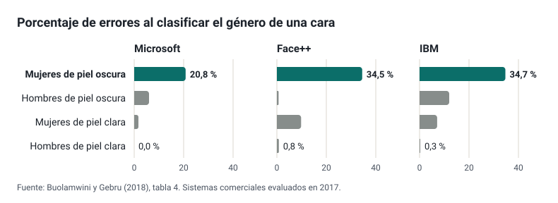

## Qué es ley y qué es prudencia

Muchas listas de «lo que no se puede hacer con IA» mezclan tres cosas de naturaleza muy distinta. En este módulo cada criterio lleva su origen:

Obligación legal
: Lo exige una norma, y se cita el artículo. No es opinable: se cumple o se incumple.

Recomendación institucional
: Lo aconseja una guía oficial (de la Comisión Europea, del Ministerio o de la Xunta), y se cita el documento. No obliga por sí misma, pero refleja el criterio de quien supervisa y conviene conocerlo.

Buena práctica
: Lo propone este curso, con su razonamiento. Es discutible, y está bien discutirlo.

Distinguirlas evita dos errores frecuentes: tratar como prohibido lo que solo es prudente, o como opcional lo que es obligatorio. También permite ver dónde una prohibición no tiene base legal ni técnica y se queda en poner puertas al campo. Lo que dice cada norma se desarrolla en [Normativa](normativa.md), y la relación con la formación oficial de la Xunta, en el [anexo](anexo-formacion-xunta.md).

## Tres filtros antes de usar una herramienta

La formación de la Xunta propone tres filtros, en este orden:[^xunta-filtros]

1. **Pertinencia.** ¿Aporta algo al aprendizaje o a mi trabajo que no consiga igual de bien de otra forma? Si la respuesta es no, no hace falta pasar a los demás.
2. **Ética.** ¿Respeta a las personas afectadas: su autonomía, su privacidad, un trato justo? Las directrices de la Comisión Europea para docentes, revisadas en 2026, lo concretan en preguntas sobre supervisión humana, transparencia, inclusión, equidad, bienestar, privacidad, solidez técnica y rendición de cuentas.[^directrices]
3. **Normativa.** ¿Lo permite la ley? Protección de datos, Reglamento de IA y normas educativas.

El orden importa. Una herramienta perfectamente legal puede no tener sentido en una tarea, y una que tiene mucho sentido puede ser ilegal con datos del alumnado.

## El residuo del pensamiento

La formación de la Xunta resume el riesgo pedagógico central en una cadena: una tarea **generada con IA**, **realizada con IA** y **evaluada con IA** deja al docente sin desarrollo profesional y al alumnado sin aprendizaje. Lo que queda, dice, es «o residuo do pensamento».[^xunta-residuo]

No es solo una intuición. En un ensayo controlado con casi mil estudiantes de matemáticas de un instituto de Turquía, quienes practicaron con un asistente tipo ChatGPT sin restricciones mejoraron un 48 % en los ejercicios de práctica, pero en el examen posterior, ya sin asistente, sacaron un 17 % menos que quienes nunca lo tuvieron. Con un asistente configurado para dar pistas en lugar de soluciones, ese efecto negativo desapareció en gran parte.[^bastani] Un estudio con programadores apunta en la misma dirección: quien usa la IA para que le explique aprende más que quien la usa para que le dé el resultado (se ve en [*Vibe coding*](../vibe-coding/index.md#en-los-ciclos-de-informática)).

**Buena práctica.** Diseña las tareas para que el pensamiento ocurra en algún sitio visible: el proceso, la explicación oral, la versión corregida, la decisión razonada. Y si el alumnado va a usar un asistente, que sea uno configurado para guiar y no para resolver, como los [modos tutor y los bots educativos](../bots-educativos/index.md).

## Sesgos

### De dónde salen

Un modelo aprende las regularidades de sus datos de entrenamiento, también las injustas: si un grupo está poco representado o aparece asociado a ciertos estereotipos, el sistema lo reproduce. El mecanismo se explica en [Cómo funciona un modelo de lenguaje](../intro-ia/funcionamiento.md#sesgos-un-reflejo-de-los-datos). Lo importante para un docente es que el sesgo no se ve en una respuesta suelta: aparece **al medir el error por grupos**.

### Dos casos medidos

El estudio *Gender Shades* evaluó en 2017 tres sistemas comerciales que clasificaban el género a partir de una foto de la cara. El error variaba enormemente según el grupo:[^gender-shades]

| Sistema | Mujeres de piel oscura | Hombres de piel oscura | Mujeres de piel clara | Hombres de piel clara |
| --- | --- | --- | --- | --- |
| Microsoft | 20,8 % | 6,0 % | 1,7 % | 0,0 % |
| Face++ | 34,5 % | 0,7 % | 9,8 % | 0,8 % |
| IBM | 34,7 % | 12,0 % | 7,1 % | 0,3 % |

El segundo caso está más cerca del aula. Cinco sistemas de reconocimiento de voz (de Amazon, Apple, Google, IBM y Microsoft) transcribieron entrevistas con hablantes de Estados Unidos: equivocaban de media el 35 % de las palabras de los hablantes negros y el 19 % de las de los blancos, también cuando decían exactamente las mismas frases.[^koenecke] Si usas transcripción automática con alumnado de acentos, variedades o lenguas poco representadas en los datos de entrenamiento, revisa el resultado antes de darlo por bueno.

### Los sesgos de quien usa la herramienta

La formación de la Xunta insiste en algo que se olvida a menudo: los humanos también tenemos sesgos, y los más relevantes aquí son el de confirmación y la tendencia a fiarnos de lo que suena seguro.[^xunta-nesgos] Una respuesta bien redactada que coincide con lo que esperábamos es justo la que menos revisamos. De ahí sale el **exceso de confianza** que la propia formación incluye entre los riesgos.

**Buena práctica.** Revisa con más cuidado las respuestas que confirman lo que ya pensabas, y prueba las herramientas con casos de alumnado distinto antes de usarlas con un grupo.

## Privacidad: la regla práctica

Los datos del alumnado los puede tratar el centro para su función educativa, con medidas de seguridad y con deber de sigilo para el profesorado.[^loe] Lo que no cubre esa habilitación es copiarlos en una herramienta que la administración no ha contratado: el proveedor no actúa por cuenta del centro, puede guardarlos o usarlos para entrenar, y no hay contrato que lo impida.

- **Obligación legal.** No introducir datos personales del alumnado (nombres, notas, informes, fotos, situaciones familiares) en herramientas que no estén contratadas o autorizadas por la administración educativa. El detalle está en [Normativa](normativa.md#protección-de-datos).
- **Buena práctica.** Trabajar con casos inventados o anonimizados de verdad: no basta con quitar el nombre si la combinación de datos («la única alumna de 2.º con discapacidad auditiva») identifica a la persona.
- **Buena práctica.** Preferir siempre las cuentas que proporciona el centro, como se ve en [Bots educativos](../bots-educativos/index.md#lo-primero-con-qué-cuenta-entra-el-alumnado).

Una demostración útil en clase: un modelo pequeño ejecutado en el propio ordenador, con programas gratuitos como Ollama o LM Studio, funciona **sin conexión a internet**. Desconecta la red y sigue respondiendo: es la prueba visible de que el modelo no necesita enviar nada fuera. Son modelos menos capaces que los de los *chatbots* comerciales, pero muestran que la cuestión de la privacidad depende de **dónde se ejecuta** el modelo.

## Autoría y evaluación

**Los detectores de texto generado por IA no son fiables.** OpenAI retiró el suyo en julio de 2023 «a causa de su bajo índice de precisión»: solo identificaba el 26 % de los textos generados por IA y marcaba como generados el 9 % de los escritos por personas.[^openai-clasificador] Un estudio con siete detectores encontró que clasificaban como generados por IA más de la mitad de las redacciones escritas por estudiantes de inglés como lengua extranjera, con una tasa media de falsos positivos del 61 %: penalizan precisamente a quien escribe con un vocabulario más sencillo.[^liang]

- **Buena práctica.** Nunca sancionar por el resultado de un detector. Como mucho, sirve para iniciar una conversación.
- **Buena práctica.** Reformular la evaluación, como pide la propia formación de la Xunta:[^xunta-conclusiones] valorar el proceso, pedir explicaciones orales, trabajar en clase las partes clave, pedir las versiones intermedias.
- **Recomendación institucional.** Pedir al alumnado que declare cómo ha usado la IA y enseñarle a citarla. Es una de las preguntas que las directrices europeas proponen a los docentes.[^directrices]
- **Buena práctica.** Indicar en tus materiales qué partes se han generado con IA. Ojo: el Reglamento de IA solo obliga a etiquetar las ultrasuplantaciones (*deepfakes*) y los textos publicados para informar al público sobre asuntos de interés público ([Normativa](normativa.md#transparencia)), no un material de clase normal.

Las trampas de texto oculto en los enunciados, y por qué no sirven para evaluar, se ven en [Técnicas avanzadas](../prompts/avanzado.md#trampas-de-texto-oculto-en-los-enunciados).

## Coste ambiental

Las cifras públicas más precisas son pocas y vienen de los propios proveedores. Google midió en 2025 que una consulta de texto mediana a Gemini consumía 0,24 Wh y 0,26 ml de agua, algo menos que ver nueve segundos de televisión; es su propia medición, y solo para texto.[^google-energia] El problema es el agregado: según la Agencia Internacional de la Energía, los centros de datos consumieron en 2024 alrededor del 1,5 % de la electricidad mundial (415 TWh), y prevé que esa cifra se duplique hasta unos 945 TWh en 2030, con la IA como principal motor.[^iea]

**Buena práctica.** Proporcionalidad: usar la IA cuando aporta algo, no por defecto, y preferir la generación de texto a la de imagen o vídeo cuando basta.

## Oportunidades y riesgos

La formación de la Xunta enumera las oportunidades y los riesgos de la IA en la educación, y reconoce que todavía faltan estudios sistemáticos e imparciales sobre sus efectos.[^xunta-conclusiones] Esta es la correspondencia de cada riesgo con lo que se trata en el curso:

| Riesgo | Qué hacer | Dónde se trata |
| --- | --- | --- |
| Privacidad y protección de datos | Datos del alumnado solo en herramientas contratadas por la administración | [Privacidad](#privacidad-la-regla-práctica) y [Normativa](normativa.md#protección-de-datos) |
| Vigilancia | Nada de sistemas que infieran emociones en el centro: está prohibido | [Normativa](normativa.md#prácticas-prohibidas) |
| Sesgos | Medir por grupos; revisar transcripciones y clasificaciones | [Sesgos](#sesgos) |
| Efecto filtro | Contrastar con fuentes; pedir las fuentes | [Chatbots](../chatbots/index.md#buscar-en-la-web-e-investigar-a-fondo) |
| Desconexión social | Que la IA no sustituya el trabajo en grupo ni la tutoría | [El residuo del pensamiento](#el-residuo-del-pensamiento) |
| Efectos en las capacidades | Tareas en las que el pensamiento sea visible | [El residuo del pensamiento](#el-residuo-del-pensamiento) |
| Inexactitudes y exceso de confianza | Comprobar en la fuente; desconfiar de lo que confirma lo esperado | [Cómo funciona](../intro-ia/funcionamiento.md#alucinaciones-plausible-no-es-verdadero) |
| Derechos de autor y plagio | Evaluar el proceso; declarar el uso de IA | [Autoría y evaluación](#autoría-y-evaluación) |
| Comercialización de la educación | Preferir herramientas contratadas y recursos abiertos | [Normativa](normativa.md#galicia) |
| Brecha digital | No exigir herramientas de pago ni cuentas personales | [Bots educativos](../bots-educativos/index.md) |
| Gasto energético | Proporcionalidad | [Coste ambiental](#coste-ambiental) |
| Manipulación y conflicto de intereses | Alfabetización en IA del alumnado | [Con el alumnado](#con-el-alumnado) |

## Para practicar

Toma las normas o consignas sobre IA de tu centro, de tu departamento o de tu programación, y etiqueta cada punto con su origen: obligación legal, recomendación institucional o buena práctica. Para cada obligación legal, busca el artículo en [Normativa](normativa.md); si no lo encuentras, probablemente no lo sea. Y para cada prohibición sin base legal, pregúntate qué riesgo intenta evitar y si hay una forma mejor de evitarlo.

## Con el alumnado

La mejor protección del alumnado es entender cómo funcionan estas herramientas: por qué se equivocan, de dónde salen sus sesgos, qué pasa con lo que escriben en ellas. El Plan integral de benestar dixital de la Xunta prevé incorporar a los currículos el uso responsable de la IA y un programa de formación del alumnado en alfabetización mediática, verificación de la información e IA (**recomendación institucional**).[^benestar] Muchos de los módulos de este curso sirven directamente para eso: la [demostración de la inyección de *prompts*](../navegadores-agenticos/index.md#una-demostración-segura), los casos de sesgo de esta página o la comparación de respuestas en [Chatbots](../chatbots/index.md).

[^xunta-filtros]: Xunta de Galicia, presentación *Intelixencia artificial (Ética e normativa en materia de Educación)*, p. 12. Su contenido completo, comentado, está en el [anexo](anexo-formacion-xunta.md).
[^directrices]: Comisión Europea, [*Guidelines on the ethical use of artificial intelligence and data in teaching and learning for educators*](https://data.europa.eu/doi/10.2766/7967834), edición revisada de 2026, apartado *Guiding questions for educators and school leaders*.
[^xunta-residuo]: Presentación de la Xunta, pp. 16–19.
[^bastani]: Bastani et al., [*Generative AI without guardrails can harm learning: Evidence from high school mathematics*](https://doi.org/10.1073/pnas.2422633122), PNAS, 2025.
[^gender-shades]: Buolamwini y Gebru, [*Gender Shades: Intersectional Accuracy Disparities in Commercial Gender Classification*](https://proceedings.mlr.press/v81/buolamwini18a.html), 2018, tabla 4. Gráfico propio con sus datos.
[^koenecke]: Koenecke et al., [*Racial disparities in automated speech recognition*](https://doi.org/10.1073/pnas.1915768117), PNAS, 2020.
[^xunta-nesgos]: Presentación de la Xunta, pp. 3–7 y 15.
[^loe]: Ley Orgánica 2/2006, de Educación, [disposición adicional vigesimotercera](https://www.boe.es/buscar/act.php?id=BOE-A-2006-7899#davigesimotercera).
[^openai-clasificador]: OpenAI, [*Nuevo clasificador de IA para detectar textos generados por IA*](https://openai.com/index/new-ai-classifier-for-indicating-ai-written-text/), nota añadida el 20 de julio de 2023.
[^liang]: Liang et al., [*GPT detectors are biased against non-native English writers*](https://arxiv.org/abs/2304.02819), Patterns, 2023.
[^xunta-conclusiones]: Presentación de la Xunta, pp. 70–71.
[^google-energia]: Elsworth et al. (Google), [*Measuring the environmental impact of delivering AI at Google Scale*](https://arxiv.org/abs/2508.15734), agosto de 2025.
[^iea]: Agencia Internacional de la Energía, [*Energy and AI*](https://www.iea.org/reports/energy-and-ai/executive-summary), 2025.
[^benestar]: Xunta de Galicia, [*Plan integral de benestar dixital de Galicia*](https://ficheiros-web.xunta.gal/plans/educacion-ciencia/plan-integral-benestar-dixital.pdf), 2026, actuaciones 18 y 19.
