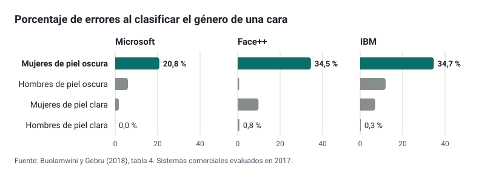

---
derived_from:
  es/etica-legal/index.md: "6fdd7dfa1d10dba1c17f9656b799cf4a236d79e9"
  es/etica-legal/normativa.md: "7ae49d1dea1555a7c7676f7d8ab12348bd6b1457"
---

<!-- .slide: id="ley-o-prudencia" class="statement" -->
## No todo lo que «no se puede hacer» con IA es ilegal

Separar lo que obliga la ley de lo que es prudencia.

---

<!-- .slide: id="tres-origenes" class="cards" -->
## Cada criterio, con su origen

### Obligación legal
Lo exige una norma: se cita el artículo.

### Recomendación institucional
Lo aconseja una guía oficial; no obliga por sí misma.

### Buena práctica
Lo propone el curso, razonado: se puede discutir.

Notas:
Distinguirlas evita tratar como prohibido lo que solo es prudente, o como opcional lo que es obligatorio, y deja ver dónde una prohibición se queda en poner puertas al campo.

---

<!-- .slide: id="tres-filtros" class="fragments" -->
## Tres filtros, en este orden

1. **Pertinencia**: ¿aporta algo que no consiga igual de bien de otra forma?
2. **Ética**: ¿respeta a las personas afectadas?
3. **Normativa**: ¿lo permite la ley?

Notas:
Son los filtros de la formación de la Xunta (p. 12). El orden importa: algo perfectamente legal puede no tener sentido en una tarea, y algo con mucho sentido puede ser ilegal con datos del alumnado.

---

<!-- .slide: id="residuo" class="statement" -->
## Generada con IA, hecha con IA, evaluada con IA: nadie aprende

Lo que queda es «o residuo do pensamento».

Notas:
La cadena es de la formación de la Xunta (pp. 16–19): sin desarrollo profesional del docente y sin aprendizaje del alumnado.

---

<!-- .slide: id="ensayo" class="big-number" -->
## La evidencia: practicar con IA sin restricciones empeora el examen

**−17 %** en el examen sin asistente, frente a quienes nunca lo tuvieron.

Bastani et al., PNAS 2025: casi mil estudiantes de secundaria.

Notas:
Con el asistente mejoraban un 48 % en la práctica. Con un asistente configurado para dar pistas en lugar de soluciones, el efecto negativo desaparecía en gran parte: de ahí los modos tutor y los bots educativos.

---

<!-- .slide: id="etapas" class="table" -->
## El sesgo entra por una etapa, y en cada una decide alguien

| Etapa | La decisión humana |
| --- | --- |
| Histórica | Usar el pasado para decidir sobre el futuro |
| Representación | Qué muestra se recoge |
| Medición | Qué se decide medir |
| Evaluación | Con quién se comprueba |
| Despliegue | Para qué se usa |

Notas:
Cinco de las siete fuentes de daño de Suresh y Guttag (2021). «La IA tiene sesgos» describe mal el problema: el sesgo entra en una etapa concreta, y en cada etapa hay una decisión humana. Lo importante para un docente es que no se ve en una respuesta suelta: aparece al medir el error por grupos.

---

<!-- .slide: id="gasto-sanitario" class="big-number" -->
## Medir el gasto en lugar de la necesidad

**46,5 %** de pacientes negros con atención adicional, en lugar del 17,7 %, si el algoritmo no hubiera predicho el gasto.

Obermeyer et al., Science 2019.

Notas:
El algoritmo predecía el gasto sanitario y no la enfermedad. Como, por un acceso desigual a la atención, se gasta menos en atender a los pacientes negros, a igual puntuación estaban bastante más enfermos. El modelo predecía bien lo que se le pidió: lo que estaba mal era la pregunta.

---

<!-- .slide: id="gender-shades" class="image-full" -->

Notas:
El sesgo no se ve en una respuesta suelta: aparece al medir el error por grupos. Tres sistemas comerciales que clasificaban el género por la cara, evaluados en 2017.

---

<!-- .slide: id="voz" class="big-number" -->
## También en la transcripción de voz

**35 %** de palabras mal transcritas a hablantes negros, frente al 19 % a hablantes blancos.

Koenecke et al., PNAS 2020: cinco sistemas comerciales.

Notas:
Incluso cuando decían exactamente las mismas frases. Con alumnado de acentos, variedades o lenguas poco representadas, revisa la transcripción antes de darla por buena. Este caso y el anterior son de la etapa de evaluación: los sistemas estaban en el mercado con un error muy distinto según el grupo, y solo se vio al medirlo.

---

<!-- .slide: id="regla-programada" class="statement" -->
## Una regla programada no es un sesgo aprendido

iTutorGroup rechazaba a las candidatas de 55 años o más porque alguien lo programó así (EEOC, 2023).

Notas:
Y a los candidatos de 60 o más: más de 200 personas cualificadas descartadas. Acordó pagar 365 000 dólares. A menudo se cita como un caso de discriminación por IA, pero no había ningún modelo que aprendiera nada. La presidenta de la EEOC: «incluso cuando la tecnología automatiza la discriminación, el empleador sigue siendo responsable». Antes de atribuir algo a «la IA», preguntar qué se decidió y quién lo decidió.

---

<!-- .slide: id="quien-responde" class="cards" -->
## Quién responde

### Obligación legal
Del sistema, quien lo desarrolla; de su uso, quien lo despliega.

### Recomendación institucional
«Cando unha IA erra… a responsabilidade é da persoa que usou a IA!» (Xunta).

### Buena práctica
Deja constancia de qué usaste, para qué y cómo lo revisaste.

Notas:
La regla de la Xunta es exacta para lo que hace cada docente con una herramienta: lo que usas, lo revisas y respondes de ello. Pero no es todo el reparto: el Reglamento de IA reparte las obligaciones entre quien desarrolla el sistema y quien lo despliega, el RGPD da derecho a no quedar sujeto a una decisión solo automatizada, y en la administración gallega una actuación apoyada en IA necesita la validación de una persona.

---

<!-- .slide: id="sesgo-propio" class="statement" -->
## Los sesgos también son nuestros: revisamos menos lo que confirma lo que esperábamos

Notas:
La formación de la Xunta insiste en ello (pp. 3–7): sesgo de confirmación y exceso de confianza en lo que suena seguro.

---

<!-- .slide: id="privacidad" class="comparison" -->
## Los datos del alumnado, solo donde la administración responde de ellos

### No
Nombres, notas, informes o fotos en un *chatbot* con cuenta personal.

### Sí
Herramientas contratadas por la administración, casos inventados o trabajos sin nada que diga de quién son.

Notas:
La LOE habilita al centro a tratar los datos que necesita, con seguridad, confidencialidad y deber de sigilo del profesorado. Un tercero que trate esos datos tiene que ser un encargado con contrato (art. 28 del RGPD). Quitar el nombre no basta si la combinación de datos identifica a la persona. Y quien envía un trabajo con el nombre cambiado por un código sigue tratando datos del alumno, porque guarda la tabla: reduce el riesgo, pero qué herramienta se puede usar lo decide la Consellería. Cómo hacerlo con trabajos, notas e informes está en el módulo Datos del alumnado.

**Demo (5 min): un modelo que funciona sin internet**. Ollama o LM Studio con un modelo pequeño ya descargado en el portátil.

1. Hacer una pregunta al modelo local y ver la respuesta.
2. Desconectar la red (wifi y cable).
3. Volver a preguntar: sigue respondiendo.
4. Hacer la misma pregunta a un *chatbot* comercial y comparar la calidad.

**Resultado esperado:** responde sin conexión, con peor calidad que un *chatbot* comercial.
**Si falla:** si no hay modelo descargado, contar el principio como se explica en la página y mostrarlo en otra sesión.
**Mensaje clave:** el problema no es «la IA», sino adónde van los datos.

---

<!-- .slide: id="detectores" class="big-number" -->
## Los detectores de IA no son fiables

**61 %** de redacciones de estudiantes de inglés como lengua extranjera marcadas como IA.

Liang et al., 2023: siete detectores.

Notas:
OpenAI retiró su propio detector en julio de 2023 por su baja precisión: detectaba el 26 % de los textos generados y marcaba el 9 % de los escritos por personas.

---

<!-- .slide: id="evaluar" -->
## Evaluar cuando existe la IA

- Nunca sancionar por el resultado de un detector.
- Valorar el proceso y las versiones intermedias.
- Explicaciones orales y trabajo en clase en las partes clave.
- Pedir que declaren cómo han usado la IA.

---

<!-- .slide: id="normativa" class="section" -->
## Lo que dice la ley

---

<!-- .slide: id="calendario" class="table dense" -->
## El Reglamento de IA se aplica por fases

| Desde | Qué cambia en un centro |
| --- | --- |
| 2 de febrero de 2025 | Prohibido inferir emociones del alumnado |
| 2 de agosto de 2026 | Avisar de que se habla con una IA; etiquetar *deepfakes* |
| 2 de diciembre de 2026 | Prohibidas las aplicaciones de desnudos falsos |
| 2 de diciembre de 2027 | Obligaciones para los sistemas educativos de alto riesgo |

Notas:
El Reglamento (UE) 2026/1744, el *Omnibus*, retrasó el alto riesgo (antes, 2 de agosto de 2026) y añadió las nuevas prohibiciones. Muchas guías, incluidas las directrices europeas para docentes, todavía dan las fechas antiguas.

---

<!-- .slide: id="emociones" class="statement" -->
## Prohibido desde 2025: inferir las emociones del alumnado

Una aplicación que el centro obliga a usar y que detecta interés o ansiedad ya lo incumple.

Notas:
Artículo 5.1.f del Reglamento de IA, con los ejemplos de las directrices de la Comisión: la misma aplicación de idiomas no está prohibida si se usa fuera del centro; seguir la mirada en un examen en línea tampoco, mientras no detecte nerviosismo.

---

<!-- .slide: id="alto-riesgo" class="cards" -->
## Alto riesgo en educación, desde diciembre de 2027

### Admisión
Decidir el acceso o distribuir al alumnado.

### Evaluación
Evaluar los resultados del aprendizaje.

### Nivel
Decidir el nivel educativo adecuado.

### Exámenes
Vigilar conductas prohibidas.

Notas:
Anexo III, punto 3. No es de alto riesgo lo que no influye sustancialmente en la decisión (artículo 6.3), salvo que elabore perfiles. Las obligaciones recaen sobre todo en la administración que implanta el sistema.

---

<!-- .slide: id="decision-humana" class="statement" -->
## Ninguna calificación puede salir solo de una herramienta

Lo impiden el RGPD (art. 22) y, en la administración gallega, la Lei 2/2025 (art. 12).

---

<!-- .slide: id="galicia-homologada" class="statement" -->
## En tramitación: solo IA homologada por la Consellería

Así lo anuncia la Xunta para la Lei de educación dixital, en el Parlamento desde julio de 2026.

Notas:
También prohibiría las decisiones basadas solo en IA, el control automatizado del comportamiento o el rendimiento, la identificación de condiciones como el TEA o el TDAH y el reconocimiento facial. Es un texto en tramitación: puede cambiar.

---

<!-- .slide: id="practica-etiquetar" class="practice" -->
## Ley, recomendación o prudencia

1. Toma las normas sobre IA de tu centro o de tu programación.
2. Etiqueta cada punto con su origen.
3. Para cada obligación legal, busca el artículo en la página de normativa.
4. Para cada prohibición sin base, piensa qué riesgo intenta evitar.

**15 minutos.** Producto: unas normas con su origen a la vista.

Notas:
Por grupos de departamento. Lo interesante sale al compartir: qué «prohibiciones» no tenían base y qué obligaciones legales nadie conocía.
