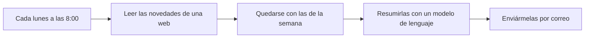

> [!NOTE]
> **Módulo avanzado**
> Para seguirlo hace falta instalar un programa en tu ordenador (o contratar el servicio en la nube) y no tener miedo a configurar cosas. No hace falta saber programar.

## Qué es una automatización

Una automatización, o **flujo de trabajo** (*workflow*), es una secuencia fija de pasos que se ejecuta sola cuando ocurre algo: a una hora, al llegar un correo, al enviarse un formulario. Es como una receta que el ordenador sigue sin ti, paso a paso, cada vez que se dan las condiciones.



Conviene situarla respecto a lo que ya se ha visto en el curso:

*Chatbot*
: Responde cuando le preguntas. Si no abres el chat, no hace nada.

Automatización
: Ejecuta siempre los mismos pasos, sin que estés delante. Es predecible: el camino lo has fijado tú.

[Agente](../intro-ia/index.md#modelo-chatbot-y-agente)
: Decide él mismo los pasos para cumplir un objetivo. Es más flexible y menos predecible.

Una automatización puede incluir un modelo de lenguaje en uno de sus pasos (para resumir, clasificar o redactar) e incluso un agente, pero el esqueleto lo decides tú.

## n8n

[n8n](https://n8n.io) es una herramienta para construir estos flujos de forma visual: cada paso es una caja (un **nodo**) que se conecta con la siguiente. Tiene nodos para cientos de servicios (Gmail, Google Sheets, Telegram, RSS, formularios, bases de datos, cualquier web con API) y nodos de IA para usar modelos de lenguaje y agentes.

Su licencia no es de software libre en sentido estricto. Es lo que la empresa llama *fair-code*: se puede usar, modificar e instalar gratis para uso interno, personal o no comercial, pero no ofrecerlo como servicio a terceros ni revenderlo.[^licencia] Para un docente o un centro que automatiza su propio trabajo, es gratuito.

| | n8n Cloud | Instalado por ti (*Community Edition*) |
| --- | --- | --- |
| Instalación | Ninguna: se usa en el navegador | En tu ordenador o en un servidor |
| Coste | De pago, con prueba gratuita sin tarjeta; el plan básico ronda los 20 € al mes con pago anual | Gratuito |
| Funciona cuando | Siempre | Mientras el equipo esté encendido |
| Tus datos | En servidores de Azure en la UE (Alemania y Suecia); sus condiciones incluyen un contrato de encargo del tratamiento | En tu equipo; n8n no recibe los datos de los flujos |
| Extras | Asistente que construye flujos a partir de una descripción, y modelos de IA sin necesidad de clave propia | Hay que conectar tus propias claves de API |

Fuentes: [precios de n8n](https://n8n.io/pricing/), [privacidad](https://docs.n8n.io/privacy-and-security/privacy.md) y [subencargados](https://n8n.io/legal/sub-processors/), consultados el 22 de octubre de 2026.

## Instalarlo en tu ordenador

La forma más limpia es con [Docker](https://www.docker.com) (que ya hay que tener instalado). Estos dos comandos, de la [documentación oficial](https://docs.n8n.io/hosting/installation/docker/), crean un volumen para guardar los datos y arrancan n8n con la zona horaria de España:

```bash
docker volume create n8n_data
docker run -it --rm --name n8n -p 5678:5678 \
  -e GENERIC_TIMEZONE="Europe/Madrid" -e TZ="Europe/Madrid" \
  -e N8N_ENFORCE_SETTINGS_FILE_PERMISSIONS=true \
  -v n8n_data:/home/node/.n8n \
  n8nio/n8n
```

Si tienes Node.js (entre las versiones 20.19 y 24), también puedes probarlo sin instalar nada con `npx n8n`. En los dos casos, n8n se abre en el navegador en `http://localhost:5678`, y la primera vez te pide crear una cuenta de administración local.

## Cómo se construye un flujo

Disparador
: El nodo que pone en marcha el flujo: una hora fija (*Schedule Trigger*), un formulario, un mensaje en un chat, una novedad en un RSS, un correo que llega.

Nodos
: Cada paso: leer, filtrar, transformar, llamar a un modelo, enviar. Cada nodo recibe datos del anterior, hace su trabajo y pasa el resultado al siguiente.

Elementos
: Los datos viajan como una lista de elementos (por ejemplo, una entrada de RSS por elemento), y cada nodo se ejecuta una vez por elemento.

Expresiones
: Para usar en un nodo un dato de un paso anterior se escribe entre dobles llaves: `{{ $json.title }}` es el título del elemento que se está procesando.

Credenciales
: Las cuentas y claves que usan los nodos (tu Gmail, tu clave de API). Se guardan aparte, cifradas; al exportar un flujo viajan su nombre y su identificador, pero no la clave.

Los flujos se guardan como ficheros JSON: se pueden descargar, compartir e importar, y también **copiar y pegar** directamente en el lienzo.[^importar] Eso permite pedirle a un *chatbot* un flujo ya hecho («dame el JSON de un flujo de n8n que…»), pegarlo y revisarlo nodo a nodo. En n8n Cloud, el asistente integrado hace lo mismo desde el propio editor.

## Un ejemplo: las novedades del BOE en tu correo

El BOE publica un canal RSS con las disposiciones sobre «Educación y enseñanza». Este flujo te las resume cada lunes:

1. **Schedule Trigger**: cada lunes a las 8:00.
2. **RSS Read**, con la dirección `https://www.boe.es/rss/canal_leg.php?l=l&c=114`.
3. **Filter**: solo los elementos publicados en los últimos siete días.
4. **Un nodo de modelo de lenguaje** con estas instrucciones:

   ```text
   Resume esta disposición del BOE en una frase para docentes de secundaria y FP.
   Indica a quién afecta y si cambia algo en su trabajo. Si no les afecta, dilo.
   No añadas nada que no esté en el texto.

   Título: {{ $json.title }}
   Enlace: {{ $json.link }}
   ```

5. **Send Email** o **Gmail**: un único correo para ti con todos los resúmenes y sus enlaces.

No maneja datos personales, cada resumen va con su enlace para comprobarlo y, si falla, no pasa nada grave. Por eso es un buen primer flujo.

## Agentes dentro de un flujo

El nodo **AI Agent** convierte un paso en un agente: recibe un objetivo, un modelo de lenguaje y unas herramientas (otros nodos: buscar en una hoja de cálculo, consultar una web, enviar un mensaje) y decide cuáles usar y en qué orden. Es potente, pero recupera los riesgos que se ven en [Navegadores con agentes](../navegadores-agenticos/index.md#el-riesgo-principal-la-inyección-de-prompts): un agente que lee correos de cualquiera y puede enviar correos es la «tríada letal» completa.

n8n permite exigir **aprobación humana** antes de que el agente use una herramienta concreta: el flujo se detiene y alguien aprueba o rechaza la acción con sus datos a la vista.[^aprobacion] Para cualquier herramienta que envíe, publique, modifique o borre, conviene activarla.

## Qué automatizar en un centro, y qué no

Buenos candidatos
: Tareas sin datos personales o solo con los tuyos: boletines de novedades, recordatorios de plazos, avisos cuando cambia una web, conversión de materiales entre formatos, copias de seguridad de tus documentos.

Con mucho cuidado
: Todo lo que toque datos del alumnado o de las familias. n8n **guarda los datos de cada ejecución**, incluido lo que pasó por cada nodo. Lo que se envía al modelo de lenguaje llega a su proveedor, y la responsabilidad del tratamiento es del centro. Antes de automatizar algo así hay que saber dónde se ejecuta, quién accede, cuánto tiempo se guarda (n8n recomienda borrar las ejecuciones antiguas automáticamente[^privacidad]) y si el centro lo autoriza. El marco legal está en [Normativa](../etica-legal/normativa.md#protección-de-datos).

No
: Decisiones sobre el alumnado (calificaciones, sanciones, admisiones) sin revisión humana.

Dos detalles prácticos. Primero, n8n no tiene un nodo para Moodle: se puede conectar con su API web mediante el nodo *HTTP Request*, pero eso requiere un permiso que solo concede la administración del aula virtual. Segundo, si lo instalas tú, n8n envía por defecto datos técnicos de uso (versión, número de flujos, errores), aunque nunca el contenido de los flujos. Quien administra la instalación puede desactivarlo.[^privacidad]

## Alternativas

- **Zapier** y **Make** ofrecen lo mismo como servicio en la nube, con muchas integraciones listas, pero sin la opción de instalarlos en tu propio equipo.
- **Power Automate**, si el centro trabaja con Microsoft 365.
- Para tareas sencillas, algunos asistentes ya programan tareas periódicas, como Claude en Chrome.

[^licencia]: n8n, [*Community license*](https://docs.n8n.io/n8n-community-license/community-license.md) y [*License FAQ*](https://docs.n8n.io/n8n-community-license/community-license/license-faq.md), consultados el 22 de octubre de 2026.
[^importar]: n8n, [*Export and import*](https://docs.n8n.io/build/manage-workflows/export-and-import.md).
[^aprobacion]: n8n, [*Human-in-the-loop for tools*](https://docs.n8n.io/build/integrate-ai/ai-examples/human-in-the-loop-for-tools.md).
[^privacidad]: n8n, [*Privacy*](https://docs.n8n.io/privacy-and-security/privacy.md), consultado el 22 de octubre de 2026.
