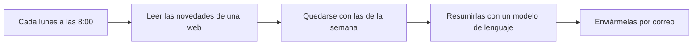

> [!NOTE]
> **Módulo avanzado**
> No hace falta instalar nada ni saber programar, pero sí crear una cuenta en un servicio de automatización, conectarle otras cuentas (el correo, una hoja de cálculo) y no tener miedo a configurar cosas.

## Qué es una automatización

Una automatización, o **flujo de trabajo** (*workflow*), es una secuencia fija de pasos que se ejecuta sola cuando ocurre algo: a una hora, al llegar un correo, al enviarse un formulario. Es como una receta que el ordenador sigue sin ti, paso a paso, cada vez que se dan las condiciones.



Conviene situarla respecto a lo que ya se ha visto en el curso:

*Chatbot*
: Responde cuando le preguntas. Si no abres el chat, no hace nada.

Automatización
: Ejecuta siempre los mismos pasos, sin que estés delante. Es predecible: el camino lo has fijado tú.

[Agente](../intro-ia/index.md#modelo-chatbot-y-agente)
: Decide él mismo los pasos para cumplir un objetivo. Es más flexible y menos predecible.

Una automatización puede incluir un modelo de lenguaje en uno de sus pasos (para resumir, clasificar o redactar) e incluso un agente, pero el esqueleto lo decides tú.

## Las herramientas

Hay varias herramientas para construir estos flujos de forma visual, sin programar: cada paso es una caja que se conecta con la siguiente. Se usan en el navegador, con una cuenta, y todas tienen conectores para cientos de servicios (Gmail, Google Sheets, Telegram, formularios, RSS). Lo que cambia es el precio, dónde quedan los datos y lo que permite el plan gratuito, como añadir un paso con un modelo de lenguaje.

| Herramienta | Sin pagar | Dónde quedan los datos |
| --- | --- | --- |
| Zapier | Plan gratuito de 100 tareas al mes, pero solo con flujos de dos pasos (un disparador y una acción) y sin pasos de IA | En Estados Unidos, sin opción de alojarlos en la UE |
| Make | Plan gratuito de 1000 créditos al mes; los flujos programados se ejecutan, como mucho, cada 15 minutos | En la UE o en Estados Unidos, según se elija al registrarse; después no se puede cambiar |
| n8n Cloud | Prueba de 14 días sin tarjeta; después, desde 20 € al mes con pago anual | En la UE, en servidores de Azure en Alemania y Suecia |
| Power Automate | Incluido en las licencias educativas de Microsoft 365 (A1, A3 y A5), solo con los conectores estándar | En el Microsoft 365 de la cuenta educativa |

El flujo de ejemplo de este módulo tiene cuatro pasos y usa un modelo de lenguaje, así que no cabe en el plan gratuito de Zapier.[^herramientas]

Para tareas sencillas ni siquiera hace falta un flujo: algunos asistentes ya programan tareas periódicas, como Claude en Chrome.

## n8n

Los ejemplos de este módulo usan [n8n](https://n8n.io), por dos razones: su galería de flujos de ejemplo se puede ver nodo a nodo sin crear cuenta, y, a diferencia de Zapier y Make, también se puede instalar en un servidor propio. Tiene nodos para cientos de servicios y nodos de IA para usar modelos de lenguaje y agentes. La versión en la nube, n8n Cloud, incluye además un asistente que construye flujos a partir de una descripción, y modelos de IA que se pueden usar sin clave propia.

Instalarlo es gratis, pero su licencia no es de software libre en sentido estricto. Es lo que la empresa llama *fair-code*: se puede usar, modificar e instalar gratis para uso interno, personal o no comercial, pero no ofrecerlo como servicio a terceros ni revenderlo.[^licencia] Con una instalación propia, los datos de los flujos se quedan en ese servidor y n8n no los recibe.[^privacidad] Es una tarea para quien administre los sistemas del centro, con la [guía oficial de instalación](https://docs.n8n.io/hosting/).

## Cómo se construye un flujo

Todas estas herramientas se basan en las mismas piezas, aunque las llamen de otra forma (en Zapier, los pasos son *acciones*; en Make, *módulos*). Estos son los nombres de n8n:

Disparador
: El nodo que pone en marcha el flujo: una hora fija (*Schedule Trigger*), un formulario, un mensaje en un chat, una novedad en un RSS, un correo que llega.

Nodos
: Cada paso: leer, filtrar, transformar, llamar a un modelo, enviar. Cada nodo recibe datos del anterior, hace su trabajo y pasa el resultado al siguiente.

Elementos
: Los datos viajan como una lista de elementos (por ejemplo, una entrada de RSS por elemento), y cada nodo se ejecuta una vez por elemento.

Expresiones
: Para usar en un nodo un dato de un paso anterior, se arrastra el campo desde el panel de entrada del nodo.[^arrastrar] n8n lo escribe como una expresión entre dobles llaves: `{{ $json.title }}` es el título del elemento que se está procesando.

Credenciales
: Las cuentas y claves que usan los nodos (tu Gmail, tu clave de API). Se guardan aparte, cifradas; al exportar un flujo viajan su nombre y su identificador, pero no la clave.

Los flujos se guardan como ficheros JSON: se pueden descargar, compartir e importar, y también **copiar y pegar** directamente en el lienzo.[^importar] Eso permite pedirle a un *chatbot* un flujo ya hecho («dame el JSON de un flujo de n8n que…»), pegarlo y revisarlo nodo a nodo. En n8n Cloud, el asistente integrado hace lo mismo desde el propio editor.

## Un ejemplo: las novedades del BOE en tu correo

El BOE publica un canal RSS con las disposiciones sobre «Educación y enseñanza». Este flujo te las resume cada lunes:

1. **Schedule Trigger**: cada lunes a las 8:00.
2. **RSS Read**, con la dirección `https://www.boe.es/rss/canal_leg.php?l=l&c=114`.
3. **Filter**: solo los elementos publicados en los últimos siete días.
4. **Un nodo de modelo de lenguaje** con estas instrucciones:

   ```text
   Resume esta disposición del BOE en una frase para docentes de secundaria y FP.
   Indica a quién afecta y si cambia algo en su trabajo. Si no les afecta, dilo.
   No añadas nada que no esté en el texto.

   Título: {{ $json.title }}
   Enlace: {{ $json.link }}
   ```

5. **Send Email** o **Gmail**: un único correo para ti con todos los resúmenes y sus enlaces.

No maneja datos personales, cada resumen va con su enlace para comprobarlo y, si falla, no pasa nada grave. Por eso es un buen primer flujo.

En la [galería de n8n](https://n8n.io/workflows/) hay flujos parecidos ya montados, que se pueden ver nodo a nodo sin crear cuenta. [Este boletín semanal de varios canales RSS](https://n8n.io/workflows/16037-send-a-weekly-aicurated-rss-digest-email-with-openai-and-gmail/), por ejemplo, se pone en marcha los lunes a las 8:00, lee los canales, se queda con los artículos más relevantes, pide el resumen a un modelo de OpenAI y lo envía con Gmail. Es más elaborado que el del BOE, con dos nodos que llevan código, pero el recorrido es el mismo.

## Agentes dentro de un flujo

El nodo **AI Agent** convierte un paso en un agente: recibe un objetivo, un modelo de lenguaje y unas herramientas (otros nodos: buscar en una hoja de cálculo, consultar una web, enviar un mensaje) y decide cuáles usar y en qué orden. Es potente, pero recupera los riesgos que se ven en [Navegadores con agentes](../navegadores-agenticos/index.md#el-riesgo-principal-la-inyección-de-prompts): un agente que lee correos de cualquiera y puede enviar correos es la «tríada letal» completa.

n8n permite exigir **aprobación humana** antes de que el agente use una herramienta concreta: el flujo se detiene y alguien aprueba o rechaza la acción con sus datos a la vista.[^aprobacion] Para cualquier herramienta que envíe, publique, modifique o borre, conviene activarla.

## Qué automatizar en un centro, y qué no

Buenos candidatos
: Tareas sin datos personales o solo con los tuyos: boletines de novedades, recordatorios de plazos, avisos cuando cambia una web, conversión de materiales entre formatos, copias de seguridad de tus documentos.

Solo en herramientas autorizadas
: Todo lo que toque datos del alumnado o de las familias. Un servicio de automatización con tu cuenta es, como un *chatbot* con cuenta personal, una plataforma externa: los datos personales solo van a herramientas que la administración educativa haya contratado o autorizado ([Datos del alumnado](../datos-alumnado/index.md#la-pregunta-previa-necesita-la-ia-los-datos)). Además, lo que se envía al modelo de lenguaje llega a su proveedor, y n8n Cloud **guarda los datos de cada ejecución**, incluido lo que pasó por cada nodo, durante el tiempo que fije tu plan.[^privacidad]

No
: Decisiones sobre el alumnado (calificaciones, sanciones, admisiones) sin revisión humana.

Un detalle práctico: n8n no tiene un nodo para Moodle. Se puede conectar con su API web mediante el nodo *HTTP Request*, pero eso requiere un permiso que solo concede la administración del aula virtual.

[^herramientas]: Precios y condiciones de [Zapier](https://zapier.com/pricing) ([pasos de IA](https://help.zapier.com/hc/en-us/articles/8496342944013), [alojamiento de los datos](https://zapier.com/legal/data-privacy)), [Make](https://www.make.com/en/pricing) ([intervalo mínimo](https://academy-content.make.com/courses/make-basics-modules/05-scheduling-your-scenario/), [centros de datos](https://help.make.com/organizations)), [n8n](https://n8n.io/pricing/) ([prueba gratuita](https://docs.n8n.io/deploy/use-n8n-cloud/start-your-free-trial)) y [Power Automate](https://learn.microsoft.com/en-us/power-platform/admin/power-automate-licensing/faqs), consultados el 5 de noviembre de 2026. Los servidores de n8n Cloud, en su lista de [subencargados](https://n8n.io/legal/sub-processors/), consultada el 22 de octubre de 2026.
[^arrastrar]: n8n, [*Use the UI mapper*](https://docs.n8n.io/build/work-with-data/reference-data/use-the-ui-mapper.md).
[^licencia]: n8n, [*Community license*](https://docs.n8n.io/n8n-community-license/community-license.md) y [*License FAQ*](https://docs.n8n.io/n8n-community-license/community-license/license-faq.md), consultados el 22 de octubre de 2026.
[^importar]: n8n, [*Export and import*](https://docs.n8n.io/build/manage-workflows/export-and-import.md).
[^aprobacion]: n8n, [*Human-in-the-loop for tools*](https://docs.n8n.io/build/integrate-ai/ai-examples/human-in-the-loop-for-tools.md).
[^privacidad]: n8n, [*Privacy*](https://docs.n8n.io/privacy-and-security/privacy.md), consultado el 5 de noviembre de 2026.
