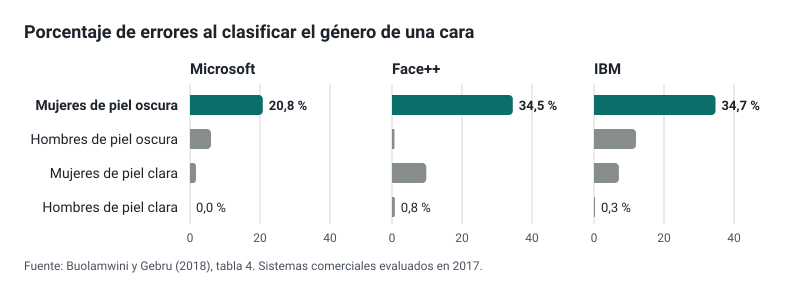
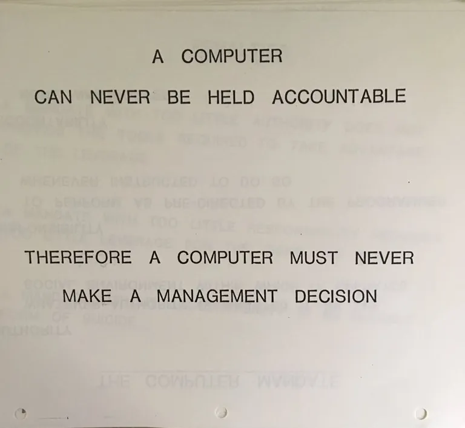

## Que é lei e que é prudencia

Moitas listas do «que non se pode facer con IA» mesturan tres cousas de natureza moi distinta. Neste módulo cada criterio leva a súa orixe:

Obriga legal
: Esíxeo unha norma, e cítase o artigo. Non é opinable: cúmprese ou incúmprese.

Recomendación institucional
: Aconséllao unha guía oficial (da Comisión Europea, do Ministerio ou da Xunta), e cítase o documento. Non obriga por si mesma, pero reflicte o criterio de quen supervisa e convén coñecelo.

Boa práctica
: Propóno este curso, co seu razoamento. É discutible, e está ben discutilo.

Distinguilas evita dous erros frecuentes: tratar como prohibido o que só é prudente, ou como opcional o que é obrigatorio. Tamén permite ver onde unha prohibición non ten base legal nin técnica e queda en poñerlle portas ao campo. O que di cada norma desenvólvese en [Normativa](normativa.md).

## Tres filtros antes de usar unha ferramenta

Hai tres preguntas que facerse, nesta orde:[^xunta-filtros]

1. **Pertinencia.** Achega algo á aprendizaxe ou ao meu traballo que non consiga igual de ben doutra forma? Se a resposta é non, non fai falla pasar aos demais.
2. **Ética.** Respecta as persoas afectadas: a súa autonomía, a súa privacidade, un trato xusto? As directrices da Comisión Europea para docentes, revisadas en 2026, concrétano en preguntas sobre supervisión humana, transparencia, inclusión, equidade, benestar, privacidade, solidez técnica e rendición de contas.[^directrices]
3. **Normativa.** Permíteo a lei? Protección de datos, Regulamento de IA e normas educativas.

A orde importa. Unha ferramenta perfectamente legal pode non ter sentido nunha tarefa, e unha que ten moito sentido pode ser ilegal con datos do alumnado.

## Aprender con IA: unha pregunta aberta

Canto convén usar a IA para aprender, e canto para avaliar, aínda non ten unha resposta xeral. O que si hai son uns poucos estudos ben deseñados que ensinan que mirar.

O máis citado é un ensaio con case mil estudantes de matemáticas dun instituto de Turquía, no curso 2023-2024. O acceso a un asistente baseado en GPT-4 repartiuse ao chou, e iso permite atribuírlle á ferramenta as diferenzas entre grupos. Os que practicaron co asistente sen restricións melloraron un 48 % nos exercicios de práctica, pero no exame posterior, xa sen el, sacaron un 17 % menos ca os que nunca o tiveron. Cun asistente configurado para dar pistas en lugar de solucións, ese efecto negativo desapareceu en boa parte.[^bastani] Un estudo con 52 programadores atopou algo parecido: os que usaron un asistente para aprender unha biblioteca nova sacaron peor nota nun cuestionario posterior ca os que non o usaron (vese en [*Vibe coding*](../vibe-coding/index.md#en-los-ciclos-de-informática)).

A lección que deixan é unha distinción: **render máis coa ferramenta non é aprender máis**. O aprendido é o que queda cando se retira. Pero estes estudos non abondan para establecer unha regra xeral:

- **Cada un é un só contexto.** Repartir ao chou é a mellor forma de saber se a ferramenta causou a diferenza, pero só nas condicións do estudo: unha materia, un centro, un país, unha versión do modelo e un momento en que estas ferramentas eran novas. Para xeneralizar fan falta réplicas noutras materias, idades e centros.
- **Miden o curto prazo.** Os dous comproban o que queda pouco despois de practicar, non o que pasa ao longo dun curso.
- **Non todas as súas conclusións teñen a mesma solidez.** No de Turquía, o tipo de asistente (con solucións ou con pistas) tamén se repartiu ao chou. No de programadores, pola contra, cadaquén escolleu como usar a IA: os que lle pedían explicacións puntuaron mellor ca os que só lle pedían código, pero eran grupos de entre 2 e 7 persoas, e quen pide explicacións quizais é tamén quen máis quere aprender. Os propios autores advirten que esa comparación non establece unha relación causal.[^anthropic-aprendizaje]

Hai ademais unha pregunta previa que ningún estudo responde por ti: **que ten que saber facer o alumnado sen a ferramenta**. Depende da especialidade e do resultado de aprendizaxe. Nun ciclo de informática, traballar cun asistente pode formar parte da competencia profesional; en matemáticas, o obxectivo pode ser xusto o contrario, razoar sen axuda. Coa avaliación pasa o mesmo: a nota decídela ti ([Datos do alumnado](../datos-alumnado/index.md#retroalimentación-sobre-una-redacción-o-un-trabajo)), pero canto pode axudarche a IA a preparar correccións e comentarios sen que perdas o que aprendes corrixindo é outra pregunta aberta.[^xunta-residuo] Son dúbidas que cada especialidade irá resolvendo coa práctica docente e con máis investigación.

**Boa práctica.** Trata cada decisión como unha hipótese: se permites a IA nunha tarefa, comproba despois que sabe facer o alumnado sen ela. Deseña as tarefas para que o pensamento quede á vista (o proceso, a explicación oral, a versión corrixida, a decisión razoada). E se o alumnado vai usar un asistente, que sexa un configurado para guiar e non para resolver, como os [modos titor e os bots educativos](../bots-educativos/index.md).

## Nesgos

### De onde entra o nesgo

Un modelo aprende as regularidades dos seus datos de adestramento, tamén as inxustas: se un grupo está pouco representado ou aparece asociado a certos estereotipos, o sistema reprodúceo. O mecanismo explícase en [Como funciona un modelo de linguaxe](../intro-ia/funcionamiento.md#sesgos-un-reflejo-de-los-datos). Pero «a IA ten nesgos» describe mal o problema: o nesgo entra nunha etapa concreta da construción ou do uso dun sistema, e en cada etapa hai unha decisión humana. Suresh e Guttag distinguen sete fontes de dano ao longo da vida dun sistema de aprendizaxe automática;[^suresh] cinco delas recoñécense ben desde un centro educativo:

| Etapa | Que pasa | A decisión humana |
| --- | --- | --- |
| Histórica | O mundo do que saen os datos xa era desigual, e o modelo apréndeo aínda que os datos estean perfectamente medidos | Usar o pasado para decidir sobre o futuro |
| Representación | Un grupo aparece pouco nos datos cos que se desenvolve o sistema, e o sistema funciona peor con el | Que mostra se recolle |
| Medición | O que se predí é un substituto (*proxy*) do que importa: a nota media polo éxito académico, o gasto sanitario pola necesidade de atención | Que se decide medir |
| Avaliación | Os datos cos que se comproba o sistema non representan a quen o vai usar | Con quen se comproba |
| Despregamento | O sistema úsase para algo distinto do que debía resolver | Para que se usa |

O caso do gasto sanitario é o máis claro. Un algoritmo comercial moi estendido, co que os sistemas sanitarios decidían que pacientes con necesidades complexas recibían atención adicional, predicía o gasto sanitario e non a enfermidade. Como, por un acceso desigual á atención, se gasta menos diñeiro en atender os pacientes negros, a igual puntuación estaban bastante máis enfermos ca os brancos. Corrixilo tería subido do 17,7 % ao 46,5 % a proporción de pacientes negros que recibían esa axuda.[^obermeyer] O modelo predicía ben o que se lle pediu: o que estaba mal era a pregunta.

O importante para un docente é que o nesgo non se ve nunha resposta solta: aparece **ao medir o erro por grupos**.

### Dous casos medidos

O estudo *Gender Shades* avaliou en 2017 tres sistemas comerciais que clasificaban o xénero a partir dunha foto da cara. O erro variaba enormemente segundo o grupo:[^gender-shades]

| Sistema | Mulleres de pel escura | Homes de pel escura | Mulleres de pel clara | Homes de pel clara |
| --- | --- | --- | --- | --- |
| Microsoft | 20,8 % | 6,0 % | 1,7 % | 0,0 % |
| Face++ | 34,5 % | 0,7 % | 9,8 % | 0,8 % |
| IBM | 34,7 % | 12,0 % | 7,1 % | 0,3 % |

O segundo caso está máis preto da aula. Cinco sistemas de recoñecemento de voz (de Amazon, Apple, Google, IBM e Microsoft) transcribiron entrevistas con falantes dos Estados Unidos: equivocaban de media o 35 % das palabras dos falantes negros e o 19 % das dos brancos, tamén cando dicían exactamente as mesmas frases.[^koenecke] Se usas transcrición automática con alumnado de acentos, variedades ou linguas pouco representadas nos datos de adestramento, revisa o resultado antes de dalo por bo.

Os dous casos son da etapa de avaliación: os sistemas estaban no mercado cun erro moi distinto segundo o grupo, e a diferenza só apareceu cando alguén o mediu por grupos.

### Unha regra programada non é un nesgo aprendido

Non todo o que se conta como discriminación da IA o é. En 2023, a empresa de titorías en liña iTutorGroup acordou pagar 365 000 dólares para pechar unha demanda da Comisión para a Igualdade de Oportunidades no Emprego dos Estados Unidos (EEOC). Segundo a demanda, programara a súa aplicación de selección de titores para rexeitar automaticamente as candidatas de 55 anos ou máis e os candidatos de 60 ou máis, e así descartou máis de 200 persoas cualificadas.[^eeoc] A EEOC presentou o caso dentro da súa iniciativa sobre IA e equidade algorítmica, e a miúdo cítase como un caso de discriminación por IA. Pero non había ningún modelo que aprendese nada: era unha regra escrita por persoas. Resumiuno a presidenta da EEOC: «mesmo cando a tecnoloxía automatiza a discriminación, o empregador segue sendo responsable» (tradución propia).

Antes de atribuírlle algo á «IA», convén preguntar que se decidiu e quen o decidiu.

### Quen responde

Que o nesgo entre por unha decisión humana non quere dicir que responda sempre a mesma persoa:

- **Obriga legal.** O Regulamento de IA reparte as obrigas entre quen desenvolve o sistema e quen o desprega ([quen é quen](normativa.md#quién-es-quién)). Toda persoa ten dereito a non ser obxecto dunha decisión baseada unicamente nun tratamento automatizado que lle afecte significativamente ([artigo 22 do RXPD](normativa.md#decisiones-automatizadas-y-evaluaciones-de-impacto)). E na administración galega, unha actuación apoiada en IA non é unha decisión administrativa sen a validación da persoa titular do órgano competente ([a lei galega de IA](normativa.md#la-ley-gallega-de-ia)).
- **Recomendación institucional.** Se unha IA erra, a responsabilidade é da persoa que a usou.[^xunta-nesgos] Para o que fas ti cunha ferramenta é exactamente así: o que usas, revísalo e respondes diso. Pero non é todo o reparto: do sistema responde quen o constrúe, e de implantalo, a administración que o desprega.
- **Boa práctica.** Deixa constancia de que ferramenta usaches, para que e como revisaches o resultado. É o que che permite responder diso.

A idea de fondo non é nova. Unha páxina atribuída a unha formación interna de IBM de 1979 resumíao así: «Un ordenador nunca pode render contas; polo tanto, un ordenador nunca debe tomar unha decisión de xestión» (tradución propia).[^ibm-1979] Décadas despois, o RXPD e a lei galega de IA recollen esa mesma idea, cada un á súa maneira: o dereito a non quedar suxeito a unha decisión só automatizada, e a validación obrigatoria por unha persoa. Ningún prohíbe usar a ferramenta; esixen que alguén decida e responda da decisión.

{.narrow}

### Os nesgos de quen usa a ferramenta

Esquécese a miúdo que os humanos tamén temos nesgos, e aquí pesan dous.[^xunta-nesgos] O primeiro é o **nesgo de confirmación**: buscamos e aceptamos con máis facilidade o que coincide co que xa pensabamos, un fenómeno que a psicoloxía documentou en contextos moi distintos.[^nickerson] Unha resposta ben redactada que coincide co que agardabamos é xusto a que menos revisamos.

O segundo é o **nesgo de automatización**: a tendencia a fiarnos de máis do que propón unha máquina. Unha revisión sistemática de 74 estudos, sobre todo de medicina e aviación, descríbeo con dúas caras: seguir un consello erróneo e non actuar cando o sistema non avisa. En catro estudos clínicos que se puideron combinar, cando o sistema de apoio se equivocaba, o risco de tomar unha decisión incorrecta subía un 26 %. Entre o que o reducía estaban a formación e deixar claro que a persoa responde da decisión, xusto o que pide o apartado anterior.[^goddard]

Cos modelos de linguaxe hai un agravante: unha resposta falsa pode soar tan fluída e segura coma unha correcta ([Como funciona](../intro-ia/funcionamiento.md#alucinaciones-plausible-no-es-verdadero)). Nun experimento prerrexistrado con 404 persoas que respondían preguntas médicas coa axuda dun buscador con IA ficticio, cando as respostas incluían unha expresión de dúbida en primeira persoa («non estou seguro, pero…»), os participantes fiábanse menos delas e acertaban máis: o exceso de confianza nas respostas erróneas baixou, aínda que non desapareceu.[^kim] É un só estudo, nun dominio concreto, pero suxire que o ton da resposta pesa en canto a revisamos. De aí sae o **exceso de confianza**, un dos [riscos da IA na educación](#oportunidades-y-riesgos).

**Boa práctica.** Revisa con máis coidado as respostas que confirman o que xa pensabas, non tomes o ton seguro como sinal de acerto, e proba as ferramentas con casos de alumnado distinto antes de usalas cun grupo.

## Privacidade: a regra práctica

Os datos do alumnado pódeos tratar o centro para a súa función educativa, con medidas de seguridade e con deber de sixilo para o profesorado.[^loe] O que non cobre esa habilitación é copialos nunha ferramenta que a administración non contratou: o provedor non actúa por conta do centro, pode gardalos ou usalos para adestrar, e non hai contrato que o impida.

- **Obriga legal.** Non introducir datos persoais do alumnado (nomes, notas, informes, fotos, situacións familiares) en ferramentas que non estean contratadas ou autorizadas pola administración educativa. O detalle está en [Normativa](normativa.md#protección-de-datos).
- **Boa práctica.** Traballar con casos inventados ou con traballos sen nada que permita saber de quen son: non abonda con quitar o nome se a combinación de datos («a única alumna de 2.º con discapacidade auditiva») identifica a persoa. Como facelo con traballos, notas e informes, caso por caso, está en [Datos do alumnado](../datos-alumnado/index.md).
- **Boa práctica.** Preferir sempre as contas que proporciona o centro, como se ve en [Bots educativos](../bots-educativos/index.md#lo-primero-con-qué-cuenta-entra-el-alumnado).

Unha demostración útil na clase: un modelo pequeno executado no propio ordenador, con programas gratuítos como Ollama ou LM Studio, funciona **sen conexión a internet**. Desconecta a rede e segue respondendo: é a proba visible de que o modelo non precisa enviar nada fóra. Son modelos menos capaces ca os dos *chatbots* comerciais, pero amosan que a cuestión da privacidade depende de **onde se executa** o modelo.

## Autoría e avaliación

**Os detectores de texto xerado por IA non son fiables.** OpenAI retirou o seu en xullo de 2023 «a causa de su bajo índice de precisión»: só identificaba o 26 % dos textos xerados por IA e marcaba como xerados o 9 % dos escritos por persoas.[^openai-clasificador] Un estudo con sete detectores atopou que clasificaban como xeradas por IA máis da metade das redaccións escritas por estudantes de inglés como lingua estranxeira, cunha taxa media de falsos positivos do 61 %: penalizan precisamente a quen escribe cun vocabulario máis sinxelo.[^liang]

- **Boa práctica.** Nunca sancionar polo resultado dun detector. Como moito, serve para iniciar unha conversa.
- **Boa práctica.** Reformular a avaliación:[^xunta-conclusiones] valorar o proceso, pedir explicacións orais, traballar na clase as partes clave, pedir as versións intermedias.
- **Recomendación institucional.** Pedirlle ao alumnado que declare como usou a IA e ensinarlle a citala. É unha das preguntas que as directrices europeas lles propoñen aos docentes.[^directrices]
- **Boa práctica.** Indicar nos teus materiais que partes se xeraron con IA. Ollo: o Regulamento de IA só obriga a etiquetar as ultrasuplantacións (*deepfakes*) e os textos publicados para informar o público sobre asuntos de interese público ([Normativa](normativa.md#transparencia)), non un material de clase normal.

As trampas de texto oculto nos enunciados, e por que non serven para avaliar, vense en [Técnicas avanzadas](../prompts/avanzado.md#trampas-de-texto-oculto-en-los-enunciados).

## Custo ambiental

As cifras públicas máis precisas son poucas e veñen dos propios provedores. Google mediu en 2025 que unha consulta de texto mediana a Gemini consumía 0,24 Wh e 0,26 ml de auga, algo menos que ver nove segundos de televisión; é a súa propia medición, e só para texto.[^google-energia] O problema é o agregado: segundo a Axencia Internacional da Enerxía, os centros de datos consumiron en 2024 arredor do 1,5 % da electricidade mundial (415 TWh), e prevé que esa cifra se duplique ata uns 945 TWh en 2030, coa IA como principal motor.[^iea]

**Boa práctica.** Proporcionalidade: usar a IA cando achega algo, non por defecto, e preferir a xeración de texto á de imaxe ou vídeo cando abonda.

## Oportunidades e riscos

A IA na educación trae oportunidades e riscos, e aínda faltan estudos sistemáticos e imparciais sobre os seus efectos.[^xunta-conclusiones] Esta táboa recolle cada risco, que facer e onde se trata no curso:

| Risco | Que facer | Onde se trata |
| --- | --- | --- |
| Privacidade e protección de datos | Datos do alumnado só en ferramentas contratadas pola administración | [Privacidade](#privacidad-la-regla-práctica) e [Normativa](normativa.md#protección-de-datos) |
| Vixilancia | Nada de sistemas que infiran emocións no centro: está prohibido | [Normativa](normativa.md#prácticas-prohibidas) |
| Nesgos | Medir por grupos; revisar transcricións e clasificacións | [Nesgos](#sesgos) |
| Efecto filtro | Contrastar con fontes; pedir as fontes | [Chatbots](../chatbots/index.md#buscar-en-la-web-e-investigar-a-fondo) |
| Desconexión social | Que a IA non substitúa o traballo en grupo nin a titoría | [Aprender con IA](#aprender-con-ia-una-pregunta-abierta) |
| Efectos nas capacidades | Tarefas nas que o pensamento sexa visible | [Aprender con IA](#aprender-con-ia-una-pregunta-abierta) |
| Inexactitudes e exceso de confianza | Comprobar na fonte; desconfiar do que confirma o agardado | [Como funciona](../intro-ia/funcionamiento.md#alucinaciones-plausible-no-es-verdadero) |
| Dereitos de autor e plaxio | Avaliar o proceso; declarar o uso de IA | [Autoría e avaliación](#autoría-y-evaluación) |
| Comercialización da educación | Preferir ferramentas contratadas e recursos abertos | [Normativa](normativa.md#galicia) |
| Fenda dixital | Non esixir ferramentas de pago nin contas persoais | [Bots educativos](../bots-educativos/index.md) |
| Gasto enerxético | Proporcionalidade | [Custo ambiental](#coste-ambiental) |
| Manipulación e conflito de intereses | Alfabetización en IA do alumnado | [Co alumnado](#con-el-alumnado) |

## Para practicar

Colle as normas ou consignas sobre IA do teu centro, do teu departamento ou da túa programación, e etiqueta cada punto coa súa orixe: obriga legal, recomendación institucional ou boa práctica. Para cada obriga legal, busca o artigo en [Normativa](normativa.md); se non o atopas, probablemente non o sexa. E para cada prohibición sen base legal, pregúntate que risco tenta evitar e se hai unha forma mellor de evitalo.

## Co alumnado

A mellor protección do alumnado é entender como funcionan estas ferramentas: por que se equivocan, de onde saen os seus nesgos, que pasa co que escriben nelas. O Plan integral de benestar dixital da Xunta prevé incorporar aos currículos o uso responsable da IA e un programa de formación do alumnado en alfabetización mediática, verificación da información e IA (**recomendación institucional**).[^benestar] Moitos dos módulos deste curso serven directamente para iso: a [demostración da inxección de *prompts*](../navegadores-agenticos/index.md#una-demostración-segura), os casos de nesgo desta páxina ou a comparación de respostas en [Chatbots](../chatbots/index.md).

[^xunta-filtros]: Xunta de Galicia, presentación *Intelixencia artificial (Ética e normativa en materia de Educación)*, de Tina Campo Fernández e Fátima Mª García Doval, decembro de 2025, p. 12.
[^directrices]: Comisión Europea, [*Guidelines on the ethical use of artificial intelligence and data in teaching and learning for educators*](https://data.europa.eu/doi/10.2766/7967834), edición revisada de 2026, apartado *Guiding questions for educators and school leaders*.
[^xunta-residuo]: Xunta de Galicia, presentación *Intelixencia artificial (Ética e normativa en materia de Educación)*, de Tina Campo Fernández e Fátima Mª García Doval, decembro de 2025, pp. 16–19.
[^bastani]: Bastani et al., [*Generative AI without guardrails can harm learning: Evidence from high school mathematics*](https://doi.org/10.1073/pnas.2422633122), PNAS, 2025.
[^anthropic-aprendizaje]: Anthropic, [*How AI assistance impacts the formation of coding skills*](https://www.anthropic.com/research/AI-assistance-coding-skills), 29 de xaneiro de 2026.
[^gender-shades]: Buolamwini e Gebru, [*Gender Shades: Intersectional Accuracy Disparities in Commercial Gender Classification*](https://proceedings.mlr.press/v81/buolamwini18a.html), 2018, táboa 4. Gráfico propio cos seus datos.
[^suresh]: Suresh e Guttag, [*A Framework for Understanding Sources of Harm throughout the Machine Learning Life Cycle*](https://doi.org/10.1145/3465416.3483305), EAAMO '21, 2021, apartado 3.
[^obermeyer]: Obermeyer, Powers, Vogeli e Mullainathan, [*Dissecting racial bias in an algorithm used to manage the health of populations*](https://doi.org/10.1126/science.aax2342), *Science*, 2019.
[^koenecke]: Koenecke et al., [*Racial disparities in automated speech recognition*](https://doi.org/10.1073/pnas.1915768117), PNAS, 2020.
[^eeoc]: EEOC, [*iTutorGroup to Pay $365,000 to Settle EEOC Discriminatory Hiring Suit*](https://www.eeoc.gov/newsroom/itutorgroup-pay-365000-settle-eeoc-discriminatory-hiring-suit), 11 de setembro de 2023; a cita da súa presidenta é da [nota de prensa da demanda](https://www.eeoc.gov/newsroom/eeoc-sues-itutorgroup-age-discrimination), 5 de maio de 2022.
[^xunta-nesgos]: Xunta de Galicia, presentación *Intelixencia artificial (Ética e normativa en materia de Educación)*, de Tina Campo Fernández e Fátima Mª García Doval, decembro de 2025, pp. 3–7 e 15.
[^nickerson]: Nickerson, [*Confirmation bias: A ubiquitous phenomenon in many guises*](https://doi.org/10.1037/1089-2680.2.2.175), *Review of General Psychology*, 1998.
[^goddard]: Goddard, Roudsari e Wyatt, [*Automation bias: a systematic review of frequency, effect mediators, and mitigators*](https://doi.org/10.1136/amiajnl-2011-000089), *JAMIA*, 2012.
[^kim]: Kim, Liao, Vorvoreanu, Ballard e Vaughan, [*“I’m Not Sure, But…”: Examining the Impact of Large Language Models’ Uncertainty Expression on User Reliance and Trust*](https://doi.org/10.1145/3630106.3658941), FAccT ’24, 2024.
[^ibm-1979]: A imaxe circula desde febreiro de 2017 e non se localizou o orixinal: o arquivo de IBM buscouna sen atopala. Simon Willison, [*A computer can never be held accountable*](https://simonwillison.net/2025/Feb/3/a-computer-can-never-be-held-accountable/), consultado o 9 de novembro de 2026.
[^loe]: Lei orgánica 2/2006, de educación, [disposición adicional vixésimo terceira](https://www.boe.es/buscar/act.php?id=BOE-A-2006-7899#davigesimotercera).
[^openai-clasificador]: OpenAI, [*Nuevo clasificador de IA para detectar textos generados por IA*](https://openai.com/index/new-ai-classifier-for-indicating-ai-written-text/), nota engadida o 20 de xullo de 2023.
[^liang]: Liang et al., [*GPT detectors are biased against non-native English writers*](https://arxiv.org/abs/2304.02819), Patterns, 2023.
[^xunta-conclusiones]: Xunta de Galicia, presentación *Intelixencia artificial (Ética e normativa en materia de Educación)*, de Tina Campo Fernández e Fátima Mª García Doval, decembro de 2025, pp. 70–71.
[^google-energia]: Elsworth et al. (Google), [*Measuring the environmental impact of delivering AI at Google Scale*](https://arxiv.org/abs/2508.15734), agosto de 2025.
[^iea]: Axencia Internacional da Enerxía, [*Energy and AI*](https://www.iea.org/reports/energy-and-ai/executive-summary), 2025.
[^benestar]: Xunta de Galicia, [*Plan integral de benestar dixital de Galicia*](https://ficheiros-web.xunta.gal/plans/educacion-ciencia/plan-integral-benestar-dixital.pdf), 2026, actuacións 18 e 19.
