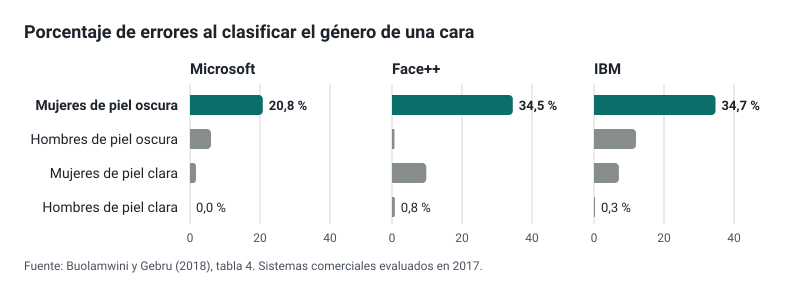
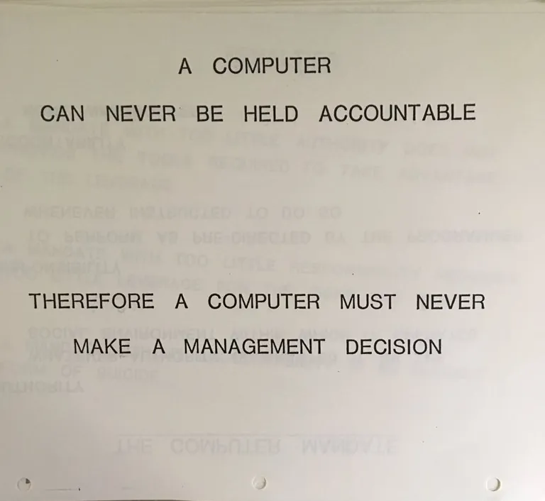

---
derived_from:
  es/etica-legal/slides.md: "3b8a60fcc69e6402b7f3bc2a843861b20ba14ae9"
---

<!-- .slide: id="ley-o-prudencia" class="statement" -->
## Non todo o que «non se pode facer» con IA é ilegal

Separar o que obriga a lei do que é prudencia.

---

<!-- .slide: id="tres-origenes" class="cards" -->
## Cada criterio, coa súa orixe

### Obriga legal
Esíxeo unha norma: cítase o artigo.

### Recomendación institucional
Aconséllao unha guía oficial; non obriga por si mesma.

### Boa práctica
Propóno o curso, razoado: pódese discutir.

Notas:
Distinguilas evita tratar como prohibido o que só é prudente, ou como opcional o que é obrigatorio, e deixa ver onde unha prohibición queda en poñerlle portas ao campo.

---

<!-- .slide: id="tres-filtros" class="fragments" -->
## Tres filtros, nesta orde

1. **Pertinencia**: achega algo que non consiga igual de ben doutra forma?
2. **Ética**: respecta as persoas afectadas?
3. **Normativa**: permíteo a lei?

Notas:
A orde importa: algo perfectamente legal pode non ter sentido nunha tarefa, e algo con moito sentido pode ser ilegal con datos do alumnado.

---

<!-- .slide: id="ensayo" class="big-number" -->
## Render máis con IA non é aprender máis

**−17 %** no exame sen axuda, tras practicar cun asistente sen restricións.

Bastani et al., PNAS 2025: un instituto de Turquía, case mil estudantes.

Notas:
Co asistente melloraban un 48 % na práctica; cun configurado para dar pistas en lugar de solucións, o efecto negativo desaparecía en boa parte: de aí os modos titor e os bots educativos. O acceso repartiuse ao chou, así que a ferramenta causou a diferenza, pero alí: unha materia, un centro, un país, e a curto prazo. Para xeneralizar fan falta réplicas.

---

<!-- .slide: id="pregunta-abierta" class="statement" -->
## Que debe saber facer o alumnado sen IA decídeo cada especialidade

E canto usala para avaliar: preguntas aínda abertas.

Notas:
Nun ciclo de informática, traballar cun asistente pode ser parte da competencia profesional; en matemáticas, o obxectivo pode ser razoar sen axuda. A nota decídea sempre o docente. Boa práctica: tratar cada decisión como unha hipótese e comprobar despois que sabe facer o alumnado sen a ferramenta.

---

<!-- .slide: id="etapas" class="table" -->
## O nesgo entra por unha etapa, e en cada unha decide alguén

| Etapa | A decisión humana |
| --- | --- |
| Histórica | Usar o pasado para decidir sobre o futuro |
| Representación | Que mostra se recolle |
| Medición | Que se decide medir |
| Avaliación | Con quen se comproba |
| Despregamento | Para que se usa |

Notas:
Cinco das sete fontes de dano de Suresh e Guttag (2021). «A IA ten nesgos» describe mal o problema: o nesgo entra nunha etapa concreta, e en cada etapa hai unha decisión humana. O importante para un docente é que non se ve nunha resposta solta: aparece ao medir o erro por grupos.

---

<!-- .slide: id="gasto-sanitario" class="big-number" -->
## Medir o gasto en lugar da necesidade

**46,5 %** de pacientes negros con atención adicional, en lugar do 17,7 %, se o algoritmo non predixese o gasto.

Obermeyer et al., Science 2019.

Notas:
O algoritmo predicía o gasto sanitario e non a enfermidade. Como, por un acceso desigual á atención, se gasta menos en atender os pacientes negros, a igual puntuación estaban bastante máis enfermos. O modelo predicía ben o que se lle pediu: o que estaba mal era a pregunta.

---

<!-- .slide: id="gender-shades" class="image-full" -->

Notas:
O nesgo non se ve nunha resposta solta: aparece ao medir o erro por grupos. Tres sistemas comerciais que clasificaban o xénero pola cara, avaliados en 2017.

---

<!-- .slide: id="voz" class="big-number" -->
## Tamén na transcrición de voz

**35 %** de palabras mal transcritas a falantes negros, fronte ao 19 % a falantes brancos.

Koenecke et al., PNAS 2020: cinco sistemas comerciais.

Notas:
Mesmo cando dicían exactamente as mesmas frases. Con alumnado de acentos, variedades ou linguas pouco representadas, revisa a transcrición antes de dala por boa. Este caso e o anterior son da etapa de avaliación: os sistemas estaban no mercado cun erro moi distinto segundo o grupo, e só se viu ao medilo.

---

<!-- .slide: id="regla-programada" class="statement" -->
## Unha regra programada non é un nesgo aprendido

iTutorGroup rexeitaba as candidatas de 55 anos ou máis porque alguén o programou así (EEOC, 2023).

Notas:
E os candidatos de 60 ou máis: máis de 200 persoas cualificadas descartadas. Acordou pagar 365 000 dólares. A miúdo cítase como un caso de discriminación por IA, pero non había ningún modelo que aprendese nada. A presidenta da EEOC: «mesmo cando a tecnoloxía automatiza a discriminación, o empregador segue sendo responsable». Antes de atribuírlle algo á «IA», preguntar que se decidiu e quen o decidiu.

---

<!-- .slide: id="quien-responde" class="cards" -->
## Quen responde

### Obriga legal
Do sistema, quen o desenvolve; do seu uso, quen o desprega.

### Recomendación institucional
Cando unha IA erra, responde quen a usou.

### Boa práctica
Deixa constancia de que usaches, para que e como o revisaches.

Notas:
Esa regra é exacta para o que fai cada docente cunha ferramenta: o que usas, revísalo e respondes diso. Pero non é todo o reparto: o Regulamento de IA reparte as obrigas entre quen desenvolve o sistema e quen o desprega, o RXPD dá dereito a non quedar suxeito a unha decisión só automatizada, e na administración galega unha actuación apoiada en IA necesita a validación dunha persoa.

---

<!-- .slide: id="ibm-1979" class="image-full" -->

Atribuída a unha formación interna de IBM, 1979.

Notas:
«Un ordenador nunca pode render contas; polo tanto, un ordenador nunca debe tomar unha decisión de xestión.» A idea non é nova: décadas despois, o RXPD e a lei galega de IA recóllena, cada un á súa maneira. Ningún prohíbe usar a ferramenta; esixen que alguén decida e responda. Atribuída, non confirmada: a imaxe circula desde 2017, non se localizou o orixinal e o arquivo de IBM non a atopou. E esa persoa que decide tamén ten nesgos (seguinte diapositiva).

---

<!-- .slide: id="sesgo-propio" class="statement" -->
## Os nesgos tamén son nosos: fiámonos do que agardabamos e do que propón a máquina

Notas:
Nesgo de confirmación e nesgo de automatización. En catro estudos clínicos combinados, cando o sistema de apoio se equivocaba, o risco de decidir mal subía un 26 % (Goddard et al., 2012); a formación e deixar claro quen responde reducíano. Cos modelos de linguaxe, unha dúbida en primeira persoa («non estou seguro, pero…») reduciu o exceso de confianza nun experimento con 404 persoas (Kim et al., 2024), aínda que é un só estudo. O ton seguro non é sinal de acerto.

---

<!-- .slide: id="privacidad" class="comparison" -->
## Os datos do alumnado, só onde a administración responde deles

### Non
Nomes, notas, informes ou fotos nun *chatbot* con conta persoal.

### Si
Ferramentas contratadas pola administración, casos inventados, ou o modelo de documento e o procedemento en lugar do resultado.

Notas:
A LOE habilita o centro a tratar os datos que precisa, con seguridade, confidencialidade e deber de sixilo do profesorado. Un terceiro que trate eses datos ten que ser un encargado con contrato (art. 28 do RXPD). Quitar o nome non abonda se a combinación de datos identifica a persoa. E quen envía un traballo co nome cambiado por un código segue tratando datos do alumno, porque garda a táboa: reduce o risco, pero que ferramenta se pode usar decídeo a Consellería, que no seu protocolo recomenda alias en plataformas externas «mantendo as obrigas» da normativa. Por iso un traballo ben limpo non está nin no «Non» nin no «Si»: aínda ninguén o autorizou. Que está claro e que non, con traballos, notas e informes, está no módulo Datos do alumnado.

**Demo (5 min): un modelo que funciona sen internet**. Ollama ou LM Studio cun modelo pequeno xa descargado no portátil.

1. Facerlle unha pregunta ao modelo local e ver a resposta.
2. Desconectar a rede (wifi e cable).
3. Volver preguntar: segue respondendo.
4. Facerlle a mesma pregunta a un *chatbot* comercial e comparar a calidade.

**Resultado esperado:** responde sen conexión, con peor calidade ca un *chatbot* comercial.
**Se falla:** se non hai modelo descargado, contar o principio como se explica na páxina e amosalo noutra sesión.
**Mensaxe clave:** o problema non é «a IA», senón onde van os datos.

---

<!-- .slide: id="detectores" class="big-number" -->
## Os detectores de IA non son fiables

**61 %** de redaccións de estudantes de inglés como lingua estranxeira marcadas como IA.

Liang et al., 2023: sete detectores.

Notas:
OpenAI retirou o seu propio detector en xullo de 2023 pola súa baixa precisión: detectaba o 26 % dos textos xerados e marcaba o 9 % dos escritos por persoas.

---

<!-- .slide: id="evaluar" -->
## Avaliar cando existe a IA

- Nunca sancionar polo resultado dun detector.
- Valorar o proceso e as versións intermedias.
- Explicacións orais e traballo na clase nas partes clave.
- Pedir que declaren como usaron a IA.

---

<!-- .slide: id="normativa" class="section" -->
## O que di a lei

---

<!-- .slide: id="calendario" class="table dense" -->
## O Regulamento de IA aplícase por fases

| Desde | Que cambia nun centro |
| --- | --- |
| 2 de febreiro de 2025 | Prohibido inferir emocións do alumnado |
| 2 de agosto de 2026 | Avisar de que se fala cunha IA; etiquetar *deepfakes* |
| 2 de decembro de 2026 | Prohibidas as aplicacións de espidos falsos |
| 2 de decembro de 2027 | Obrigas para os sistemas educativos de alto risco |

Notas:
O Regulamento (UE) 2026/1744, o *Omnibus*, atrasou o alto risco (antes, 2 de agosto de 2026) e engadiu as novas prohibicións. Moitas guías, incluídas as directrices europeas para docentes, aínda dan as datas antigas.

---

<!-- .slide: id="emociones" class="statement" -->
## Prohibido desde 2025: inferir as emocións do alumnado

Unha aplicación que o centro obriga a usar e que detecta interese ou ansiedade xa o incumpre.

Notas:
Artigo 5.1.f do Regulamento de IA, cos exemplos das directrices da Comisión: a mesma aplicación de idiomas non está prohibida se se usa fóra do centro; seguir a mirada nun exame en liña tampouco, mentres non detecte nerviosismo.

---

<!-- .slide: id="alto-riesgo" class="cards" -->
## Alto risco en educación, desde decembro de 2027

### Admisión
Decidir o acceso ou distribuír o alumnado.

### Avaliación
Avaliar os resultados da aprendizaxe.

### Nivel
Decidir o nivel educativo axeitado.

### Exames
Vixiar condutas prohibidas.

Notas:
Anexo III, punto 3. Non é de alto risco o que non inflúe substancialmente na decisión (artigo 6.3), agás que elabore perfís. As obrigas recaen sobre todo na administración que implanta o sistema.

---

<!-- .slide: id="decision-humana" class="statement" -->
## Ningunha cualificación pode saír só dunha ferramenta

Impídeno o RXPD (art. 22) e, na administración galega, a Lei 2/2025 (art. 12).

---

<!-- .slide: id="galicia-homologada" class="statement" -->
## En tramitación: só IA homologada pola Consellería

Así o anuncia a Xunta para a Lei de educación dixital, no Parlamento desde xullo de 2026.

Notas:
Tamén prohibiría as decisións baseadas só en IA, o control automatizado do comportamento ou o rendemento, a identificación de condicións como o TEA ou o TDAH e o recoñecemento facial. É un texto en tramitación: pode cambiar.

---

<!-- .slide: id="practica-etiquetar" class="practice" -->
## Lei, recomendación ou prudencia

1. Colle as normas sobre IA do teu centro ou da túa programación.
2. Etiqueta cada punto coa súa orixe.
3. Para cada obriga legal, busca o artigo na páxina de normativa.
4. Para cada prohibición sen base, pensa que risco tenta evitar.

**15 minutos.** Produto: unhas normas coa súa orixe á vista.

Notas:
Por grupos de departamento. O interesante sae ao compartir: que «prohibicións» non tiñan base e que obrigas legais ninguén coñecía.
