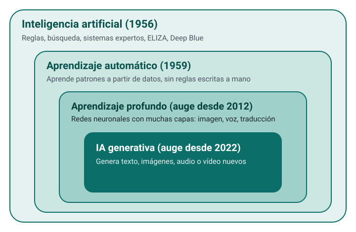
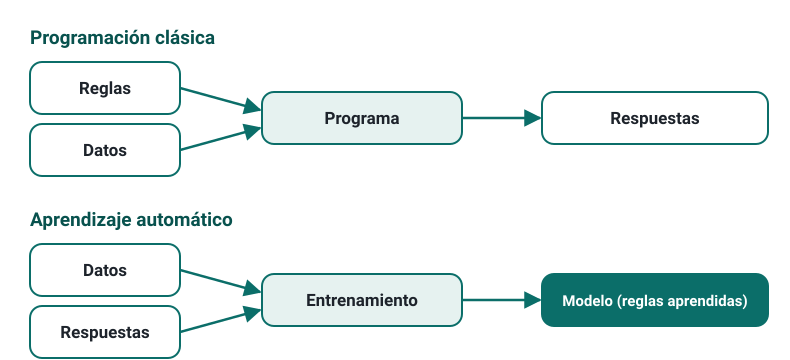

---
derived_from:
  es/intro-ia/slides.md: "2d540f1a0856ae0fd1e8d1aca11b48d134011e0e"
---

<!-- .slide: id="setenta-anos" class="statement" -->
## «A IA» é a parte máis recente dun campo con setenta anos

Intelixencia artificial, aprendizaxe automática, aprendizaxe profunda e IA xerativa non son sinónimos.

---

<!-- .slide: id="conjuntos" class="image-full" -->

Notas:
ELIZA (1966) e Deep Blue (1997) eran IA sen aprendizaxe: regras escritas a man e moito cálculo. A aprendizaxe profunda despega en 2012 e a IA xerativa popularízase a finais de 2022.

---

<!-- .slide: id="reglas-o-datos" class="image-full" -->

Notas:
O cambio de enfoque: en lugar de escribir as regras, dánselle ao programa datos coas súas respostas e o adestramento extrae as regras. O resultado é un modelo. Exemplos cotiáns anteriores aos chatbots: filtros de spam, recomendacións, predición do tempo.

---

<!-- .slide: id="moravec" class="statement" -->
## O difícil para nós é doado para un ordenador, e ao revés

O paradoxo de Moravec: a IA redacta un informe impecable e falla nunha pregunta de sentido común.

---

<!-- .slide: id="por-que-ahora" class="cards fragments" -->
## Por que agora

### Cálculo
GPU e chips específicos para adestrar redes enormes.

### Datos
A web, libros dixitalizados e código público.

### Arquitecturas
O *transformer* (2017) escala os modelos de linguaxe.

### Investimento
Desde 2022, recursos sen precedentes.

---

<!-- .slide: id="linea-temporal" class="timeline" -->
## Unha liña temporal

- **2012** AlexNet inicia o auxe da aprendizaxe profunda.
- **2017** Publícase a arquitectura *transformer*.
- **2020** GPT-3 fai tarefas para as que non se adestrou.
- **2022** ChatGPT populariza os asistentes conversacionais.
- **2024** Modelos que razoan antes de responder.
- **2025** Pesos abertos baratos, vídeo con son, navegadores con axentes.

---

<!-- .slide: id="modelo-chatbot-agente" class="cards" -->
## Tres cousas distintas

### Modelo
O sistema adestrado que xera texto. GPT-5, Gemini, Claude Sonnet.

### *Chatbot*
O produto co que conversamos: modelo máis interface, memoria, busca, ficheiros.

### Axente
Recibe un obxectivo e **actúa**: planifica, usa ferramentas e decide o seguinte paso.

Notas:
A un chatbot pregúntaslle e respóndeche; a un axente encargáslle unha tarefa e execútaa, cos riscos que iso implica.

---

<!-- .slide: id="como-funciona" class="section" -->
## Como funciona un modelo de linguaxe

---

<!-- .slide: id="siguiente-palabra" class="statement" -->
## Predí a seguinte palabra, unha e outra vez

Como o teclado do móbil, pero adestrado cunha cantidade enorme de texto e tendo en conta todo o anterior.

---

<!-- .slide: id="plausible" class="statement" -->
## Xera o máis plausible; non comproba o que di

Case sempre coincide co correcto. Cando non, o erro soa igual de seguro.

---

<!-- .slide: id="tokens-contexto" class="two-col" -->
## *Tokens* e xanela de contexto

### *Tokens*
Fragmentos de texto cos que traballa o modelo. En galego, unha palabra ocupa a miúdo máis dun.

### Xanela de contexto
O que o modelo ten en conta á vez: instrucións, conversa, adxuntos e resposta. O que queda fóra non existe para el.

---

<!-- .slide: id="base-asistente" class="two-col" -->
## Do modelo base ao asistente

### Preadestramento
Aprende a predicir o seguinte *token* sobre enormes cantidades de texto. Sabe continuar textos, non seguir instrucións.

### Axuste posterior
Con conversas de exemplo e valoracións humanas aprende a comportarse como asistente: seguir instrucións, dar formato, negarse.

Notas:
O ton servizal e a tendencia a darche a razón non son unha personalidade: son comportamentos aprendidos nesta fase.

---

<!-- .slide: id="demo-respuestas-distintas" class="demo" -->
## A mesma pregunta, dúas respostas

O modelo escolle entre as palabras máis probables cun compoñente de azar.

Notas:
**Demo (3 min)**. Calquera *chatbot*, en dous chats temporais.

1. Facer a mesma petición aberta nos dous chats (por exemplo, «Propón unha actividade de 20 minutos para introducir a fotosíntese en 2.º da ESO»).
2. Poñer as dúas respostas unha ao lado da outra.
3. Rexenerar unha delas e amosar que volve cambiar.

**Resultado esperado:** propostas distintas, igual de seguras.
**Se falla:** explicar coa páxina que cada palabra se escolle entre unha distribución de probabilidades.
**Mensaxe clave:** cando o resultado importa, rexenera ou compara.

---

<!-- .slide: id="alucinaciones" -->
## Alucinacións

- Resposta fluída e segura que é **falsa**: datos, citas, referencias inventadas.
- Non é un fallo puntual: o adestramento premia máis arriscar unha resposta ca dicir «non o sei».
- Os modelos actuais fallan menos, sobre todo coa busca web, pero o risco non desaparece.
- **Toda cifra, cita, referencia ou norma compróbase na fonte.**

---

<!-- .slide: id="demo-referencias" class="demo" -->
## Existen estas referencias?

Pedir bibliografía e comprobala.

Notas:
**Demo (5 min)**. Calquera *chatbot*, nun chat temporal e sen busca web se se pode desactivar.

1. Pedir tres referencias académicas sobre un tema moi concreto da túa materia.
2. Buscar cada título nun buscador académico.
3. Repetir a petición coa busca web activada e abrir as fontes que cita.

**Resultado esperado:** algunha referencia verosímil que non existe ou con datos cambiados; con busca, fontes reais que hai que ler igualmente.
**Se falla:** se todas existen, comprobar que os datos (autores, ano, revista) coinciden.
**Mensaxe clave:** plausible non é verdadeiro; o que vaia a un documento compróbase na fonte.

---

<!-- .slide: id="sabe-busca" class="two-col" -->
## O que sabe e o que busca

### Data de corte
O que pasou despois do adestramento non está no modelo.

### Busca web
Os *chatbots* buscan e citan páxinas. Mellora a actualidade, pero pode escoller mal as fontes ou resumilas mal.

Notas:
Matiz: o modelo pode reproducir de forma literal fragmentos dos seus datos de adestramento, sobre todo textos moi repetidos. De aí parte dos conflitos sobre dereitos de autor e a recomendación de non introducir datos persoais.

---

<!-- .slide: id="razonan" -->
## Modelos que razoan

- Xeran un razoamento intermedio antes de responder.
- Melloran moito en matemáticas, programación e lóxica, a cambio de tempo.
- Seguen a ser texto xerado: non son dedución infalible.
- O razoamento que mostran non sempre reflicte o que determinou a resposta.

---

<!-- .slide: id="sesgos" class="statement" -->
## Os nesgos son un reflexo dos datos

Non unha «decisión» do modelo, e corrixilos introduce outros desequilibrios.
