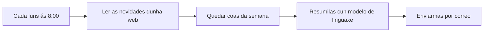

> [!NOTE]
> **Módulo avanzado**
> Para seguilo cómpre instalar un programa no teu ordenador (ou contratar o servizo na nube) e non ter medo a configurar cousas. Non fai falla saber programar.

## Que é unha automatización

Unha automatización, ou **fluxo de traballo** (*workflow*), é unha secuencia fixa de pasos que se executa soa cando ocorre algo: a unha hora, ao chegar un correo, ao enviarse un formulario. É coma unha receita que o ordenador segue sen ti, paso a paso, cada vez que se dan as condicións.



Convén situala respecto ao que xa se viu no curso:

*Chatbot*
: Responde cando lle preguntas. Se non abres o chat, non fai nada.

Automatización
: Executa sempre os mesmos pasos, sen que esteas diante. É predicible: o camiño fixáchelo ti.

[Axente](../intro-ia/index.md#modelo-chatbot-y-agente)
: Decide el mesmo os pasos para cumprir un obxectivo. É máis flexible e menos predicible.

Unha automatización pode incluír un modelo de linguaxe nun dos seus pasos (para resumir, clasificar ou redactar) e mesmo un axente, pero o esqueleto decídelo ti.

## n8n

[n8n](https://n8n.io) é unha ferramenta para construír estes fluxos de forma visual: cada paso é unha caixa (un **nodo**) que se conecta coa seguinte. Ten nodos para centos de servizos (Gmail, Google Sheets, Telegram, RSS, formularios, bases de datos, calquera web con API) e nodos de IA para usar modelos de linguaxe e axentes.

A súa licenza non é de software libre en sentido estrito. É o que a empresa chama *fair-code*: pódese usar, modificar e instalar de balde para uso interno, persoal ou non comercial, pero non ofrecelo como servizo a terceiros nin revendelo.[^licencia] Para un docente ou un centro que automatiza o seu propio traballo, é gratuíto.

| | n8n Cloud | Instalado por ti (*Community Edition*) |
| --- | --- | --- |
| Instalación | Ningunha: úsase no navegador | No teu ordenador ou nun servidor |
| Custo | De pago, cunha proba gratuíta sen tarxeta; o plan básico anda polos 20 € ao mes con pagamento anual | Gratuíto |
| Funciona cando | Sempre | Mentres o equipo estea aceso |
| Os teus datos | En servidores de Azure na UE (Alemaña e Suecia); as súas condicións inclúen un contrato de encargo do tratamento | No teu equipo; n8n non recibe os datos dos fluxos |
| Extras | Asistente que constrúe fluxos a partir dunha descrición, e modelos de IA sen necesidade de clave propia | Hai que conectar as túas propias claves de API |

Fontes: [prezos de n8n](https://n8n.io/pricing/), [privacidade](https://docs.n8n.io/privacy-and-security/privacy.md) e [subencargados](https://n8n.io/legal/sub-processors/), consultados o 22 de outubro de 2026.

## Instalalo no teu ordenador

A forma máis limpa é con [Docker](https://www.docker.com) (que xa hai que ter instalado). Estes dous comandos, da [documentación oficial](https://docs.n8n.io/hosting/installation/docker/), crean un volume para gardar os datos e arrancan n8n co fuso horario de España:

```bash
docker volume create n8n_data
docker run -it --rm --name n8n -p 5678:5678 \
  -e GENERIC_TIMEZONE="Europe/Madrid" -e TZ="Europe/Madrid" \
  -e N8N_ENFORCE_SETTINGS_FILE_PERMISSIONS=true \
  -v n8n_data:/home/node/.n8n \
  n8nio/n8n
```

Se tes Node.js (entre as versións 20.19 e 24), tamén podes probalo sen instalar nada con `npx n8n`. Nos dous casos, n8n ábrese no navegador en `http://localhost:5678`, e a primeira vez pídeche crear unha conta de administración local.

## Como se constrúe un fluxo

Disparador
: O nodo que pon en marcha o fluxo: unha hora fixa (*Schedule Trigger*), un formulario, unha mensaxe nun chat, unha novidade nun RSS, un correo que chega.

Nodos
: Cada paso: ler, filtrar, transformar, chamar a un modelo, enviar. Cada nodo recibe datos do anterior, fai o seu traballo e pásalle o resultado ao seguinte.

Elementos
: Os datos viaxan como unha lista de elementos (por exemplo, unha entrada de RSS por elemento), e cada nodo execútase unha vez por elemento.

Expresións
: Para usar nun nodo un dato dun paso anterior escríbese entre chaves dobres: `{{ $json.title }}` é o título do elemento que se está a procesar.

Credenciais
: As contas e claves que usan os nodos (o teu Gmail, a túa clave de API). Gárdanse á parte, cifradas; ao exportar un fluxo viaxan o seu nome e o seu identificador, pero non a clave.

Os fluxos gárdanse como ficheiros JSON: pódense descargar, compartir e importar, e tamén **copiar e pegar** directamente no lenzo.[^importar] Iso permite pedirlle a un *chatbot* un fluxo xa feito («dáme o JSON dun fluxo de n8n que…»), pegalo e revisalo nodo a nodo. En n8n Cloud, o asistente integrado fai o mesmo desde o propio editor.

## Un exemplo: as novidades do BOE no teu correo

O BOE publica unha canle RSS coas disposicións sobre «Educación y enseñanza». Este fluxo resúmechas cada luns:

1. **Schedule Trigger**: cada luns ás 8:00.
2. **RSS Read**, co enderezo `https://www.boe.es/rss/canal_leg.php?l=l&c=114`.
3. **Filter**: só os elementos publicados nos últimos sete días.
4. **Un nodo de modelo de linguaxe** con estas instrucións:

   ```text
   Resume esta disposición do BOE nunha frase para docentes de secundaria e FP.
   Indica a quen afecta e se cambia algo no seu traballo. Se non lles afecta, dio.
   Non engadas nada que non estea no texto.

   Título: {{ $json.title }}
   Ligazón: {{ $json.link }}
   ```

5. **Send Email** ou **Gmail**: un único correo para ti con todos os resumos e as súas ligazóns.

Non manexa datos persoais, cada resumo vai coa súa ligazón para comprobalo e, se falla, non pasa nada grave. Por iso é un bo primeiro fluxo.

## Axentes dentro dun fluxo

O nodo **AI Agent** converte un paso nun axente: recibe un obxectivo, un modelo de linguaxe e unhas ferramentas (outros nodos: buscar nunha folla de cálculo, consultar unha web, enviar unha mensaxe) e decide cales usar e en que orde. É potente, pero recupera os riscos que se ven en [Navegadores con axentes](../navegadores-agenticos/index.md#el-riesgo-principal-la-inyección-de-prompts): un axente que le correos de calquera e pode enviar correos é a «tríade letal» completa.

n8n permite esixir **aprobación humana** antes de que o axente use unha ferramenta concreta: o fluxo detense e alguén aproba ou rexeita a acción cos seus datos á vista.[^aprobacion] Para calquera ferramenta que envíe, publique, modifique ou borre, convén activala.

## Que automatizar nun centro, e que non

Bos candidatos
: Tarefas sen datos persoais ou só cos teus: boletíns de novidades, recordatorios de prazos, avisos cando cambia unha web, conversión de materiais entre formatos, copias de seguridade dos teus documentos.

Con moito coidado
: Todo o que toque datos do alumnado ou das familias. n8n **garda os datos de cada execución**, incluído o que pasou por cada nodo. O que se envía ao modelo de linguaxe chega ao seu provedor, e a responsabilidade do tratamento é do centro. Antes de automatizar algo así hai que saber onde se executa, quen accede, canto tempo se garda (n8n recomenda borrar as execucións antigas automaticamente[^privacidad]) e se o centro o autoriza. O marco legal vese no módulo de ética e normativa.<!-- TODO: enlazar ../etica-legal/normativa.md cuando exista -->

Non
: Decisións sobre o alumnado (cualificacións, sancións, admisións) sen revisión humana.

Dous detalles prácticos. Primeiro, n8n non ten un nodo para Moodle: pódese conectar coa súa API web mediante o nodo *HTTP Request*, pero iso require un permiso que só concede a administración da aula virtual. Segundo, se o instalas ti, n8n envía por defecto datos técnicos de uso (versión, número de fluxos, erros), aínda que nunca o contido dos fluxos. Quen administra a instalación pode desactivalo.[^privacidad]

## Alternativas

- **Zapier** e **Make** ofrecen o mesmo como servizo na nube, con moitas integracións listas, pero sen a opción de instalalos no teu propio equipo.
- **Power Automate**, se o centro traballa con Microsoft 365.
- Para tarefas sinxelas, algúns asistentes xa programan tarefas periódicas, como Claude en Chrome.

[^licencia]: n8n, [*Community license*](https://docs.n8n.io/n8n-community-license/community-license.md) e [*License FAQ*](https://docs.n8n.io/n8n-community-license/community-license/license-faq.md), consultados o 22 de outubro de 2026.
[^importar]: n8n, [*Export and import*](https://docs.n8n.io/build/manage-workflows/export-and-import.md).
[^aprobacion]: n8n, [*Human-in-the-loop for tools*](https://docs.n8n.io/build/integrate-ai/ai-examples/human-in-the-loop-for-tools.md).
[^privacidad]: n8n, [*Privacy*](https://docs.n8n.io/privacy-and-security/privacy.md), consultado o 22 de outubro de 2026.
