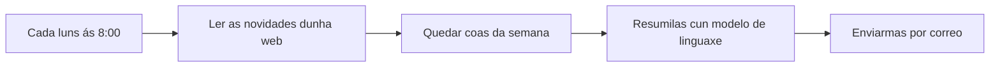

> [!NOTE]
> **Módulo avanzado**
> Non cómpre instalar nada nin saber programar, pero si crear unha conta nun servizo de automatización, conectarlle outras contas (o correo, unha folla de cálculo) e non ter medo a configurar cousas.

## Que é unha automatización

Unha automatización, ou **fluxo de traballo** (*workflow*), é unha secuencia fixa de pasos que se executa soa cando ocorre algo: a unha hora, ao chegar un correo, ao enviarse un formulario. É coma unha receita que o ordenador segue sen ti, paso a paso, cada vez que se dan as condicións.



Convén situala respecto ao que xa se viu no curso:

*Chatbot*
: Responde cando lle preguntas. Se non abres o chat, non fai nada.

Automatización
: Executa sempre os mesmos pasos, sen que esteas diante. É predicible: o camiño fixáchelo ti.

[Axente](../intro-ia/index.md#modelo-chatbot-y-agente)
: Decide el mesmo os pasos para cumprir un obxectivo. É máis flexible e menos predicible.

Unha automatización pode incluír un modelo de linguaxe nun dos seus pasos (para resumir, clasificar ou redactar) e mesmo un axente, pero o esqueleto decídelo ti.

## As ferramentas

Hai varias ferramentas para construír estes fluxos de forma visual, sen programar: cada paso é unha caixa que se conecta coa seguinte. Úsanse no navegador, cunha conta, e todas teñen conectores para centos de servizos (Gmail, Google Sheets, Telegram, formularios, RSS). O que cambia é o prezo, onde quedan os datos e o que permite o plan gratuíto, como engadir un paso cun modelo de linguaxe.

| Ferramenta | Sen pagar | Onde quedan os datos |
| --- | --- | --- |
| Zapier | Plan gratuíto de 100 tarefas ao mes, pero só con fluxos de dous pasos (un disparador e unha acción) e sen pasos de IA | Nos Estados Unidos, sen opción de aloxalos na UE |
| Make | Plan gratuíto de 1000 créditos ao mes; os fluxos programados execútanse, como moito, cada 15 minutos | Na UE ou nos Estados Unidos, segundo se escolla ao rexistrarse; despois non se pode cambiar |
| n8n Cloud | Proba de 14 días sen tarxeta; despois, desde 20 € ao mes con pagamento anual | Na UE, en servidores de Azure en Alemaña e Suecia |
| Power Automate | Incluído nas licenzas educativas de Microsoft 365 (A1, A3 e A5), só cos conectores estándar | No Microsoft 365 da conta educativa |

O fluxo de exemplo deste módulo ten catro pasos e usa un modelo de linguaxe, así que non cabe no plan gratuíto de Zapier.[^herramientas]

Para tarefas sinxelas nin sequera fai falla un fluxo: algúns asistentes xa programan tarefas periódicas, como Claude en Chrome.

## n8n

Os exemplos deste módulo usan [n8n](https://n8n.io), por dúas razóns: a súa galería de fluxos de exemplo pódese ver nodo a nodo sen crear conta e, a diferenza de Zapier e Make, tamén se pode instalar nun servidor propio. Ten nodos para centos de servizos e nodos de IA para usar modelos de linguaxe e axentes. A versión na nube, n8n Cloud, inclúe ademais un asistente que constrúe fluxos a partir dunha descrición, e modelos de IA que se poden usar sen clave propia.

Instalalo é gratuíto, pero a súa licenza non é de software libre en sentido estrito. É o que a empresa chama *fair-code*: pódese usar, modificar e instalar de balde para uso interno, persoal ou non comercial, pero non ofrecelo como servizo a terceiros nin revendelo.[^licencia] Cunha instalación propia, os datos dos fluxos quedan nese servidor e n8n non os recibe.[^privacidad] É unha tarefa para quen administre os sistemas do centro, coa [guía oficial de instalación](https://docs.n8n.io/hosting/).

## Como se constrúe un fluxo

As pezas son as mesmas en todas estas ferramentas, aínda que cada unha as chame doutro xeito (en Zapier, os pasos son *accións*; en Make, *módulos*). Estes son os nomes de n8n:

Disparador
: O nodo que pon en marcha o fluxo: unha hora fixa (*Schedule Trigger*), un formulario, unha mensaxe nun chat, unha novidade nun RSS, un correo que chega.

Nodos
: Cada paso: ler, filtrar, transformar, chamar a un modelo, enviar. Cada nodo recibe datos do anterior, fai o seu traballo e pásalle o resultado ao seguinte.

Elementos
: Os datos viaxan como unha lista de elementos (por exemplo, unha entrada de RSS por elemento), e cada nodo execútase unha vez por elemento.

Expresións
: Para usar nun nodo un dato dun paso anterior, arrástrase o campo desde o panel de entrada do nodo.[^arrastrar] n8n escríbeo como unha expresión entre chaves dobres: `{{ $json.title }}` é o título do elemento que se está a procesar.

Credenciais
: As contas e claves que usan os nodos (o teu Gmail, a túa clave de API). Gárdanse á parte, cifradas; ao exportar un fluxo viaxan o seu nome e o seu identificador, pero non a clave.

Os fluxos gárdanse como ficheiros JSON: pódense descargar, compartir e importar, e tamén **copiar e pegar** directamente no lenzo.[^importar] Iso permite pedirlle a un *chatbot* un fluxo xa feito («dáme o JSON dun fluxo de n8n que…»), pegalo e revisalo nodo a nodo. En n8n Cloud, o asistente integrado fai o mesmo desde o propio editor.

## Un exemplo: as novidades do BOE no teu correo

O BOE publica unha canle RSS coas disposicións sobre «Educación y enseñanza». Este fluxo resúmechas cada luns:

1. **Schedule Trigger**: cada luns ás 8:00.
2. **RSS Read**, co enderezo `https://www.boe.es/rss/canal_leg.php?l=l&c=114`.
3. **Filter**: só os elementos publicados nos últimos sete días.
4. **Un nodo de modelo de linguaxe** con estas instrucións:

   ```text
   Resume esta disposición do BOE nunha frase para docentes de secundaria e FP.
   Indica a quen afecta e se cambia algo no seu traballo. Se non lles afecta, dio.
   Non engadas nada que non estea no texto.

   Título: {{ $json.title }}
   Ligazón: {{ $json.link }}
   ```

5. **Send Email** ou **Gmail**: un único correo para ti con todos os resumos e as súas ligazóns.

Non manexa datos persoais, cada resumo vai coa súa ligazón para comprobalo e, se falla, non pasa nada grave. Por iso é un bo primeiro fluxo.

Na [galería de n8n](https://n8n.io/workflows/) hai fluxos parecidos xa montados, que se poden ver nodo a nodo sen crear conta. [Este boletín semanal de varias canles RSS](https://n8n.io/workflows/16037-send-a-weekly-aicurated-rss-digest-email-with-openai-and-gmail/), por exemplo, ponse en marcha os luns ás 8:00, le as canles, queda cos artigos máis relevantes, pídelle o resumo a un modelo de OpenAI e envíao con Gmail. É máis elaborado que o do BOE, con dous nodos que levan código, pero o percorrido é o mesmo.

## Axentes dentro dun fluxo

O nodo **AI Agent** converte un paso nun axente: recibe un obxectivo, un modelo de linguaxe e unhas ferramentas (outros nodos: buscar nunha folla de cálculo, consultar unha web, enviar unha mensaxe) e decide cales usar e en que orde. É potente, pero recupera os riscos que se ven en [Navegadores con axentes](../navegadores-agenticos/index.md#el-riesgo-principal-la-inyección-de-prompts): un axente que le correos de calquera e pode enviar correos é a «tríade letal» completa.

n8n permite esixir **aprobación humana** antes de que o axente use unha ferramenta concreta: o fluxo detense e alguén aproba ou rexeita a acción cos seus datos á vista.[^aprobacion] Para calquera ferramenta que envíe, publique, modifique ou borre, convén activala.

## Que automatizar nun centro, e que non

Bos candidatos
: Tarefas sen datos persoais ou só cos teus: boletíns de novidades, recordatorios de prazos, avisos cando cambia unha web, conversión de materiais entre formatos, copias de seguridade dos teus documentos.

Só en ferramentas autorizadas
: Todo o que toque datos do alumnado ou das familias. Un servizo de automatización coa túa conta é, coma un *chatbot* con conta persoal, unha plataforma externa: os datos persoais só van a ferramentas que a administración educativa contratase ou autorizase ([Datos do alumnado](../datos-alumnado/index.md#la-pregunta-previa-necesita-la-ia-los-datos)). Ademais, o que se envía ao modelo de linguaxe chega ao seu provedor, e n8n Cloud **garda os datos de cada execución**, incluído o que pasou por cada nodo, durante o tempo que fixe o teu plan.[^privacidad]

Non
: Decisións sobre o alumnado (cualificacións, sancións, admisións) sen revisión humana.

Un detalle práctico: n8n non ten un nodo para Moodle. Pódese conectar coa súa API web mediante o nodo *HTTP Request*, pero iso require un permiso que só concede a administración da aula virtual.

[^herramientas]: Prezos e condicións de [Zapier](https://zapier.com/pricing) ([pasos de IA](https://help.zapier.com/hc/en-us/articles/8496342944013), [aloxamento dos datos](https://zapier.com/legal/data-privacy)), [Make](https://www.make.com/en/pricing) ([intervalo mínimo](https://academy-content.make.com/courses/make-basics-modules/05-scheduling-your-scenario/), [centros de datos](https://help.make.com/organizations)), [n8n](https://n8n.io/pricing/) ([proba gratuíta](https://docs.n8n.io/deploy/use-n8n-cloud/start-your-free-trial)) e [Power Automate](https://learn.microsoft.com/en-us/power-platform/admin/power-automate-licensing/faqs), consultados o 5 de novembro de 2026. Os servidores de n8n Cloud, na súa lista de [subencargados](https://n8n.io/legal/sub-processors/), consultada o 22 de outubro de 2026.
[^arrastrar]: n8n, [*Use the UI mapper*](https://docs.n8n.io/build/work-with-data/reference-data/use-the-ui-mapper.md).
[^licencia]: n8n, [*Community license*](https://docs.n8n.io/n8n-community-license/community-license.md) e [*License FAQ*](https://docs.n8n.io/n8n-community-license/community-license/license-faq.md), consultados o 22 de outubro de 2026.
[^importar]: n8n, [*Export and import*](https://docs.n8n.io/build/manage-workflows/export-and-import.md).
[^aprobacion]: n8n, [*Human-in-the-loop for tools*](https://docs.n8n.io/build/integrate-ai/ai-examples/human-in-the-loop-for-tools.md).
[^privacidad]: n8n, [*Privacy*](https://docs.n8n.io/privacy-and-security/privacy.md), consultado o 5 de novembro de 2026.
