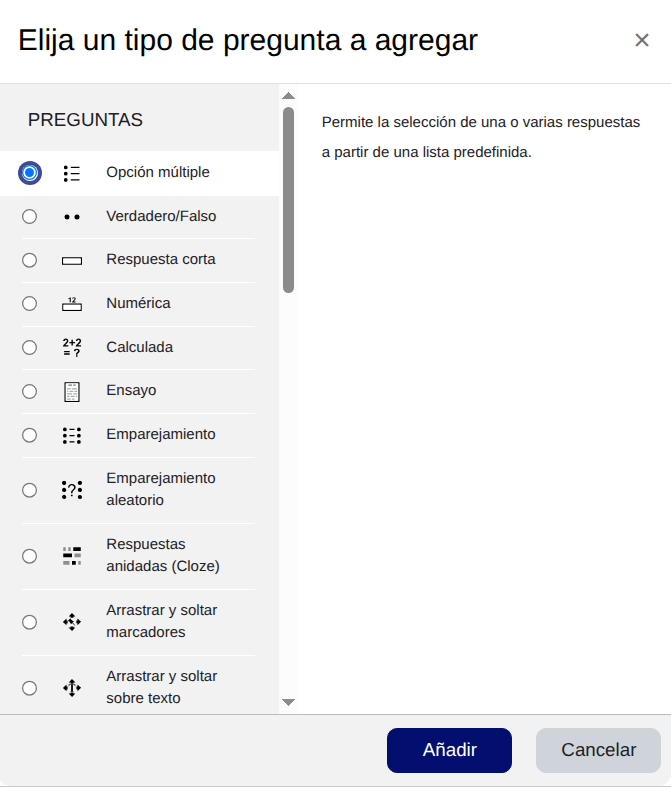
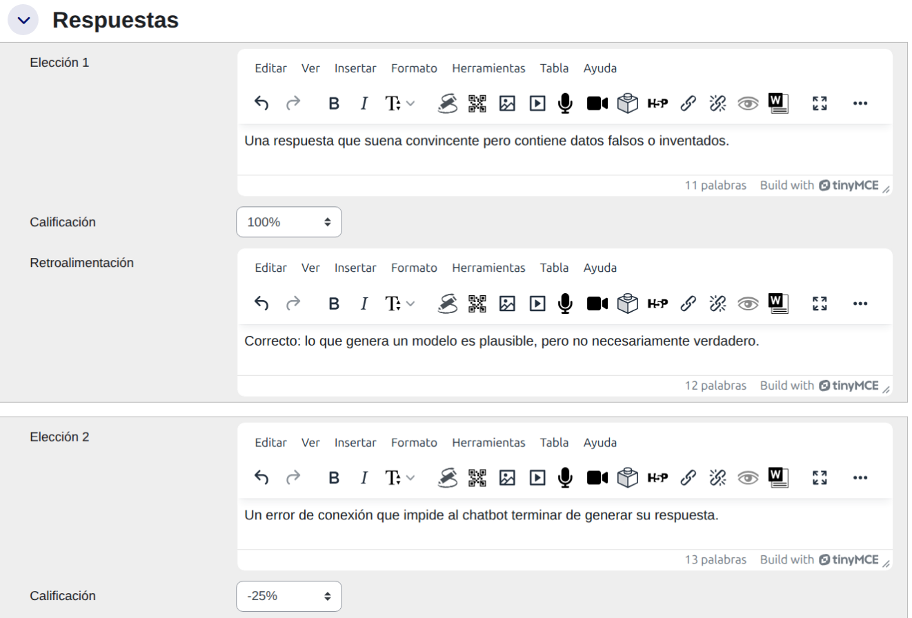
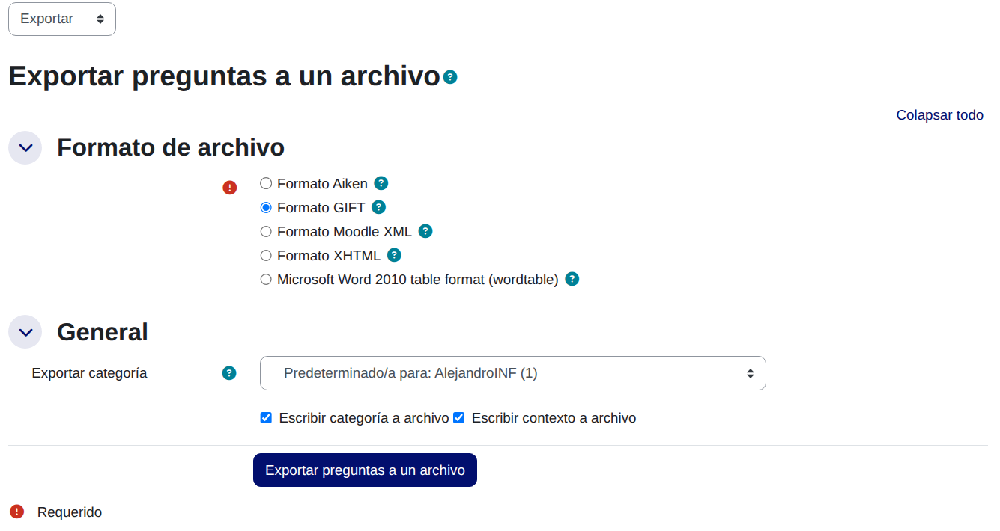
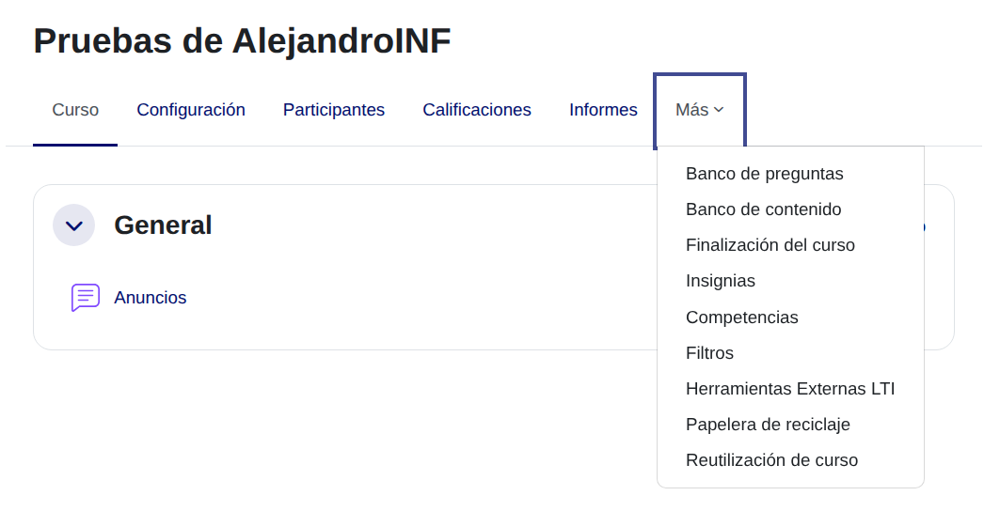
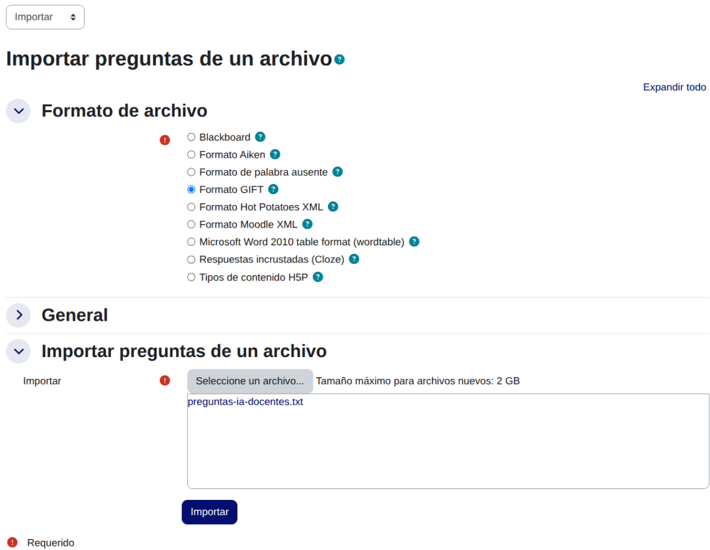
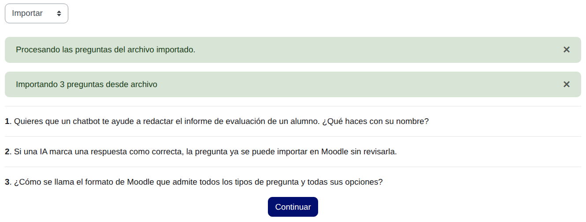
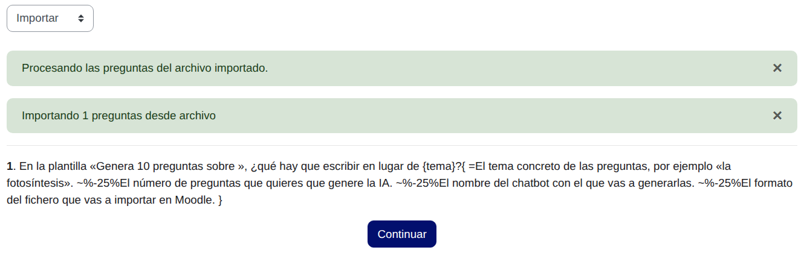
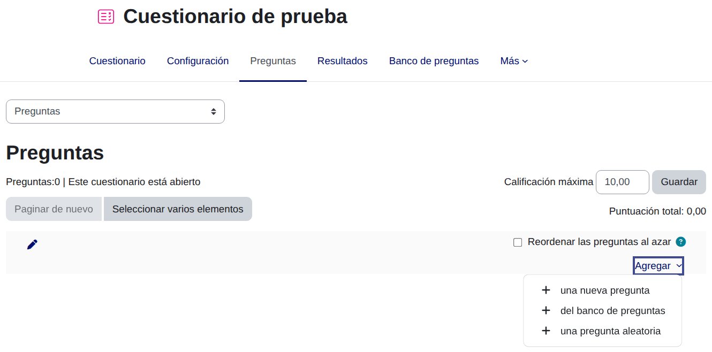
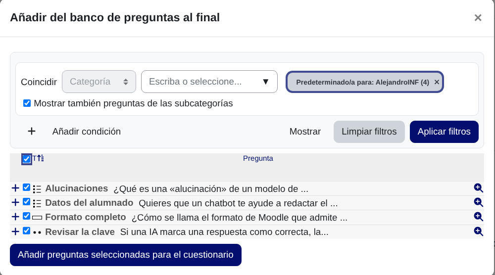
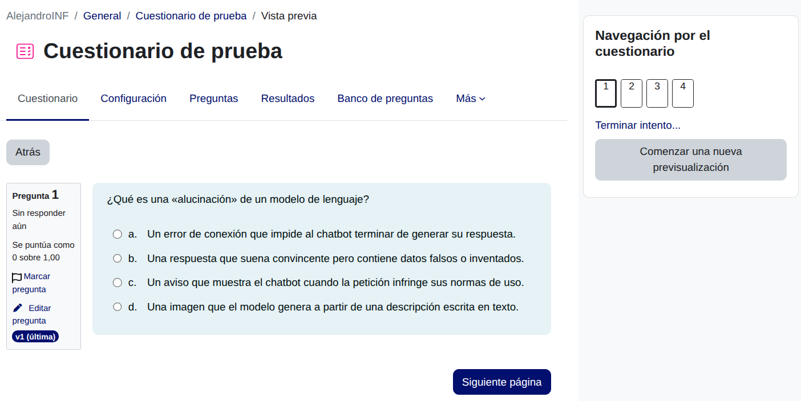

## Formatos que Moodle importa

Moodle importa preguntas desde un ficheiro de texto en varios formatos. Para traballar con IA interesan tres:

| Formato | Para que serve | Vantaxes | Limitacións |
| --- | --- | --- | --- |
| Aiken | Escolla múltiple sinxela | Moi doado de ler e de xerar | Só escolla múltiple cunha resposta correcta; sen penalización nin retroalimentación |
| GIFT | A maioría dos tipos de pregunta | Compacto; admite penalizacións, retroalimentación e varios tipos de pregunta | Os seus caracteres especiais hai que escapalos |
| Moodle XML | Todos os tipos de pregunta e todas as súas opcións | É o formato completo de exportación de Moodle | Longo e difícil de ler a simple vista |

Documentación oficial de Moodle (en castelán): [Aiken](https://docs.moodle.org/all/es/Formato_Aiken), [GIFT](https://docs.moodle.org/all/es/Formato_GIFT) e [Moodle XML](https://docs.moodle.org/all/es/Formato_Moodle_XML).

Os exemplos desta páxina son as mesmas preguntas que aparecen nas capturas.

### Aiken

```aiken
¿Qué es una «alucinación» de un modelo de lenguaje?
A. Un error de conexión que impide al chatbot terminar de generar su respuesta.
B. Una respuesta que suena convincente pero contiene datos falsos o inventados.
C. Un aviso que muestra el chatbot cuando la petición infringe sus normas de uso.
D. Una imagen que el modelo genera a partir de una descripción escrita en texto.
ANSWER: B
```

### GIFT

Unha pregunta de escolla múltiple con título, unha resposta correcta (`=`), tres incorrectas (`~`) que restan un 25 % e retroalimentación (`#`) en cada opción. Os dous puntos das retroalimentacións van escapados (`\:`), polo motivo que explica o aviso de máis abaixo:

```gift
::Datos del alumnado::Quieres que un chatbot te ayude a redactar el informe de evaluación de un alumno. ¿Qué haces con su nombre?{
    =Lo quito, igual que cualquier dato que permita identificarlo.#Correcto\: el informe no necesita datos personales del alumnado.
    ~%-25%Lo dejo, porque el chatbot necesita saber de quién se trata.#El chatbot puede redactar el informe sin saber quién es el alumno.
    ~%-25%Lo dejo si he desactivado que el proveedor entrene con mis datos.#Que no entrene con tus datos no evita que se los envíes a un tercero.
    ~%-25%Lo dejo si borro la conversación al terminar el informe.#Borrarla después no evita que los datos ya se hayan enviado.
}
```

Unha pregunta de verdadeiro ou falso con retroalimentación. Ollo á orde: a **primeira** mensaxe é a que ve quen falla e a segunda, quen acerta.

```gift
::Revisar la clave::Si una IA marca una respuesta como correcta, la pregunta ya se puede importar en Moodle sin revisarla.{FALSE#La IA también se equivoca al marcar la respuesta correcta\: revísala siempre.#Correcto\: la revisión no se puede delegar.}
```

> [!WARNING]
> **O fallo máis habitual ao importar GIFT**
> Os caracteres `~ = # { } :` teñen significado en GIFT. Se aparecen dentro do texto dunha pregunta ou dunha resposta (unha fórmula, unha hora, unha ligazón) hai que escribilos cunha barra diante: `\=`, `\:`, `\{`… Pídelle expresamente á IA que os escape. Un carácter sen escapar non sempre dá erro: ás veces Moodle importa sen avisar unha pregunta deformada, como no [exemplo da importación](#importar-en-moodle).

### Moodle XML

O ficheiro ten que ser un documento XML completo: coa cabeceira e todas as preguntas dentro dun único elemento `<quiz>`. Unha pregunta de resposta curta que acepta dúas respostas válidas:

```xml
<?xml version="1.0" encoding="UTF-8"?>
<quiz>
  <question type="shortanswer">
    <name><text>Formato completo</text></name>
    <questiontext format="html">
      <text><![CDATA[<p>¿Cómo se llama el formato de Moodle que admite todos los tipos de pregunta y todas sus opciones?</p>]]></text>
    </questiontext>
    <defaultgrade>1</defaultgrade>
    <answer fraction="100" format="moodle_auto_format">
      <text>Moodle XML</text>
      <feedback format="html"><text><![CDATA[<p>Correcto.</p>]]></text></feedback>
    </answer>
    <answer fraction="100" format="moodle_auto_format">
      <text>XML</text>
      <feedback format="html"><text><![CDATA[<p>Correcto.</p>]]></text></feedback>
    </answer>
  </question>
</quiz>
```

## Xerar as preguntas con IA

### O método máis fiable: partir dunha exportación de Moodle

En lugar de describirlle á IA o formato, **dálle un exemplo real**. É a técnica de dar un exemplo de saída (*one-shot*) aplicada a Moodle:

1. Crea a man en Moodle unha pregunta do tipo que queres (por exemplo, escolla múltiple con penalización e retroalimentación). Nas capturas é a do [exemplo de Aiken](#aiken), agora con penalización e retroalimentación. No banco de preguntas (como chegar, en [Importar en Moodle](#importar-en-moodle)), preme **Crear unha nova pregunta…** e escolle o tipo:

   {.border .narrow}

   No formulario, cada resposta leva a súa cualificación (100 % a correcta e unha porcentaxe negativa as incorrectas, se queres que penalicen) e a súa retroalimentación, que a interface galega de Moodle chama «Comentarios»:

   {.border}

2. Expórtaa desde o banco de preguntas no formato que vaias usar (GIFT ou Moodle XML): no despregable da páxina, **Exportar**. Moodle exporta todas as preguntas da categoría que escollas, pero só precisas copiar unha.

   {.border}

3. Abre o ficheiro descargado, copia a pregunta e pégaa no *chat* como exemplo: «Xera 10 preguntas sobre [tema] con exactamente este formato».
4. Engade as preguntas xeradas ao mesmo ficheiro e impórtao.

Así a IA copia exactamente o que o teu Moodle espera, incluídos os detalles que ninguén lembraría describir (o marcado HTML, as penalizacións, os caracteres xa escapados).

> [!TIP]
> **Un formato por conversa**
> Se lle dás exemplos en formatos distintos á vez (unha pregunta en GIFT e outra en XML), os modelos tenden a mesturalos. Usa un único formato en cada petición, e se precisas converter, pide a conversión como unha tarefa á parte.

### Un *prompt* base

```text
Xera 10 preguntas de escolla múltiple en formato GIFT sobre: [TEMA].

Requisitos:
- 4 opcións por pregunta e unha soa resposta correcta.
- Variedade de dificultade (doada, media, difícil).
- Distractores plausibles, de lonxitude parecida á da resposta correcta.
- Escapa con \ os caracteres ~ = # { } : que aparezan no texto.
- Devolve só o contido do ficheiro, sen comentarios.
```

### Un asistente personalizado para tests

Este *prompt* úsase como instrucións fixas dun asistente que xera preguntas con criterios de rigor esixentes:

:::: chat model="ChatGPT (GPT personalizado)"
::: user
Crea preguntas de test en formato GIFT importable a Moodle, seguindo as seguintes regras.

- Sempre serán preguntas de resposta múltiple con 4 respostas e unha única correcta.
- As respostas incorrectas restarán media pregunta a non ser que se indique o contrario.
- Todas as respostas deben ter unha lonxitude similar.
- Débese priorizar o rigor. A resposta correcta debe ser a única que o é. As outras deben ser manifestamente incorrectas.
- Deben evitarse respostas incorrectas por non ser «a mellor definición» das que se dan, «a principal desvantaxe» ou outras formas de gradación. As respostas incorrectas deben ser manifestamente incorrectas para evitar ambigüidades e as preguntas deben ser claras.
- Ningunha das respostas debe ser descartable de xeito trivial. Evita o habitual nesgo de que a resposta correcta sexa sempre unha de 3 similares e haxa outra máis absurda.
- O nivel de dificultade esperado é para alumnado de mestrado universitario salvo que se indique o contrario.
- Non inclúas un número antes das preguntas, serán baralladas.
- Normalmente pasarase material co que xerar as preguntas; evita facer referencias directas como «segundo os apuntamentos». As preguntas deben conter por si soas toda a información necesaria para respondelas.
- Sé coidadoso evitando nesgos como que a resposta correcta sexa a máis detallada ou a máis longa.

Un exemplo do formato desexado:

```gift
::¿Qué es el muestreo estratificado?::[html]¿Qué es el muestreo estratificado?{
    ~%-50%Dividir el dataset en grupos y garantizar que todas las muestras de un grupo están en el mismo conjunto (test, validación o entrenamiento).
    =Dividir el dataset en grupos y tomar un porcentaje de cada estrato manteniendo la proporción original de las clases.
    ~%-50%Dividir el dataset en grupos y aumentar la presencia de las clases minoritarias duplicando o generando nuevas muestras.
    ~%-50%Dividir el dataset en grupos y aumentar la complejidad del modelo para hacerlo más robusto.
}
```
:::
::: assistant collapsed
```gift
::¿Qué es un modelo generativo en inteligencia artificial?::[html]¿Qué es un modelo generativo en inteligencia artificial?{
    ~%-50%Un algoritmo que clasifica datos existentes en categorías predefinidas basándose en características aprendidas durante el entrenamiento.
    ~%-50%Un sistema que optimiza decisiones secuenciales mediante la interacción con un entorno para maximizar una recompensa acumulativa.
    =Un tipo de modelo que aprende la distribución de los datos de entrenamiento y puede generar nuevas muestras similares a estos.
    ~%-50%Un enfoque que reduce la dimensionalidad de datos complejos transformándolos en representaciones más simples mientras preserva información esencial.
}

::¿Qué es la validación cruzada?::[html]¿Qué es la validación cruzada (cross-validation)?{
    ~%-50%Una técnica para reducir la complejidad del modelo eliminando características redundantes del conjunto de datos.
    ~%-50%Un método para evaluar el rendimiento de varios modelos simultáneamente en un único conjunto de entrenamiento.
    ~%-50%Un procedimiento que combina las predicciones de varios modelos para mejorar la precisión general del sistema.
    =Una técnica que divide los datos en múltiples subconjuntos para entrenar y validar el modelo, usando cada subconjunto como datos de prueba una vez.
}
```
:::
::::

Con estas instrucións hai un [GPT público](https://chatgpt.com/g/g-67b721d49a0481918a78bc5104bd22ea-generador-de-preguntas-de-test) que se pode usar directamente.

> [!WARNING]
> **Que escribir nas instrucións dun asistente**
> Non escribas «Crea un xerador de preguntas de test…»: iso describe o asistente, non o que debe facer. Escribe directamente as instrucións que queres que se apliquen en cada conversa: «Cando o usuario che dea un tema ou un material, xera preguntas de test en formato GIFT con estas regras…».

## Revisar antes de importar

Xerar é a parte doada. A revisión é imprescindible e non se pode delegar:

- [ ] **A clave é correcta.** Comproba que a resposta marcada como correcta o é, e que ningunha das incorrectas podería selo tamén.
- [ ] **Sen pistas involuntarias.** A correcta non é sistematicamente a máis longa, a máis detallada nin a máis matizada.
- [ ] **Sen negacións confusas.** As preguntas con «NON» ou «AGÁS» adoitan medir a atención máis ca o coñecemento.
- [ ] **Autocontidas.** Pódense responder sen consultar os apuntamentos («segundo o tema 3…»).
- [ ] **O ficheiro importa.** Próbao primeiro nun banco de preguntas de probas e mira a vista previa.

## Importar en Moodle

1. Garda as preguntas nun ficheiro de texto (`.txt` para GIFT ou Aiken, `.xml` para Moodle XML) con codificación UTF-8.
2. Abre o banco de preguntas:
   - En **Moodle 4.x**: no curso, **Máis → Banco de preguntas**, e no despregable da páxina, **Importar**. As capturas desta páxina son desta versión, na aula virtual dun centro (outubro de 2026).

     {.border}

   - En **Moodle 5.0 ou posterior**: os bancos de preguntas están no curso, en **Máis → Bancos de preguntas**. Abre o banco onde queiras gardalas e escolle **Importar**.
3. Escolle o formato, sobe o ficheiro e preme **Importar**. Nas capturas, o ficheiro ten tres preguntas en GIFT: as dúas do [exemplo de GIFT](#gift) e a de resposta curta do [exemplo de Moodle XML](#moodle-xml).

   {.border}

   Moodle mostra as preguntas importadas, ou o erro da liña que falla:

   {.border}

   Le esa lista aínda que non haxa erro. Se nun enunciado aparecen marcas de GIFT (`~`, `=`, `%`), algún carácter especial non estaba escapado e Moodle importou unha pregunta deformada sen avisar. Neste exemplo, as chaves do modelo de *prompt* `{tema}` fixeron que Moodle tomase «tema» como única resposta correcta dunha pregunta de resposta curta, e pegase as catro opcións ao enunciado:

   {.border}

4. Na proba, **Preguntas → Engadir → do banco de preguntas**:

   {.border}

   Selecciona as novas e preme **Engadir preguntas seleccionadas á proba**:

   {.border}

5. Usa a **vista previa** da proba antes de abrila ao alumnado: mostra cada pregunta tal como a verán.

   {.border}

## Para ir máis alá

Para bancos grandes xerados a partir dos materiais dun curso, o proxecto [tests-generator](https://github.com/avidaldo/tests-generator) automatiza o proceso completo: resume os materiais, xera as preguntas por lotes, permite revisalas nun editor e exporta a Moodle XML.
